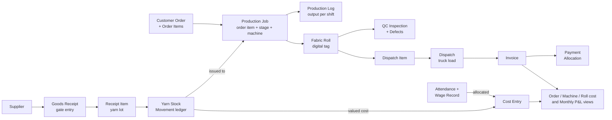
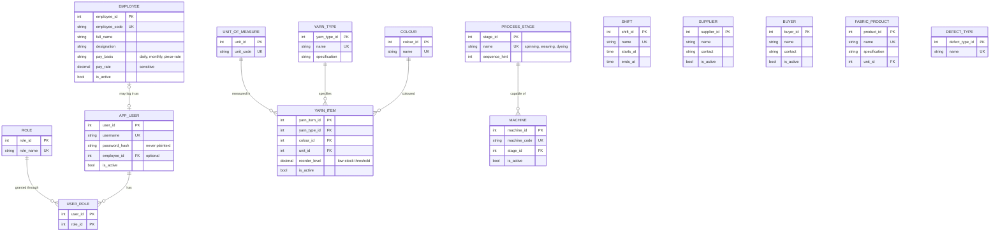
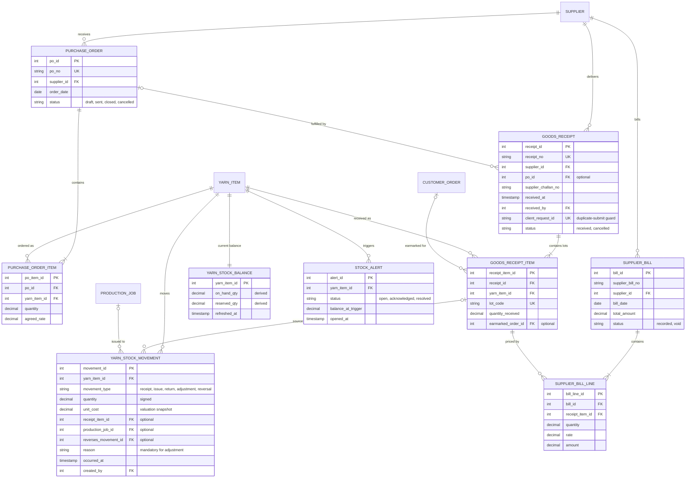
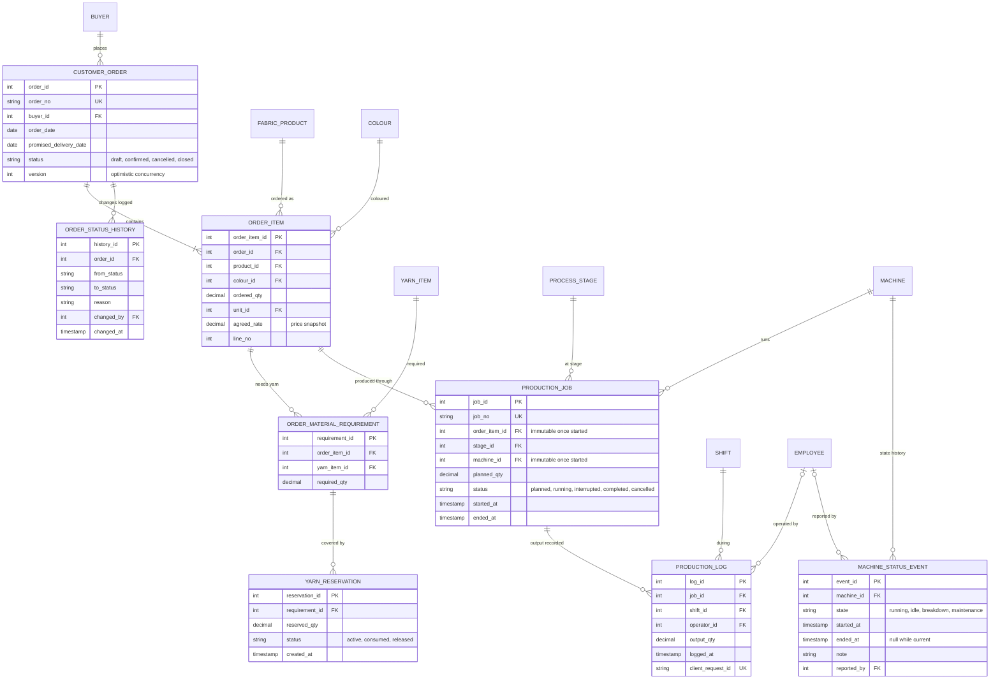
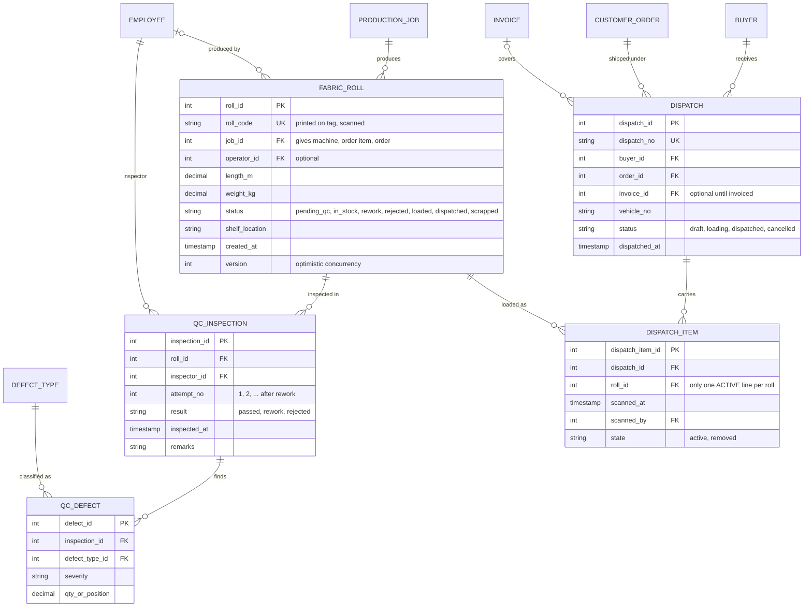
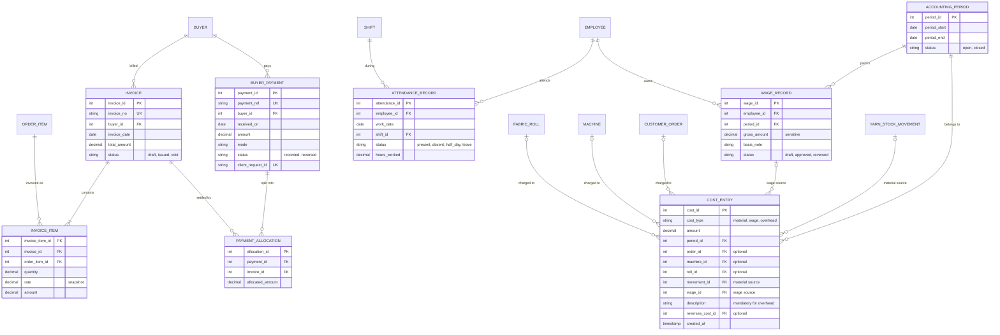
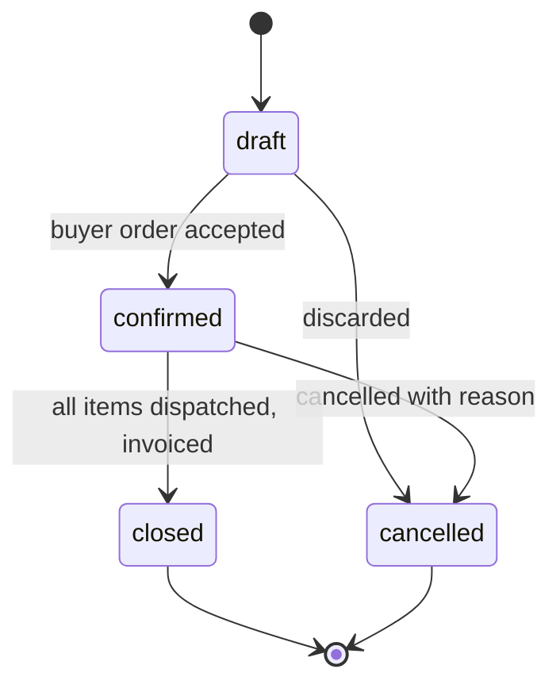
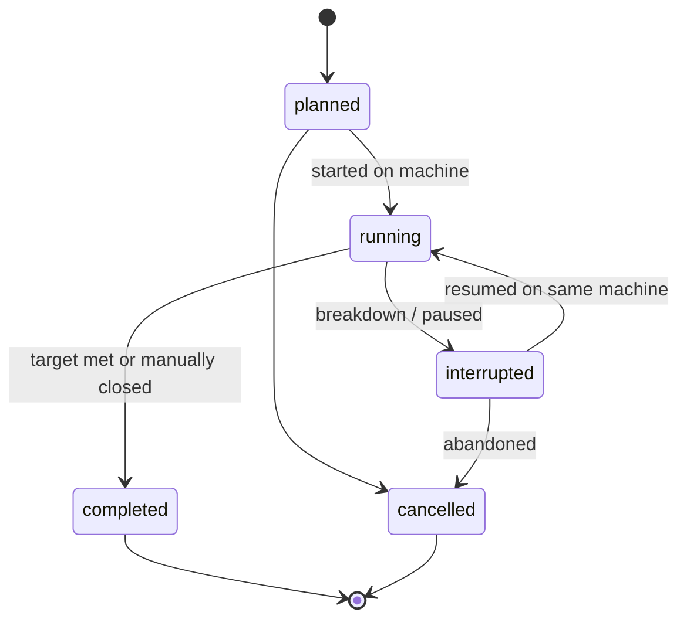
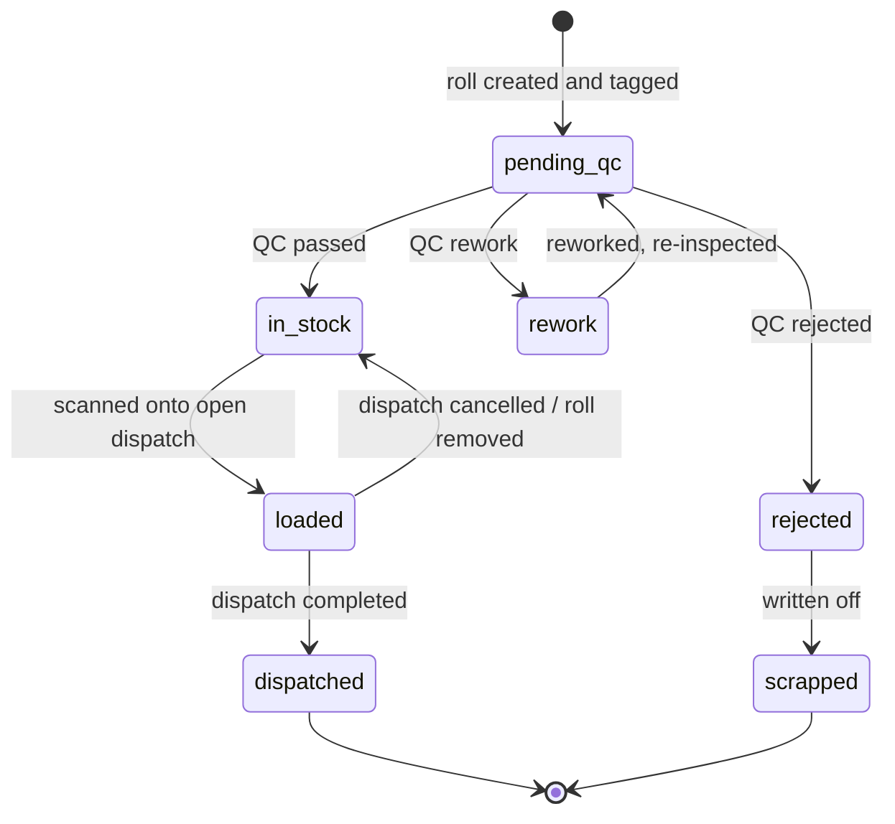
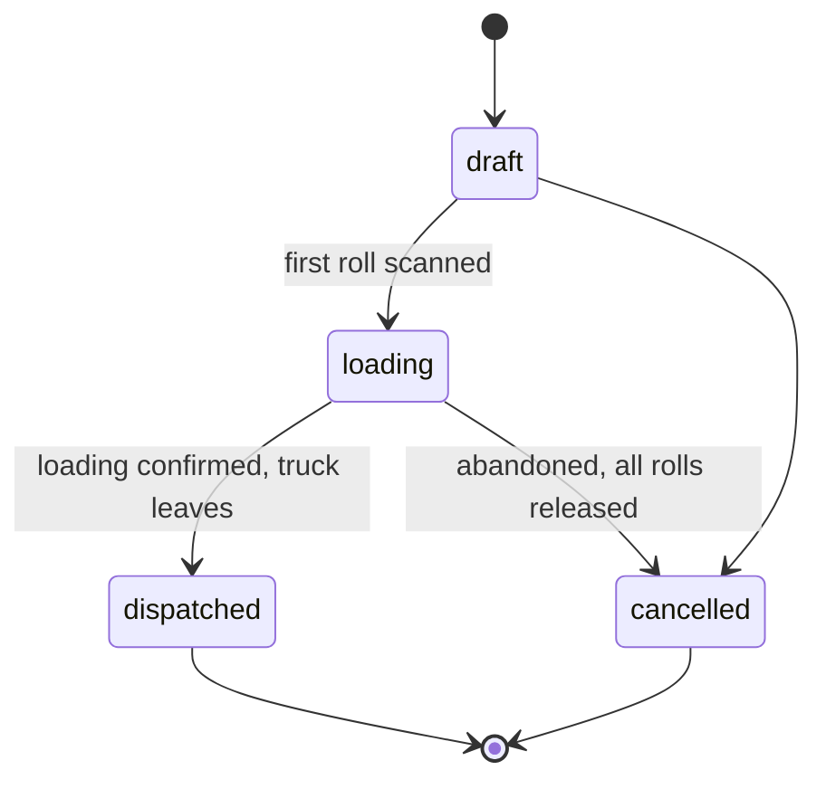

# 03 — Entity-Relationship Design

**Project:** Textile Manufacturing System — Everest Textile Mills
**Database:** PostgreSQL (see `02-database-technology-selection.md`)
**Depends on:** `01-requirements-analysis.md` (FR-x.y requirements, BR-x rules, A-x assumptions, Q-x open questions)
**Scope:** conceptual and logical model. No SQL DDL (that belongs to Phase 4 / `04-database-schema.md`). Attribute lists below show *key and business-significant* attributes; the full column list, data types, and nullability are fixed in Phase 4.

**Legend used in diagrams:** `PK` primary key · `FK` foreign key · `UK` unique business code.
Cardinality notation: `||` exactly one · `|o` zero or one · `o{` zero or many · `|{` one or many.

---

## 1. The design in one picture: the traceability spine

The PS is fundamentally about **tracing and reconciling** material, work, quality, goods and money. The whole model is built around one chain:

Everything the owner, quality checker, store clerk or phone-answering staff needs is a walk along this chain. **A roll is the hub of traceability:** from a roll you can reach its job → machine, order item → order → buyer, producing operator, every inspection and defect, and its dispatch and invoice.

---

## 2. Entity inventory

**Type key:** **M** master/reference data · **T** transaction (business event/document) · **L** ledger (append-only) · **C** cached derived value · **A** audit/history.

### 2.1 Access and people

| # | Entity | Type | Purpose | Requirements |
|---|---|---|---|---|
| 1 | `role` | M | Named permission group (gate staff, production manager, quality checker, accounts, owner, admin) | Doc 01 §2 |
| 2 | `app_user` | M | A system login account; may be linked to an employee | Doc 01 §2 |
| 3 | `user_role` | M | Many-to-many link: user ↔ role | Doc 01 §2 |
| 4 | `employee` | M | Workers and staff (operators, checkers, supervisors). Target of attendance, wages, "who produced / inspected" attribution | FR-2.4, FR-3.4, FR-6.2 |

### 2.2 Master and reference data

| # | Entity | Type | Purpose | Requirements |
|---|---|---|---|---|
| 5 | `supplier` | M | Yarn vendors | FR-1.1 |
| 6 | `buyer` | M | Customers who order fabric | FR-4.x, FR-5.5 |
| 7 | `unit_of_measure` | M | Units (kg, metre, piece) so every quantity carries an explicit unit | A5 |
| 8 | `yarn_type` | M | Yarn specification (fibre, count/denier, etc.) | FR-1.1 |
| 9 | `colour` | M | Colour list, used by yarn and fabric | FR-1.1, FR-3.3 |
| 10 | `yarn_item` | M | The stockable raw material: one *yarn type × colour* combination, with its unit and low-stock threshold | FR-1.2, FR-1.3 |
| 11 | `fabric_product` | M | Fabric specification a buyer can order (weave, width, weight, etc.) | FR-4.x |
| 12 | `process_stage` | M | The manufacturing steps: spinning, weaving, dyeing (extensible) | FR-2.x, A3 |
| 13 | `machine` | M | Each physical machine, its stage capability and active flag | FR-2.1–2.3 |
| 14 | `shift` | M | Shift definitions (name, start/end time) | FR-2.4 |
| 15 | `defect_type` | M | Catalogue of defects (hole, colour mismatch, bad weaving, …) | FR-3.3 |

### 2.3 Raw material (W1)

| # | Entity | Type | Purpose | Requirements |
|---|---|---|---|---|
| 16 | `purchase_order` | T | Order placed with a supplier (optional entity — A8) | FR-1.4 (buy more) |
| 17 | `purchase_order_item` | T | Lines on a purchase order | FR-1.4 |
| 18 | `goods_receipt` | T | **The gate entry**: one truck arrival from one supplier | FR-1.1 |
| 19 | `goods_receipt_item` | T | One yarn line on a receipt = **one yarn lot**; carries quantity received, optional order earmark, and a lot code | FR-1.1 |
| 20 | `yarn_stock_movement` | L | **Append-only stock ledger**: receipts (+), issues to production (−), returns, adjustments. Source of truth for stock | FR-1.2, BR-1 |
| 21 | `yarn_stock_balance` | C | Current on-hand quantity per yarn item (fast read) — derived from the ledger | FR-1.2 |
| 22 | `stock_alert` | T | Low-stock warning with a lifecycle (open → acknowledged → resolved) | FR-1.3 |
| 23 | `supplier_bill` | T | Supplier invoice document | FR-1.5, FR-6.1 |
| 24 | `supplier_bill_line` | T | Bill line linked to a received lot; provides the actual purchase price for valuation | FR-6.1 |

### 2.4 Orders and material planning (W1, W4)

| # | Entity | Type | Purpose | Requirements |
|---|---|---|---|---|
| 25 | `customer_order` | T | Buyer's order header: buyer, order date, promised delivery date, commercial status | FR-4.1, FR-4.3 |
| 26 | `order_item` | T | Order line: fabric product, colour, ordered quantity, agreed rate | FR-4.x, FR-6.4 |
| 27 | `order_status_history` | A | History of commercial status changes with user and reason | BR-11, audit |
| 28 | `order_material_requirement` | T | Yarn required to fulfil an order item (yarn item + quantity) | FR-1.4 |
| 29 | `yarn_reservation` | T | Stock set aside for a requirement (active → consumed / released) | FR-1.1, FR-1.4 |

### 2.5 Production floor (W2)

| # | Entity | Type | Purpose | Requirements |
|---|---|---|---|---|
| 30 | `production_job` | T | One order item at one stage **on one machine** (planned qty, status, start/end) | FR-2.1, FR-2.2 |
| 31 | `production_log` | L | Append-only output entries: job, machine (via job), shift, operator, quantity, time | FR-2.3, FR-2.4 |
| 32 | `machine_status_event` | L | Machine state periods: running / idle / breakdown / maintenance, with start and end | FR-2.2, FR-2.5 |

### 2.6 Quality (W3)

| # | Entity | Type | Purpose | Requirements |
|---|---|---|---|---|
| 33 | `fabric_roll` | T | The tagged roll: roll code, length/weight, producing job, producing operator, current status | FR-3.1, FR-5.1 |
| 34 | `qc_inspection` | L | One inspection event per roll: inspector, result (passed / rework / rejected), time | FR-3.2 |
| 35 | `qc_defect` | L | Defects found in an inspection: defect type, severity, quantity/position | FR-3.3, FR-3.4 |

### 2.7 Dispatch and billing (W5)

| # | Entity | Type | Purpose | Requirements |
|---|---|---|---|---|
| 36 | `dispatch` | T | A truck load: buyer, vehicle, dispatch number, status (draft → loading → dispatched) | FR-5.2, FR-5.3 |
| 37 | `dispatch_item` | T | One scanned roll on a dispatch | FR-5.3, FR-5.4 |
| 38 | `invoice` | T | Sales invoice for a buyer | FR-5.5 |
| 39 | `invoice_item` | T | Invoice line tied to an order item (quantity, rate, amount) | FR-5.5 |

### 2.8 Payments, workforce, and cost (W6)

| # | Entity | Type | Purpose | Requirements |
|---|---|---|---|---|
| 40 | `buyer_payment` | L | A payment received from a buyer | FR-6.3 |
| 41 | `payment_allocation` | L | Splits a payment across invoices (many-to-many payment ↔ invoice) | FR-6.3 |
| 42 | `attendance_record` | T | Digital attendance: employee, date, shift, hours/status | FR-6.2 |
| 43 | `accounting_period` | M | Month (or other) period that can be closed; anchors cost and P&L reporting | FR-6.6 |
| 44 | `wage_record` | T | Wages computed for an employee for a period | FR-6.2 |
| 45 | `cost_entry` | L | **Cost ledger**: each cost amount tagged to order / machine / roll where known | FR-6.4, 6.5, 6.7 |

### 2.9 Cross-cutting

| # | Entity | Type | Purpose | Requirements |
|---|---|---|---|---|
| 46 | `audit_log` | A | Who did what, when, to which record, for sensitive operations (cancellations, adjustments, voids, role changes, wage edits) | Doc 01 §7 |

### 2.10 Deliberately **not** separate entities

| Candidate | Decision | Reason |
|---|---|---|
| Order "operational status" (in weaving, in QC, ready for dispatch) | **Derived view**, not stored | Would drift from reality (BR-11). Computed from jobs, rolls, dispatches |
| Machine "current status" | Derived from the open `machine_status_event` + active job | Machine count is small; avoids a second place to keep consistent |
| Order completion % / job produced quantity | Derived from `production_log` / `fabric_roll` | Same reason |
| Finished-goods shelf stock | Derived: rolls whose status is *in stock* | The roll *is* the stock unit (A4) |
| Invoice paid/outstanding amount | Derived from `payment_allocation` | Avoids two sources of truth |
| Customer call log | Not modelled | Not required by the PS — status lookup only (Q15 if needed) |
| Separate "weaving order", "dyeing order", etc. | Not modelled | One generic `production_job` + `process_stage` covers all stages |
| Separate tables per defect kind | Not modelled | One `defect_type` master + `qc_defect` |
| Shift-assignment table | Not modelled | Operator and shift are recorded on each `production_log`; adding a roster table is deferred until requested (Q1/Q11) |

---

## 3. ER diagrams

### 3.1 People and master data

*Uniqueness note:* `yarn_item` is unique on (yarn_type, colour) — one stockable item per combination.

### 3.2 Raw material, stock and supplier billing (W1)

### 3.3 Orders, material planning and production (W1, W2, W4)

### 3.4 Rolls, quality and dispatch (W3, W5)

### 3.5 Billing, payments, workforce and cost (W5, W6)

---

## 4. Relationship catalogue

### 4.1 Cardinality and delete behaviour

**Delete behaviour key:** **RESTRICT** = cannot delete the parent while children exist (default) · **CASCADE** = children are removed with the parent (only for owned, non-historical children) · **VOID** = parent is never deleted; marked cancelled/void.

| Parent → Child | Cardinality | Business meaning | Delete / lifecycle behaviour |
|---|---|---|---|
| `employee` → `app_user` | 1 : 0..1 | Not every worker has a login | RESTRICT; deactivate |
| `app_user` ↔ `role` via `user_role` | M : N | A user may hold several roles | `user_role` rows CASCADE with user (no history value); changes logged in `audit_log` |
| `yarn_type`/`colour` → `yarn_item` | 1 : N each | Item = type × colour | RESTRICT |
| `supplier` → `purchase_order` | 1 : N | | RESTRICT |
| `purchase_order` → `purchase_order_item` | 1 : 1..N | | CASCADE only while draft; otherwise VOID |
| `supplier` → `goods_receipt` | 1 : N | One gate entry = one supplier | RESTRICT |
| `purchase_order` → `goods_receipt` | 1 : 0..N | Receipt may or may not follow a PO; a PO may be received in parts | RESTRICT |
| `goods_receipt` → `goods_receipt_item` | 1 : 1..N | A truck can carry several yarn lines | VOID (cancel receipt creates reversing ledger entries) |
| `customer_order` → `goods_receipt_item` | 1 : 0..N | Optional "earmarked for order" tag (FR-1.1, Q3) | RESTRICT |
| `yarn_item` → `yarn_stock_movement` | 1 : N | Every stock change is a ledger row | Never deleted; corrected by reversal |
| `goods_receipt_item` → `yarn_stock_movement` | 1 : 0..N | Which lot a movement relates to (receipt line, later issues/returns) | RESTRICT |
| `production_job` → `yarn_stock_movement` | 1 : 0..N | Issues of yarn to a job | RESTRICT |
| `yarn_item` → `yarn_stock_balance` | 1 : 1 | Cached current stock | Created with item; never independently edited |
| `yarn_item` → `stock_alert` | 1 : N | History of low-stock alerts | RESTRICT |
| `supplier_bill` → `supplier_bill_line` | 1 : 1..N | | VOID |
| `goods_receipt_item` → `supplier_bill_line` | 1 : 0..N | A lot can be billed in parts; a bill can appear later than the lot | RESTRICT |
| `buyer` → `customer_order` | 1 : N | | RESTRICT |
| `customer_order` → `order_item` | 1 : 1..N | | CASCADE only in draft; confirmed orders are cancelled, not deleted |
| `order_item` → `order_material_requirement` | 1 : N | Several yarns per fabric | CASCADE with draft item; otherwise RESTRICT |
| `order_material_requirement` → `yarn_reservation` | 1 : N | Reservations over time | RESTRICT; released not deleted |
| `order_item` → `production_job` | 1 : N | Several stages and several machines/runs per item | RESTRICT |
| `machine` → `production_job` | 1 : N | **At most one `running` job per machine at a time** (BR-3) | RESTRICT |
| `process_stage` → `production_job`, `machine` | 1 : N | | RESTRICT |
| `production_job` → `production_log` | 1 : N | Output entries | Never deleted; corrected by compensating entry |
| `machine` → `machine_status_event` | 1 : N | **At most one open (un-ended) event per machine** | Never deleted |
| `production_job` → `fabric_roll` | 1 : N | Job → machine, order item → order → buyer are all reached through the job (no duplicate columns on the roll) | RESTRICT; roll scrapped, not deleted |
| `fabric_roll` → `qc_inspection` | 1 : N | Attempts after rework | Never deleted |
| `qc_inspection` → `qc_defect` | 1 : 0..N | A *passed* inspection may have no defects | Never deleted |
| `defect_type` → `qc_defect` | 1 : N | | RESTRICT |
| `dispatch` → `dispatch_item` | 1 : N | | Items marked `removed` (not deleted) if un-loaded |
| `fabric_roll` → `dispatch_item` | 1 : 0..N overall, **1 : 0..1 active** | A roll may appear again only after an earlier line was removed (BR-7) | RESTRICT |
| `invoice` → `dispatch` | 1 : 0..N | Default practice assumed: one invoice per dispatch; model also allows several dispatches per invoice (Q5) | VOID invoice requires dispatch un-linked or re-invoiced |
| `invoice` → `invoice_item` | 1 : 1..N | | CASCADE in draft; VOID once issued |
| `order_item` → `invoice_item` | 1 : N | Partial invoicing | RESTRICT |
| `buyer_payment` ↔ `invoice` via `payment_allocation` | M : N | One payment can settle several invoices; one invoice may be paid in instalments | Never deleted; reversed |
| `employee` → `attendance_record` | 1 : N | One per employee per date per shift | Corrections audited |
| `employee` → `wage_record` | 1 : N | One per employee per period | Reversed, not deleted |
| `accounting_period` → `wage_record`, `cost_entry` | 1 : N | Closed period blocks new/changed entries | RESTRICT |
| `wage_record` → `cost_entry` | 1 : 0..N | One wage record may be split across orders/machines | Reversal entries |
| `yarn_stock_movement` → `cost_entry` | 1 : 0..N | Material issued → valued cost | Reversal entries |

### 4.2 Many-to-many relationships and their resolving entities

| Relationship | Resolving entity | Extra attributes held |
|---|---|---|
| User ↔ Role | `user_role` | — |
| Payment ↔ Invoice | `payment_allocation` | allocated amount |
| Order item ↔ Yarn item | `order_material_requirement` | required quantity |
| Roll ↔ Dispatch | `dispatch_item` | scanned time/user, active/removed |
| Lot ↔ Supplier bill | `supplier_bill_line` | quantity, rate, amount |

### 4.3 Key integrity invariants (to be enforced in the database in Phase 4)

| ID | Invariant | Requirement |
|---|---|---|
| INV-1 | `yarn_stock_balance.on_hand_qty` always equals the sum of that item's ledger movements, and is never negative | BR-1, FR-1.2 |
| INV-2 | A roll has at most one **active** dispatch line | BR-7, FR-5.4 |
| INV-3 | A machine has at most one `running` job at a time, and at most one open status event | BR-3, FR-2.2 |
| INV-4 | A job's machine and order item cannot change after it starts (re-assignment = new job) | FR-3.4 traceability |
| INV-5 | Only rolls in `in_stock` status can be added to a dispatch | BR-6 |
| INV-6 | Σ allocations of a payment ≤ payment amount; Σ allocations to an invoice ≤ invoice total | FR-6.3 |
| INV-7 | A `cost_entry` has exactly one source (material → movement, wage → wage record, overhead → none but with a description) | BR-9 |
| INV-8 | Inserting a QC inspection and updating the roll's status happen together or not at all | FR-3.2 |
| INV-9 | Active reservations for a yarn item never exceed its on-hand quantity | FR-1.4 |
| INV-10 | Ledger tables (`yarn_stock_movement`, `production_log`, `machine_status_event`, `qc_inspection`, `qc_defect`, `buyer_payment`, `payment_allocation`, `cost_entry`) are append-only; no update/delete privileges for application roles | BR-10 |
| INV-11 | Entries into a closed accounting period are rejected | FR-6.6 |

---

## 5. Key strategy (design level)

| Aspect | Decision | Reason |
|---|---|---|
| Internal primary keys | Surrogate integer (64-bit) identity keys on all entities; link-only tables use the composite of their two foreign keys | Compact, fast joins, stable under renames |
| Business identifiers | Separate human-readable codes with unique constraints: `order_no`, `job_no`, `receipt_no`, `lot_code`, `roll_code`, `dispatch_no`, `invoice_no`, `payment_ref`, `po_no`, `employee_code`, `machine_code` | What staff say on the phone and what the scanner reads (FR-3.1, FR-4.2). Sequence/format rules (e.g. prefix + year + running number) are defined in Phase 4 |
| Roll tag | `roll_code` is what is printed on the physical roll as barcode/QR (Q13); internal key is never exposed | Scan-friendly and safe to reprint |
| Duplicate-request guard | `client_request_id` (unique) on repeatable submissions: gate receipt, production log, buyer payment | Retries and double-clicks cannot create duplicates (doc 01 §8) |
| Foreign keys | Declared on every relationship in §4; default RESTRICT | Referential integrity enforced by the database |
| Natural unique constraints | (yarn_type, colour) on `yarn_item`; (employee, date, shift) on `attendance_record`; (employee, period) on `wage_record`; (job_id, attempt) on inspection per roll; (order, line_no) on `order_item` | Stops duplicate business facts |

---

## 6. Normalisation and justified exceptions

**Baseline:** all transactional entities are designed to **3NF**: every non-key attribute depends on the key, the whole key, and nothing but the key.

Examples of normalisation decisions:
- A roll does **not** store its order, machine or buyer — these are reached via `production_job` (which is fixed once started, INV-4). This removes a whole class of "roll says machine A, job says machine B" errors.
- Supplier and buyer details live only in their masters.
- Yarn specification and colour live once, combined in `yarn_item`.
- Units are references, not repeated text.

**Deliberate, documented denormalisation (only where required):**

| Where | What is duplicated | Why it is justified | How consistency is kept |
|---|---|---|---|
| `yarn_stock_balance` | Sum of the stock ledger | Real-time stock view and low-stock check on every receipt/issue (FR-1.2, FR-1.3) must be instant and lock-friendly | Updated in the same transaction as each ledger insert; reconciliation check (balance = ledger sum) |
| `fabric_roll.status` | Latest inspection outcome + stock/dispatch state | Dispatch gating (INV-5) and shelf-stock queries need a single authoritative flag, checked under lock | Changed only together with the event that causes it (inspection, dispatch scan), in one transaction; history lives in `qc_inspection` / `dispatch_item` |
| `yarn_stock_movement.unit_cost` | Price at the time of issue | Cost of past production must not change if a later bill or price changes | Immutable once written (ledger) |
| `order_item.agreed_rate`, `invoice_item.rate` | Selling price snapshot | A rate agreed today must not shift with later master changes | Snapshot semantics; only editable while the document is in draft |
| `customer_order` header totals (if shown) | Not stored | Computed from lines — avoided to prevent drift | — |

---

## 7. Data lifecycle

| Entity group | Create | Modify | Archive | Delete | Retention |
|---|---|---|---|---|---|
| Masters (supplier, buyer, machine, yarn item, employee, …) | Admin | Allowed; changes audited for sensitive fields (e.g. pay rate) | Set inactive | **Never physical** | Indefinite (small) |
| Gate receipts and lots | Gate staff | Not editable after posting; fix by cancel + re-enter or adjustment | After retention period (Q14) | Never | Follow financial retention |
| Stock, production, QC, cost, payment ledgers | System/business action | **Never** (append-only); corrections by reversal rows | Partition/archive by date once large (Phase 8) | Never (except retention-expiry archival) | QC and finance: longest category |
| Orders | Sales/admin | Draft: freely; confirmed: limited fields + history | Closed orders archived by age | Draft may be discarded; confirmed → cancelled | Financial retention |
| Production jobs | Manager | Status progression; planning fields until start | With order | Never | With order |
| Fabric rolls | System when output is recorded | Status transitions only | With order | Never (scrapped status) | Longest of QC/finance |
| Dispatches and invoices | Dispatch/accounts | Draft only | With order | Draft dispatch → cancelled; issued invoice → void | Financial retention |
| Attendance and wages | Supervisor / accounts | Before approval; afterwards reversal | By period | Never | Per employment/financial rules (Q14) |
| Audit log | System | Never | Rolled to archive after retention | Only at retention expiry, by DBA procedure | Longest |

**Retention periods are not given in the PS.** The design assumes no hard deletion of business data; the exact retention/archival period is Q14.

---

## 8. State management

Stored statuses are limited to states that **humans or events actually change**. Progress-style statuses are derived (see §2.10).

### 8.1 Customer order (commercial status only)

*Operational stage shown to staff on a buyer call* — "waiting for yarn", "in spinning/weaving/dyeing", "in quality check", "ready for dispatch", "partially dispatched", "dispatched" — is **derived** from jobs, rolls, and dispatches, never typed in.

### 8.2 Production job

A breakdown that needs a *different machine* ends the job (`interrupted`/closed) and creates a new job for the remaining quantity, keeping history accurate (INV-4).

### 8.3 Fabric roll

Open point: whether a rejected roll can be downgraded and sold (as "seconds") instead of scrapped — Q12/Q-new; the model can add a transition without structural change.

### 8.4 Dispatch

### 8.5 Other status sets

| Entity | Statuses | Notes |
|---|---|---|
| `goods_receipt` | received → cancelled | Cancel posts reversing ledger entries |
| `purchase_order` | draft → sent → closed / cancelled | "Partially received" is derived from receipts |
| `yarn_reservation` | active → consumed / released | |
| `stock_alert` | open → acknowledged → resolved | Resolved automatically when stock recovers |
| `machine_status_event.state` | running, idle, breakdown, maintenance | A period model, not a lifecycle |
| `invoice` | draft → issued → void | Paid / partly paid / outstanding is **derived** from allocations |
| `buyer_payment` | recorded → reversed | |
| `wage_record` | draft → approved → reversed | |
| `accounting_period` | open → closed | Closed blocks new postings (INV-11) |
| `supplier_bill` | recorded → void | |

---

## 9. Audit fields

| Entity class | Standard audit fields | Additional |
|---|---|---|
| Masters | `created_at`, `created_by`, `updated_at`, `updated_by`, `is_active` | Sensitive-field changes (e.g. pay rate) also written to `audit_log` |
| Transactions with editable lifecycle (orders, jobs, rolls, dispatches, invoices) | `created_at/by`, `updated_at/by`, `version` (optimistic-concurrency counter) | Cancel/void: `cancelled_at`, `cancelled_by`, `cancel_reason` |
| Ledgers (append-only) | `created_at`, `created_by` only | `reverses_*_id` pointer on corrections |
| Status-history tables | actor + timestamp + from/to + reason | `order_status_history`; QC history is the inspections themselves |
| `audit_log` | actor, action, entity name, entity id, timestamp, before/after summary, source (screen/API) | Written for: stock adjustments, receipt/dispatch/invoice cancellations or voids, payment reversals, wage changes, role/user changes, period close |

All timestamps in UTC with timezone awareness (A12); business dates (work date, invoice date) as plain dates.

---

## 10. Derived data and how it stays consistent

| Derived value | Source facts | Mechanism | Consistency rule | Requirement |
|---|---|---|---|---|
| Current raw-material stock | `yarn_stock_movement` | **Cached** in `yarn_stock_balance` | Updated in the same transaction as every ledger insert; periodic reconciliation compares cache with ledger sum | FR-1.2 |
| Reserved / available stock | `yarn_reservation`, balance | Computed on read | No stored copy beyond `reserved_qty` cache refreshed in the same transaction as the reservation | FR-1.4 |
| **Yarn sufficiency for a new order** | Requirements vs available stock vs open purchase orders | Computed on demand | Live; never stored | FR-1.4 |
| Low-stock alert | Balance vs `yarn_item.reorder_level` | Event row in `stock_alert` created when a ledger insert crosses the threshold | Created in the same transaction; auto-resolved when balance recovers | FR-1.3 |
| Job produced quantity, completion % | `production_log` | Computed (view) | No stored copy | FR-2.1 |
| Machine current state, idle list | Open `machine_status_event` + running job | Computed (view) | No stored copy | FR-2.2 |
| Output per machine per shift/day | `production_log` | Computed (view); summary table only if proven slow | — | FR-2.3, FR-6.5 |
| Roll quality status | Latest `qc_inspection` | **Cached** on `fabric_roll.status` | Single transaction with the inspection insert (INV-8) | FR-3.2 |
| Defects by machine/worker | `qc_defect` → inspection → roll → job → machine; `fabric_roll.operator_id` | Query/view | Always reconstructable from facts | FR-3.4 |
| Order operational stage | Jobs, rolls, dispatches | Computed (view) | Never typed in (BR-11) | FR-4.2 |
| Finished stock on shelf | Rolls with status `in_stock` | Computed | — | FR-5.1 |
| Dispatch vs invoice match | Dispatched roll quantities per order item vs invoice quantities | Reconciliation view | Mismatch listed as an exception | FR-5.5 |
| Invoice paid / outstanding | `payment_allocation` | Computed | No stored copy | FR-6.3 |
| Material cost of an order | `yarn_stock_movement` (issue, valued) → `cost_entry` | Generated at issue time | Same transaction as the issue; reversals mirror cancellations | FR-6.4 |
| Wage cost of an order/machine | `wage_record` → allocated `cost_entry` rows | Generated at wage approval | Allocation basis pending Q7 | FR-6.2, 6.4 |
| **Cost per roll** | `cost_entry` rows tagged to roll, or order cost ÷ roll output | View (method pending Q6/Q7) | — | FR-6.7 |
| Monthly profit / loss | Invoices (revenue) − cost entries by period | View | Period-closed figures frozen | FR-6.6 |

**Rule:** a derived value is stored only when (a) it is checked on every write path (stock balance, roll status), or (b) measured performance demands it. Everything else is a view.

**Design note — avoiding double-counted material cost:** supplier bills supply the *price* of a lot, and material cost is recognised when yarn is **issued to production** (consumption basis). Bills do not create cost entries themselves. If the owner wants purchase-basis accounting instead, this is Q6.

---

## 11. Normalisation / design checks against "strict rules"

| Rule | How the design complies |
|---|---|
| Don't assume every feature needs its own table | §2.10 lists what is derived or merged |
| No redundant fields without reason | §6 lists every duplication with its justification |
| No circular dependencies | The model is a directed chain (§1): no entity both depends on and is depended on by another via mandatory FKs. `production_job` ↔ `yarn_stock_movement` is the only cross-link, and it is one-directional (movements reference jobs; jobs hold no pointer back) |
| No single business operation updating many unrelated records | Gate entry: receipt + lots + ledger + balance (+ alert) in one transaction, all within the raw-material domain. Dispatch: dispatch + roll status. QC: inspection + roll status. Each touches 2–4 closely related rows |
| Deletion behaviour defined | §4.1 and §7 |
| Concurrency considered | `version` columns (orders, rolls), unique/partial-unique rules (INV-2/3), atomic balance (INV-1); mechanics detailed in Phase 4 documents |

---

## 12. Requirement-to-entity traceability

| Requirement | Entities | Key relationships / invariants |
|---|---|---|
| FR-1.1 Gate entry | `goods_receipt`, `goods_receipt_item`, `supplier`, `yarn_item`, `customer_order` (earmark), `yarn_stock_movement` | Receipt → lots → ledger; `client_request_id` |
| FR-1.2 Real-time stock | `yarn_stock_movement`, `yarn_stock_balance` | INV-1 |
| FR-1.3 Low-stock alert | `yarn_item.reorder_level`, `stock_alert` | Alert created on threshold crossing |
| FR-1.4 Enough yarn for new order? | `order_material_requirement`, `yarn_reservation`, `yarn_stock_balance`, `purchase_order(_item)` | INV-9 |
| FR-1.5 / FR-6.1 Raw material bills | `supplier_bill`, `supplier_bill_line` → lot → `yarn_stock_movement.unit_cost` → `cost_entry` | |
| FR-2.1 Order ↔ machine ↔ completion | `production_job`, `order_item`, `machine`, `production_log` | Completion derived |
| FR-2.2 Idle machines | `machine_status_event`, `production_job` | INV-3 |
| FR-2.3 / FR-6.5 Output per machine | `production_log` | Derived view |
| FR-2.4 Shift traceability | `production_log` (shift, operator), `shift`, `employee` | |
| FR-2.5 Breakdowns | `machine_status_event`, job `interrupted` state | INV-4 |
| FR-3.1 Roll digital ID | `fabric_roll.roll_code` → `production_job` → machine & order | |
| FR-3.2 Pass / rework / reject | `qc_inspection`, `fabric_roll.status` | INV-8 |
| FR-3.3 Defects | `qc_defect`, `defect_type` | |
| FR-3.4 Trace defect to machine / worker | `qc_defect` → `qc_inspection` → `fabric_roll` → `production_job.machine_id`; `fabric_roll.operator_id` | INV-4 |
| FR-4.1 / 4.2 Central order status | `customer_order` + derived stage view over jobs, rolls, dispatches | BR-11 |
| FR-4.3 Delivery date | `customer_order.promised_delivery_date` | |
| FR-5.1 Shelf stock | `fabric_roll.status = in_stock`, `shelf_location` | |
| FR-5.2 Dispatched record | `dispatch`, `dispatch_item` | |
| FR-5.3 Scan on loading | `dispatch_item` (scan time/user), `fabric_roll.roll_code` | |
| FR-5.4 No double dispatch / no miss | INV-2, INV-5; derived "rolls ready vs loaded" per order | |
| FR-5.5 Invoice match | `invoice`, `invoice_item`, `dispatch.invoice_id` | Reconciliation view |
| FR-6.2 Wages from attendance | `attendance_record`, `wage_record`, `cost_entry` | |
| FR-6.3 Buyer payments | `buyer_payment`, `payment_allocation` | INV-6 |
| FR-6.4 Cost per order | `cost_entry.order_id` | INV-7 |
| FR-6.6 Monthly profit / loss | `invoice`, `cost_entry`, `accounting_period` | INV-11 |
| FR-6.7 Cost per roll | `cost_entry.roll_id` or allocation view | Method depends on Q6/Q7 |

Every FR in doc 01 maps to at least one entity and relationship.

---

## 13. How open questions would change this model

| Question | If the answer differs from the assumption | Model impact |
|---|---|---|
| **Q3** Can yarn arrive with no order? | Already handled: `earmarked_order_id` is optional and reservations are separate. If yarn is *always* tied to an order, the earmark becomes mandatory | One nullability change |
| **Q6** Valuation method (FIFO / weighted average / lot cost) | Lot-level actual cost needs issue movements to reference lots (already possible via `receipt_item_id`); weighted average needs a running-average figure maintained per item | Possible extra cached column on `yarn_stock_balance`; no new entities |
| **Q7** Wage allocation basis | Hours on jobs need per-employee hours per job, which today lives only partly in `production_log` and `attendance_record` | Possibly a small `job_labour` link entity; otherwise wages stay plant-level (indirect cost) |
| **Q9** Stage flow / what spinning consumes / where roll identity is born | If every stage creates its own output unit (e.g. dyed roll as a new roll), add a parent-roll link on `fabric_roll`; if a roll must be traced through every stage machine, add a roll-to-job link table | One self-reference or one link entity |
| **Q1** Who records output; sensors? | High-frequency machine data would favour a separate ingest/partition strategy | Volume tuning only (Phase 5/8) |
| **Q5** One invoice per dispatch vs many | Already supported (nullable `dispatch.invoice_id`, N dispatches per invoice) | None |
| **A8** No purchase orders | Drop `purchase_order(_item)`; sufficiency check uses stock only | Remove 2 entities |
| Multi-plant / multi-company (A1) | Add a `plant` (or tenant) key to nearly every entity | Significant, so confirm now |

---

## 14. Handoff to Phase 4

When schema design resumes, the implementation agent should receive, from this document:
1. the entity list (§2) and relationship catalogue (§4),
2. the invariants INV-1…INV-11 to be turned into database constraints and transaction rules,
3. the state machines (§8) to be turned into allowed-transition rules,
4. the consistency rules for cached values (§6, §10),
5. the open questions (§13), preferably answered first — especially Q3, Q6, Q7, Q9.
