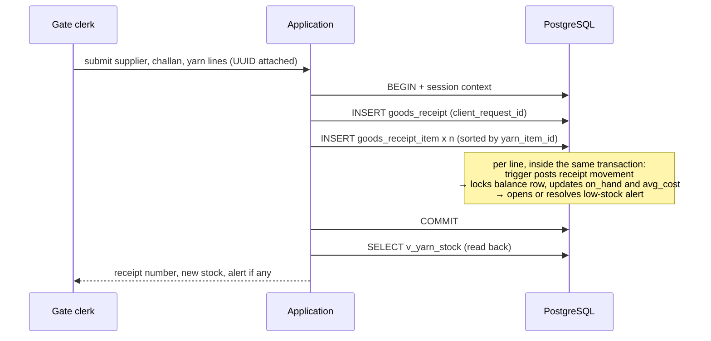
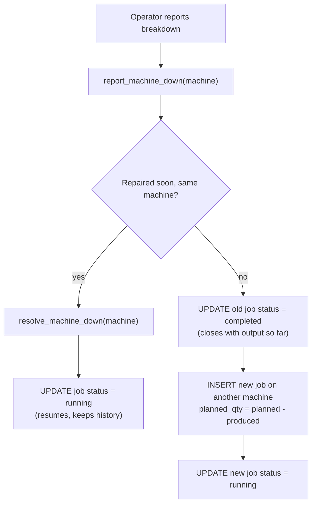
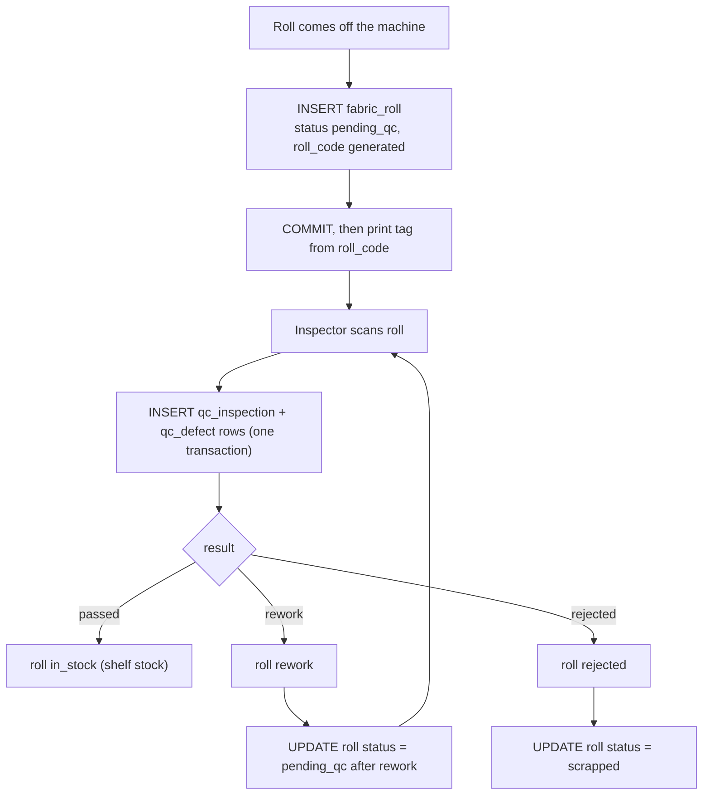
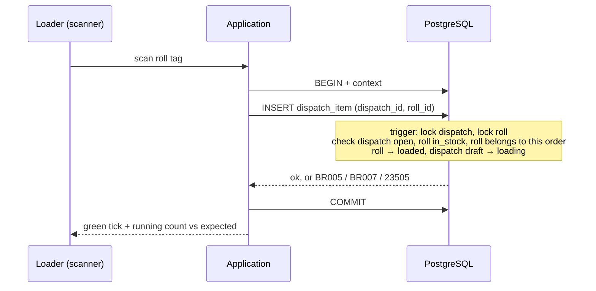
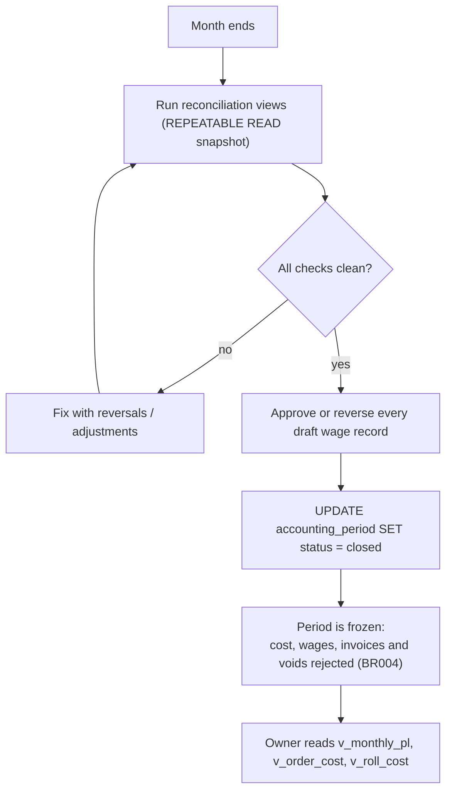

# 05 — Data Flow and Transactions

**Project:** Textile Manufacturing System — Everest Textile Mills
**Database:** PostgreSQL 15+ (single instance)
**Depends on:** `04-database-schema.md` (tables, triggers, error codes), `03-entity-relationship-design.md` (invariants, state machines), `01-requirements-analysis.md` (FR / BR IDs)
**Companion:** `06-query-and-index-strategy.md` — every view named `v_…` below is defined there.
**Scope:** how the application creates, reads, updates and "deletes" data; every multi-step business operation as one transaction; what happens when things fail or collide. No application code — only SQL and pseudocode that an implementation agent can translate.

---

## 1. Principles

1. **One business operation = one database transaction.** Nothing a user would call "one action" is ever half-saved.
2. **The database already refuses invalid states** (doc 04). The application's job is to (a) open the transaction with the right context, (b) issue the statements in the right order, (c) translate errors, (d) retry when it is safe.
3. **Derived values are never written by the application.** `yarn_stock_balance`, `fabric_roll.status` (on inspection / dispatch), `machine_status_event` (on job start/stop), `invoice.total_amount`, cost entries and order history are all maintained by triggers inside the same transaction.
4. **Nothing is physically deleted.** "Delete" always means cancel, void, deactivate, release or reverse (Section 4).
5. **No external call inside a transaction.** Label printing, SMS/e-mail alerts and scanner acknowledgements happen *after* `COMMIT`, driven by the committed data. If they fail, the data is still correct and the side effect can be repeated from the committed row.

---

## 2. Transaction rules that apply to every workflow

### 2.1 Opening a transaction

```sql
BEGIN;                                                   -- READ COMMITTED (PostgreSQL default) unless stated otherwise
SELECT set_config('app.user_id', $1::text, true);        -- true = local to this transaction (SET LOCAL cannot take bind parameters)
SELECT set_config('app.source',  $2,       true);        -- e.g. 'screen:gate-entry'            (optional)
SELECT set_config('app.reason',  $3,       true);        -- mandatory by policy for cancel/void/reverse/adjust
SET LOCAL lock_timeout = '5s';                           -- wait for a row lock at most 5 s, then fail with 55P03
SET LOCAL statement_timeout = '15s';                     -- interactive screens; reports use their own, longer value
```

If `app.user_id` is missing, every `created_by NOT NULL` insert fails (doc 04 §2) — an anonymous write is impossible.

### 2.2 Isolation level

| Use | Level | Why |
|---|---|---|
| All write workflows | **READ COMMITTED** (default) | Every contention point is protected by an explicit row lock (`FOR UPDATE` inside triggers) or a unique/exclusion constraint, so stronger isolation adds retries without adding safety |
| Month-end reports, reconciliation queries, "close period" pre-checks | **REPEATABLE READ, READ ONLY** | One consistent snapshot across many tables, so totals add up even while scanning continues |
| Dashboard / lookups | READ COMMITTED, single statement | Each statement sees a consistent snapshot; MVCC means readers never block writers |

`SERIALIZABLE` is **not** used: there is no write-skew risk that the locks and constraints above do not already cover, and it would force retries on the hot scanning path.

### 2.3 Lock order (deadlock prevention)

When one transaction touches several locked rows it must lock them in this order. The triggers in doc 04 already follow it; application code that locks explicitly (`SELECT … FOR UPDATE`) must too.

| Order | Row | Taken by |
|---|---|---|
| 1 | `dispatch` | Scanning a roll, completing / cancelling a dispatch |
| 2 | `fabric_roll` (ascending `roll_id` when several) | QC inspection, dispatch scan, status updates |
| 3 | `production_job` | Output log (share), start/stop, roll creation (share) |
| 4 | `yarn_stock_balance` (ascending `yarn_item_id` when several) | Every stock movement, every reservation |
| 5 | `buyer_payment`, then `invoice` (ascending `invoice_id`) | Payment allocation |
| 6 | `doc_sequence` row | Invoice issue (held to commit — the price of gap-free numbers) |

Multi-line inputs (gate entry with several yarn lines, cancelling a receipt) are therefore **inserted sorted by `yarn_item_id`**.

### 2.4 Optimistic concurrency (editable documents)

`customer_order`, `purchase_order`, `production_job`, `fabric_roll`, `dispatch`, `invoice` carry `version`. Every user-driven update is:

```sql
UPDATE customer_order SET promised_delivery_date = $2
 WHERE order_id = $1 AND version = $3;     -- $3 = version the user's screen was loaded with
-- rows affected = 0  →  someone else changed it  →  reload, show "changed by <user> at <time>", let the user redo
```

A trigger bumps `version` on every update, so a stale screen can never overwrite a newer change (no lost updates). Trigger-driven updates (e.g. QC changing a roll's status) also bump it, which is intended: a screen showing an old roll status must refresh.

### 2.5 Idempotency — duplicate requests

The browser or scanner generates a UUID **once per user action** (when the form opens / the scan is read) and re-sends the *same* UUID on every retry.

| Operation | Guard | On duplicate |
|---|---|---|
| Gate entry | `goods_receipt.client_request_id` | Insert returns no row → look up by `client_request_id`, return the original receipt |
| Output log | `production_log.client_request_id` | Same |
| Roll creation | `fabric_roll.client_request_id` | Same — and the **same `roll_code`** comes back, so no second tag |
| Manual stock issue / return / adjustment | `yarn_stock_movement.client_request_id` | Same |
| Buyer payment | `buyer_payment.client_request_id` | Same |
| Receipt line posting, reversal | `uq_movement_one_receipt_per_line`, `reverses_movement_id UNIQUE` | Constraint violation = "already done" |
| State changes (confirm, issue invoice, complete dispatch, QC) | State machine + `WHERE status = '<expected>'` | 0 rows / `BR002` / `BR009` = "already done"; return the current state |
| Roll scan onto a dispatch | Partial unique index + status check | "Already on **this** dispatch" is success; "on **another** dispatch" is an error (WF-9) |

Pattern for the UUID-guarded inserts:

```sql
INSERT INTO goods_receipt (supplier_id, po_id, supplier_challan_no, client_request_id)
VALUES ($1, $2, $3, $4)
ON CONFLICT (client_request_id) DO NOTHING
RETURNING receipt_id;
-- no row returned  →  ROLLBACK;  SELECT * FROM goods_receipt WHERE client_request_id = $4;  return that to the user as success
```

### 2.6 Failure handling and retries

| Error | Meaning | Application action |
|---|---|---|
| `40001` serialization failure, `40P01` deadlock | Rare here (lock order above) | **Retry the whole transaction** up to 3 times with random 20–100 ms delay |
| `55P03` lock timeout / `57014` statement timeout | Someone holds the row too long | Tell the user "busy, try again"; do not auto-retry writes more than once |
| `23505` on a `client_request_id` constraint | Duplicate request | Return the original result (above) |
| `23505` on any other unique / partial-unique | A business conflict | Map by constraint name (doc 04 §11) |
| `BR001 … BR011`, `23503`, `23514`, `23P01` | Rule violation | **Never retry.** Show the mapped message; the transaction has already rolled back |
| Connection lost before `COMMIT` | Outcome unknown | Re-send with the **same** request id; idempotency guards make this safe |
| Connection lost after `COMMIT`, before the user saw the answer | Outcome known to DB only | Same retry → duplicate path returns the stored result |

A transaction that raises any error is rolled back as a whole; `SAVEPOINT` is used only where a *tolerated* failure exists (e.g. trying to reserve stock and falling back to partial — WF-3).

### 2.7 Reading back the updated state

After `COMMIT` the application reads from the views in doc 06 (never from cached UI state), keyed by the identifiers it just created: `receipt_no`, `roll_code`, `dispatch_no`, `order_no`, `invoice_no`. Because triggers update caches in the same transaction, a read issued after `COMMIT` always sees consistent balances, roll status and totals.

---

## 3. Workflow-to-requirement map

| Workflow | Requirements |
|---|---|
| WF-1 Gate entry · WF-2 Cancel gate entry | FR-1.1, FR-1.2, FR-1.3 |
| WF-3 Order, sufficiency check, reservation | FR-1.4, FR-4.1, FR-4.3 |
| WF-4 Yarn issue / return / adjustment | FR-1.2, FR-6.1, FR-6.4, BR-1 |
| WF-5 Start / stop job · WF-6 Output logging · WF-7 Breakdown & reassignment | FR-2.1–2.5 |
| WF-8 Roll creation & quality control | FR-3.1–3.4, BR-4, BR-5 |
| WF-9 Dispatch loading | FR-5.1–5.4, BR-6, BR-7 |
| WF-10 Invoice | FR-5.5, BR-8 |
| WF-11 Buyer payment | FR-6.3 |
| WF-12 Supplier bill | FR-1.5, FR-6.1 |
| WF-13 Attendance and wages | FR-6.2 |
| WF-14 Period close, cost, profit/loss | FR-6.4–6.7 |
| WF-15 Buyer calls about an order (read) | FR-4.1, FR-4.2, FR-4.3 |
| WF-16 Reconciliation checks | INV-1, INV-6, BR-10 |

---

## 4. Create / read / update / delete policy by entity

| Entity group | Create | Read | Update | "Delete" |
|---|---|---|---|---|
| Masters (`supplier`, `buyer`, `yarn_type`, `colour`, `yarn_item`, `fabric_product`, `machine`, `shift`, `defect_type`, `employee`) | Admin | All roles (pay fields restricted, doc 07) | Admin; `updated_by/at` set by trigger; sensitive changes audited | `is_active = false` |
| `app_user`, `user_role` | Admin | Admin | Admin; audited | Deactivate user; remove role link |
| `customer_order`, `order_item` | Sales / admin | All staff | Draft: freely. Confirmed: quantity/rate/date only, versioned + audited | Draft → `cancelled`; confirmed → `cancelled` with reason. Draft **lines** may be removed |
| `order_material_requirement`, `yarn_reservation` | Sales / production | Production, store | Reservation status only | `released` (not deleted) |
| `purchase_order` (+ items) | Store / accounts | Store, accounts | Draft items freely; status per state machine | `cancelled` |
| `goods_receipt` (+ items) | Gate staff | Store, accounts | Cancel only | `cancelled` → reversing ledger rows |
| `yarn_stock_movement`, `cost_entry`, `production_log`, `payment_allocation`, `order_status_history`, `audit_log` | System / business action | Role-based | **Never** | **Never** — reversal row |
| `yarn_stock_balance` | Trigger only | All store/production | Trigger only | Never |
| `production_job` | Production manager | All | Status progression; machine/order frozen after start | `cancelled` (only before output exists, see WF-5) |
| `machine_status_event` | Trigger / `report_machine_down` | All | Close `ended_at` once | Never |
| `fabric_roll` | Operator / supervisor (WF-8) | All | Status by QC / dispatch triggers; shelf, length, weight before sale | `scrapped` |
| `qc_inspection`, `qc_defect` | Quality checker | All; defects → production, owner | **Never** | **Never** — re-inspect |
| `dispatch`, `dispatch_item` | Dispatch staff | All | Draft/loading: add/remove rolls, vehicle, link invoice | `cancelled` → rolls released |
| `invoice`, `invoice_item` | Accounts | Accounts, owner, customer-facing staff (status) | Draft only; then issue | Draft → void; issued → void (with conditions) |
| `buyer_payment` | Accounts | Accounts, owner | One-way `recorded → reversed` | `reversed` |
| `supplier_bill` (+ lines) | Accounts | Accounts, owner | Void only | `void` |
| `attendance_record` | Supervisor | Accounts, owner | Until wages approved; audited | Never |
| `wage_record` | Accounts | Accounts, owner | Draft edit; approve; reverse | `reversed` |
| `accounting_period` | Auto (`period_for`) / accounts | All finance | `open → closed` once | Never |

---

## 5. Workflow simulations

Every workflow is simulated the same way (brief, Phase 8): records read, records written, constraints enforced, transaction scope, failure midway, conflicting users, duplicate requests, how the new state is read back, and whether the design stretches to future features.

### WF-1 · Yarn arrives at the gate (FR-1.1, FR-1.2, FR-1.3)



```sql
BEGIN;  -- + context (2.1)
INSERT INTO goods_receipt (supplier_id, po_id, supplier_challan_no, client_request_id)
VALUES ($supplier, $po_or_null, $challan, $uuid)
ON CONFLICT (client_request_id) DO NOTHING RETURNING receipt_id;

-- one row per yarn line, ordered by yarn_item_id
INSERT INTO goods_receipt_item (receipt_id, yarn_item_id, quantity_received, challan_quantity, unit_rate, earmarked_order_id)
VALUES ($receipt_id, $yarn_item, $qty, $challan_qty, $rate, $order_or_null);
COMMIT;
```

| # | Question | Answer |
|---|---|---|
| 1 | Records read | `supplier`, `yarn_item` (pick-lists), optional `purchase_order`, optional `customer_order` (earmark), existing receipt by request id |
| 2 | Records written | `goods_receipt` (1) · `goods_receipt_item` (n) · `yarn_stock_movement` (n, by trigger) · `yarn_stock_balance` (n, by trigger) · `stock_alert` (0..n, by trigger) |
| 3 | Constraints enforced | NOT NULL / FKs · `quantity_received > 0` · `uq_receipt_challan` (same challan twice) · `fk_receipt_po_supplier` (PO belongs to this supplier) · lines only inside the creating transaction · `uq_movement_one_receipt_per_line` · weighted-average recomputation · `uq_stock_alert_one_live` |
| 4 | Transaction needed? | **Yes** — header, all lines, ledger, balance and alert succeed together |
| 5 | Failure midway | Whole gate entry rolls back; nothing booked, stock unchanged. The clerk resubmits with the same UUID |
| 6 | Conflicting users | Two clerks receiving the *same yarn item* at once: the balance row lock serialises the two movements; both succeed and the totals add. Same challan keyed twice: second fails `23505 uq_receipt_challan` → "already booked as GRN-…" |
| 7 | Duplicate request | Same UUID → `ON CONFLICT DO NOTHING` returns no row → application returns the original receipt |
| 8 | Reading updated state | `SELECT … FROM v_yarn_stock WHERE yarn_item_id = ANY($ids)`; open alerts from `v_open_stock_alerts` |
| 9 | Future support | Incoming-yarn inspection → new table referencing `goods_receipt_item`; several warehouses → add `location_id` to movement and balance key; barcode on lots → `lot_code` already unique |

---

### WF-2 · Cancel a gate entry (wrong supplier, wrong quantity)

```sql
BEGIN;  -- + context, app.reason is MANDATORY
UPDATE goods_receipt SET status = 'cancelled', cancel_reason = $reason
 WHERE receipt_id = $1 AND status = 'received';
-- rows affected = 0 → already cancelled (idempotent) → return current state
COMMIT;
```

Triggers do the rest: stamp `cancelled_at/by`, insert one **reversal movement per lot** (sorted by yarn item), update balances, write `audit_log` and, via `trg_movement_apply`, re-evaluate low-stock alerts.

| # | Question | Answer |
|---|---|---|
| 1 | Read | The receipt and its lots' receipt movements |
| 2 | Written | `goods_receipt` (status), `yarn_stock_movement` (n reversals), `yarn_stock_balance` (n), `audit_log` (1), possibly `stock_alert` |
| 3 | Constraints | State machine `received → cancelled` · `ck_receipt_cancel` (reason) · `reverses_movement_id UNIQUE` · **`ck_balance_not_negative`** |
| 4 | Transaction | Yes |
| 5 | Failure midway | All-or-nothing; receipt stays `received` |
| 6 | Conflict | If some of that yarn has **already been issued** to jobs, the reversal would push stock negative → `23514 ck_balance_not_negative` → "Cannot cancel: yarn from this delivery is already in production. Post an adjustment instead." Two people cancelling at once: the second matches 0 rows |
| 7 | Duplicate | Second cancel updates 0 rows → treated as success |
| 8 | Read back | Receipt row + `v_yarn_stock` |
| 9 | Future | Partial cancellation of one lot → a reversal of just that movement (the ledger already allows it); not needed now |

---

### WF-3 · A new order arrives — create, check yarn, confirm, reserve (FR-1.4, FR-4.1, FR-4.3)

**3a. Create the draft** (one transaction): `INSERT customer_order` (status defaults to `draft`), then `INSERT order_item` per line (rate snapshot from the price the buyer agreed), then `INSERT order_material_requirement` (yarn per line). Draft lines may still be edited or removed.

**3b. "Is there enough yarn, or must we buy?"** — a read-only query, live, never stored (doc 03 §10):

```sql
-- per yarn needed by the order: required vs free stock vs yarn already on order from suppliers
SELECT y.yarn_item_id, yt.name AS yarn, c.name AS colour,
       r.required_qty,
       b.on_hand_qty - b.reserved_qty                          AS free_now,
       COALESCE(po.open_po_qty, 0)                             AS on_order,
       GREATEST(r.required_qty - (b.on_hand_qty - b.reserved_qty), 0)                         AS shortfall_now,
       GREATEST(r.required_qty - (b.on_hand_qty - b.reserved_qty) - COALESCE(po.open_po_qty, 0), 0) AS must_buy
  FROM (SELECT omr.yarn_item_id, SUM(omr.required_qty) - COALESCE(SUM(rs.reserved), 0) AS required_qty
          FROM order_item oi
          JOIN order_material_requirement omr USING (order_item_id)
          LEFT JOIN (SELECT requirement_id, SUM(reserved_qty) AS reserved
                       FROM yarn_reservation WHERE status = 'active' GROUP BY requirement_id) rs USING (requirement_id)
         WHERE oi.order_id = $order_id
         GROUP BY omr.yarn_item_id) r
  JOIN yarn_item y          ON y.yarn_item_id = r.yarn_item_id
  JOIN yarn_type yt         ON yt.yarn_type_id = y.yarn_type_id
  JOIN colour c             ON c.colour_id = y.colour_id
  JOIN yarn_stock_balance b ON b.yarn_item_id = r.yarn_item_id
  LEFT JOIN LATERAL (SELECT SUM(poi.quantity - COALESCE(rec.received, 0)) AS open_po_qty
                       FROM purchase_order po
                       JOIN purchase_order_item poi ON poi.po_id = po.po_id AND poi.yarn_item_id = r.yarn_item_id
                       LEFT JOIN LATERAL (SELECT SUM(gi.quantity_received) AS received
                                            FROM goods_receipt g JOIN goods_receipt_item gi USING (receipt_id)
                                           WHERE g.po_id = po.po_id AND g.status = 'received'
                                             AND gi.yarn_item_id = poi.yarn_item_id) rec ON true
                      WHERE po.status = 'sent') po ON true;
```

This is **advisory** (a snapshot). The authoritative step is the reservation in 3d.

**3c. Confirm** — `UPDATE customer_order SET status = 'confirmed', promised_delivery_date = $date WHERE order_id = $1 AND version = $v AND status = 'draft'`. Triggers require ≥ 1 line, stamp `confirmed_at`, write `order_status_history`.

**3d. Reserve stock** — one statement per requirement, atomic against concurrent orders:

```sql
WITH locked AS (
  SELECT on_hand_qty - reserved_qty AS free
    FROM yarn_stock_balance WHERE yarn_item_id = $yarn_item FOR UPDATE      -- serialises competing orders for this yarn
), need AS (
  SELECT omr.required_qty - COALESCE((SELECT SUM(reserved_qty) FROM yarn_reservation
                                       WHERE requirement_id = omr.requirement_id AND status IN ('active','consumed')), 0) AS still_needed
    FROM order_material_requirement omr WHERE omr.requirement_id = $req
)
INSERT INTO yarn_reservation (requirement_id, reserved_qty)
SELECT $req, LEAST(need.still_needed, locked.free)
  FROM need, locked
 WHERE LEAST(need.still_needed, locked.free) > 0
RETURNING reserved_qty;
-- 0 rows → nothing free; the shortfall from 3b tells the manager to buy
```

| # | Question | Answer |
|---|---|---|
| 1 | Read | `buyer`, `fabric_product`, `colour`, `yarn_stock_balance`, open `purchase_order(_item)`, existing reservations |
| 2 | Written | 3a: `customer_order`, `order_item`, `order_material_requirement` · 3c: `customer_order` (status), `order_status_history` · 3d: `yarn_reservation`, `yarn_stock_balance.reserved_qty` (trigger) |
| 3 | Constraints | Unit of order line = product's unit (`fk_order_item_product_unit`) · promised date required once confirmed · ≥ 1 line to confirm · state machine · `ck_reserved_within_on_hand` (INV-9) · `uq_requirement` |
| 4 | Transaction | 3a one transaction; 3c one; each 3d reservation one (so one failing yarn does not undo the others) |
| 5 | Failure midway | 3a rolls back to nothing (no half-order). A failure between 3c and 3d leaves a confirmed order with unmet requirements — visible in `v_order_material_check`, and re-running 3d is safe (it only reserves what is still needed) |
| 6 | Conflicting users | Two orders needing the same last 500 kg: the `FOR UPDATE` serialises them; the second computes `free` after the first's reservation. Even if the application skipped the lock, `ck_reserved_within_on_hand` rejects the over-reservation. Two people editing one draft: version check (2.4) |
| 7 | Duplicate | Confirm twice → second matches 0 rows. Reserve twice → `still_needed` is already 0 → inserts nothing. (Create-order double-click makes two *drafts*; visible and discardable — no stock or money effect) |
| 8 | Read back | `v_order_status` (stage), `v_order_material_check` |
| 9 | Future | Bill of materials per product (auto-fill requirements) → new `product_bom` table; stage-wise consumption → `stage_id` on requirement |

---

### WF-4 · Yarn is issued to a production job (and returns / manual adjustments) (FR-1.2, FR-6.1, FR-6.4)

Issuing stock is the moment **material cost is recognised** (doc 03 §10): the trigger values the issue at the current weighted-average cost and writes the matching `cost_entry` for that order and machine.

```sql
BEGIN;  -- + context
-- 1. if this issue draws on a reservation, consume it first so reserved_qty drops before on_hand does
UPDATE yarn_reservation SET status = 'consumed', closed_at = now()
 WHERE reservation_id = $res AND status = 'active'
RETURNING reserved_qty;                                   -- 0 rows → already consumed (retry) or none used
-- 2. if only part of the reservation is issued, re-reserve the remainder (reservations are all-or-nothing rows)
INSERT INTO yarn_reservation (requirement_id, reserved_qty) VALUES ($req, $reserved - $issued);    -- only when $issued < $reserved
-- 3. the issue itself
INSERT INTO yarn_stock_movement (yarn_item_id, movement_type, quantity, production_job_id, client_request_id)
VALUES ($yarn_item, 'issue', -$issued, $job, $uuid)
ON CONFLICT (client_request_id) DO NOTHING;
COMMIT;
```

Variants:

| Variant | Statement | Notes |
|---|---|---|
| **Return unused yarn** | `INSERT … movement_type = 'return', quantity = +q, production_job_id = $job, client_request_id = $uuid` | Valued at current average; posts a negative `cost_entry` for the order |
| **Manual adjustment** (count difference) | `INSERT … 'adjustment', quantity = ±q, reason = $why, client_request_id = $uuid` | `app.reason` + `reason` mandatory; audited; no production cost entry |
| **Correct a wrong issue** | `INSERT … 'reversal', quantity = +q, reverses_movement_id = $m, reason = $why` | Reversal posts the mirrored negative cost entry in the **current** open period |

| # | Question | Answer |
|---|---|---|
| 1 | Read | Job → order item → order (for cost attribution), balance row, reservation |
| 2 | Written | `yarn_reservation`, `yarn_stock_movement`, `yarn_stock_balance`, `cost_entry` (trigger), `stock_alert` (maybe), `accounting_period` (auto-created if the month has none) |
| 3 | Constraints | `ck_movement_shape` · `ck_movement_idempotent` · **`ck_balance_not_negative`** · `ck_reserved_within_on_hand` · `ck_cost_material_has_order` · period must be open (BR004) |
| 4 | Transaction | Yes — reservation, ledger, balance and cost are one fact |
| 5 | Failure midway | Insufficient stock → `23514` → everything (including the reservation consumption) rolls back; the user sees "only X kg available". Closed period → `BR004` → rolled back |
| 6 | Conflicting users | Two supervisors issuing the same yarn: `FOR UPDATE` on the balance row serialises them; the second sees the reduced stock. Issue vs. a gate-entry cancel of the same lot: whoever locks the balance first wins; the other re-evaluates against the new balance |
| 7 | Duplicate | Same `client_request_id` → `DO NOTHING` → application returns the original movement. **Without this guard a double-click would issue twice** (found in simulation, doc 04 §1.1 #3a) |
| 8 | Read back | `v_yarn_stock`, `v_order_cost` |
| 9 | Future | FIFO / per-lot costing (Q6): issue movements can already carry `receipt_item_id`; add per-lot balance |

*Soft rule (application, not DB):* warn when the issued yarn item is not in the order's requirements. It is a planning aid, not an integrity rule, so it is deliberately not a constraint.

---

### WF-5 · Start, pause and finish a job (FR-2.1, FR-2.2)

```sql
-- plan (manager)                         -- requires the order to be 'confirmed'
INSERT INTO production_job (order_item_id, stage_id, machine_id, planned_qty) VALUES ($oi, $stage, $machine, $qty);

-- start
UPDATE production_job SET status = 'running' WHERE job_id = $1 AND version = $v AND status IN ('planned','interrupted');

-- finish (target met or manually closed); also the way to close an interrupted job that will not resume
UPDATE production_job SET status = 'completed' WHERE job_id = $1 AND version = $v AND status IN ('running','interrupted');

-- cancel a planned job that never ran
UPDATE production_job SET status = 'cancelled' WHERE job_id = $1 AND status IN ('planned','interrupted');
```

What the triggers do on **start**: reject if the machine is deactivated or in breakdown/maintenance, stamp `started_at`, close the machine's `idle` event and open a `running` event. On **finish/interrupt**: close the `running` event and open `idle` (unless a breakdown event is already open).

| # | Question | Answer |
|---|---|---|
| 1 | Read | `machine` (stage, active), open `machine_status_event`, `customer_order` status |
| 2 | Written | `production_job`, `machine_status_event` (close + open, by trigger) |
| 3 | Constraints | `fk_job_machine_stage` (machine's stage = job's stage) · **`uq_job_one_running_per_machine`** (BR-3) · `uq_mse_one_open` · `ex_mse_no_overlap` · INV-4 immutability · state machine |
| 4 | Transaction | Yes (job + machine events) |
| 5 | Failure midway | Rolled back together — never a "running job on an idle machine" |
| 6 | Conflicting users | Two managers starting different jobs on one machine: the second hits `23505 uq_job_one_running_per_machine` → "Machine already running job JOB-…". Two people editing one job: version check |
| 7 | Duplicate | Start twice → second matches 0 rows (status already `running`) → return current state |
| 8 | Read back | `v_machine_status`, `v_job_progress` |
| 9 | Future | Routing enforcement (stage 2 cannot start before stage 1 output exists) → one more trigger or a `job_dependency` table; not required by the PS |

---

### WF-6 · Output is logged during the shift (FR-2.3, FR-2.4)

```sql
INSERT INTO production_log (job_id, shift_id, operator_id, output_qty, client_request_id)
VALUES ($job, $shift, $operator_or_null, $metres, $uuid)
ON CONFLICT (client_request_id) DO NOTHING;
```

**Shift change needs no special action:** the job keeps running; logs before and after the change carry different `shift_id` / `operator_id`, so "what each shift/worker produced" is a query (`v_output_by_machine_shift`). **Corrections** are negative entries that fully offset one earlier entry: `INSERT … output_qty = -q, reverses_log_id = $log, reason = $why`.

| # | Question | Answer |
|---|---|---|
| 1 | Read | Job status (share-locked by the trigger) |
| 2 | Written | `production_log` only (job progress and dashboard figures are views) |
| 3 | Constraints | Job must be `running` for positive output · correction must offset exactly one earlier positive entry of the same job · `reverses_log_id UNIQUE` (corrected at most once) · `ck_log_qty` |
| 4 | Transaction | Single statement = atomic |
| 5 | Failure midway | Nothing written; the operator resends |
| 6 | Conflicting users | Log arriving while the manager completes the job: the share lock makes them serialise — the log either lands before completion or is refused with `BR010` "job is not running". Two supervisors correcting the same entry: second fails `23505 reverses_log_id` |
| 7 | Duplicate | Same UUID → ignored, original returned |
| 8 | Read back | `v_job_progress` (produced, % of planned), dashboard `v_machine_status` |
| 9 | Future | Sensors (Q1): the same insert at higher volume; partitioning triggers in doc 06 §9 |

---

### WF-7 · A machine breaks down mid-job; work moves to another machine (FR-2.5, INV-4)

Order of statements matters (event first, job second), so it is wrapped in one database function — installed as migration `0009_workflow_functions.sql`:

```sql
-- 0009_workflow_functions.sql
-- Report a machine as down (breakdown or maintenance). Safe to call twice.
CREATE FUNCTION report_machine_down(p_machine bigint, p_state text, p_note text, p_reported_by bigint DEFAULT NULL)
RETURNS bigint LANGUAGE plpgsql AS $$
DECLARE v_event bigint;
BEGIN
  IF p_state NOT IN ('breakdown', 'maintenance') THEN
    RAISE EXCEPTION 'State must be breakdown or maintenance' USING ERRCODE = 'BR010';
  END IF;
  SELECT event_id INTO v_event FROM machine_status_event
   WHERE machine_id = p_machine AND ended_at IS NULL AND state IN ('breakdown', 'maintenance') FOR UPDATE;
  IF FOUND THEN RETURN v_event; END IF;                                   -- already down: idempotent

  UPDATE machine_status_event SET ended_at = now() WHERE machine_id = p_machine AND ended_at IS NULL;      -- 1. close running / idle
  INSERT INTO machine_status_event (machine_id, state, note, reported_by)
  VALUES (p_machine, p_state, p_note, p_reported_by) RETURNING event_id INTO v_event;                      -- 2. open the down period
  UPDATE production_job SET status = 'interrupted' WHERE machine_id = p_machine AND status = 'running';     -- 3. interrupt the job
  RETURN v_event;
END $$;

-- Machine repaired: close the down period and return to idle (jobs are resumed explicitly, WF-5)
CREATE FUNCTION resolve_machine_down(p_machine bigint) RETURNS void LANGUAGE plpgsql AS $$
BEGIN
  UPDATE machine_status_event SET ended_at = now()
   WHERE machine_id = p_machine AND ended_at IS NULL AND state IN ('breakdown', 'maintenance');
  IF NOT FOUND THEN
    RAISE EXCEPTION 'Machine % has no open breakdown/maintenance period', p_machine USING ERRCODE = 'BR010';
  END IF;
  INSERT INTO machine_status_event (machine_id, state) VALUES (p_machine, 'idle');
END $$;
```



Remaining quantity for the replacement job:

```sql
SELECT j.planned_qty - COALESCE(SUM(l.output_qty), 0) AS remaining
  FROM production_job j LEFT JOIN production_log l USING (job_id) WHERE j.job_id = $old_job GROUP BY j.planned_qty;
```

| # | Question | Answer |
|---|---|---|
| 1 | Read | Open event, running job, output so far |
| 2 | Written | `machine_status_event` (close/open), `production_job` (interrupt; later complete + new job) |
| 3 | Constraints | `uq_mse_one_open`, `ex_mse_no_overlap`, INV-4 (machine of a started job can't change — hence the **new job**), state machine, `fk_job_machine_stage` (replacement machine must be of the same stage) |
| 4 | Transaction | Yes — each of: report; reassign (complete old + create new + start new) |
| 5 | Failure midway | Rolled back; the machine never ends up "breakdown" with a job still `running` |
| 6 | Conflicting users | Two people reporting the same breakdown: the second returns the existing event. A log arriving as the job is interrupted: refused (`BR010`) — the operator is told to log it after resume |
| 7 | Duplicate | `report_machine_down` is idempotent by construction |
| 8 | Read back | `v_machine_status` (shows breakdown with note), `v_job_progress` for both jobs |
| 9 | Future | Downtime reports / OEE: already derivable from `machine_status_event` periods |

---

### WF-8 · A fabric roll is produced, tagged and inspected (FR-3.1 – FR-3.4)



```sql
-- 8a. create the roll (operator / supervisor)
INSERT INTO fabric_roll (job_id, operator_id, length_m, weight_kg, shelf_location, client_request_id)
VALUES ($job, $operator_or_null, $m, $kg, $shelf, $uuid)
ON CONFLICT (client_request_id) DO NOTHING
RETURNING roll_id, roll_code;                       -- print the tag AFTER commit

-- 8b. inspect (quality checker) — ONE transaction
INSERT INTO qc_inspection (roll_id, inspector_id, result, remarks)
VALUES ($roll, $inspector, 'rework', $remarks) RETURNING inspection_id;     -- trigger: locks roll, sets attempt_no, flips roll status
INSERT INTO qc_defect (inspection_id, defect_type_id, severity, defect_count, position_note)
VALUES ($insp, $defect_type, 'major', 2, 'selvedge, 14 m from start');
COMMIT;   -- deferred check here: rework/rejected without any defect row → BR009

-- 8c. after physical rework
UPDATE fabric_roll SET status = 'pending_qc' WHERE roll_id = $1 AND status = 'rework' AND version = $v;
-- 8d. write off a rejected roll
UPDATE fabric_roll SET status = 'scrapped' WHERE roll_id = $1 AND status = 'rejected' AND version = $v;
```

| # | Question | Answer |
|---|---|---|
| 1 | Read | Job (status), roll (status, locked), previous attempts |
| 2 | Written | 8a: `fabric_roll` · 8b: `qc_inspection`, `qc_defect` (n), `fabric_roll.status` (trigger) · 8c/8d: `fabric_roll` |
| 3 | Constraints | Job not `planned`/`cancelled` · `roll_code` unique · `length_m > 0` · only a `pending_qc` roll can be inspected (INV-8, `BR009`) · `uq_inspection_attempt` · defect required for rework/reject · defects only inside the inspecting transaction · rolls' job/code/operator immutable · state machine |
| 4 | Transaction | Yes for 8b (inspection + defects + roll status); 8a is a single statement |
| 5 | Failure midway | A rework result without a defect fails at commit → the whole inspection (including the status change) rolls back; the roll stays `pending_qc` |
| 6 | Conflicting users | Two inspectors scanning the same roll: the second blocks on the roll lock, then finds it no longer `pending_qc` → `BR009` "already inspected — current status: in_stock". Inspection vs. dispatch scan of the same roll: serialised by the roll lock; a `pending_qc` roll is never dispatchable (`BR005`) |
| 7 | Duplicate | Roll creation: same UUID → same roll and tag. Inspection resubmitted: `BR009` (no longer pending) → application shows the stored inspection |
| 8 | Read back | `v_roll_trace` (roll → job → machine → order → buyer, all inspections, defects) |
| 9 | Future | "Seconds" (downgrade instead of scrap) → one more transition row; severity grading rules or a defect catalogue (Q12) → columns on `defect_type`; parent-roll link (Q9) → one self-FK |

**Traceability (FR-3.4)** is a pure read — no extra writes needed: defect → inspection → roll → job → machine, and `fabric_roll.operator_id` / `production_log.operator_id` for the worker (`v_defects_by_machine`, `v_defects_by_operator`).

---

### WF-9 · Loading the truck (FR-5.1 – FR-5.4)



```sql
-- 9a. open a load for an order (buyer comes from the order; composite FK enforces it)
INSERT INTO dispatch (order_id, buyer_id, vehicle_no) SELECT order_id, buyer_id, $vehicle FROM customer_order WHERE order_id = $1 AND status = 'confirmed';

-- 9b. each scan = its own short transaction
INSERT INTO dispatch_item (dispatch_id, roll_id)
SELECT $dispatch, roll_id FROM fabric_roll WHERE roll_code = $scanned;

-- 9c. un-load a roll
UPDATE dispatch_item SET state = 'removed', remove_reason = $why WHERE dispatch_item_id = $1 AND state = 'active';

-- 9d. truck leaves
UPDATE dispatch SET status = 'dispatched', vehicle_no = $vehicle WHERE dispatch_id = $1 AND version = $v AND status = 'loading';

-- 9e. abandon the load (rolls return to stock automatically)
UPDATE dispatch SET status = 'cancelled', cancel_reason = $why WHERE dispatch_id = $1 AND status IN ('draft','loading');
```

**Handling scan outcomes in the application**

| Outcome | Cause | Message to loader |
|---|---|---|
| Success | — | ✔ roll added |
| `BR005` and the roll's active line is on **this** dispatch | Re-scan of a roll already loaded here | Treat as success: "already on this load" |
| `BR005` otherwise | Roll is `pending_qc` / `rework` / `rejected` / already `loaded` elsewhere / `dispatched` | "Roll R-… cannot be dispatched (status …)" |
| `BR007` | Roll belongs to a different order, or the load is closed | "Roll belongs to order …" |
| `23505 uq_dispatch_item_one_active_roll` | Another truck's scan won the race (backstop) | "Roll is on another active dispatch" |

**Missed items** (FR-5.4) are a query, not a rule: `v_dispatch_progress` lists, per order, rolls `in_stock` that have not been loaded versus rolls loaded, so the loader sees what is still missing.

| # | Question | Answer |
|---|---|---|
| 1 | Read | Dispatch (locked), roll (locked), roll's job → order item → order |
| 2 | Written | `dispatch_item`, `fabric_roll.status`, `dispatch.status`; at 9d the status of every loaded roll; at 9e every active line + rolls |
| 3 | Constraints | **`uq_dispatch_item_one_active_roll`** (INV-2/BR-7) · roll must be `in_stock` (INV-5/BR-6) · roll's order = dispatch's order (BR-8) · composite FKs buyer↔order↔invoice · empty dispatch cannot be sent · `ck_dispatch_sent` (vehicle) |
| 4 | Transaction | Yes — each scan, completion, cancellation |
| 5 | Failure midway | A scan either fully succeeds (line + roll `loaded` + dispatch `loading`) or leaves no trace. Completion that fails leaves rolls `loaded` and the dispatch `loading` — nothing is lost, nothing is double-counted |
| 6 | Conflicting users | **Two trucks scanning the same roll at the same instant:** both transactions lock their own dispatch, then queue on the roll's row lock; the winner flips it to `loaded`; the loser re-reads status `loaded` → `BR005`. If the trigger were ever bypassed, the partial unique index still rejects the second active line. **Dispatch vs QC:** roll lock serialises. **Two people completing the same dispatch:** second matches 0 rows |
| 7 | Duplicate | Re-scan: see table above |
| 8 | Read back | `v_dispatch_progress`, `v_dispatch_lines` (for the invoice), `v_roll_trace` |
| 9 | Future | Multiple warehouses / shelf bins → `shelf_location` can become a table; weighbridge integration → extra column on `dispatch`; returns from buyer → new roll transition `dispatched → returned` plus a credit-note document |

---

### WF-10 · Invoice matching the load (FR-5.5, BR-8)

```sql
BEGIN;  -- + context
-- 10a. draft invoice for the buyer
INSERT INTO invoice (buyer_id) VALUES ($buyer) RETURNING invoice_id;

-- 10b. lines = what was actually loaded, grouped by order line, at the agreed rate
INSERT INTO invoice_item (invoice_id, order_item_id, quantity, rate, amount)
SELECT $inv, oi.order_item_id, SUM(r.length_m), oi.agreed_rate, round(SUM(r.length_m) * oi.agreed_rate, 2)
  FROM dispatch_item di
  JOIN fabric_roll r       ON r.roll_id = di.roll_id
  JOIN production_job j    ON j.job_id = r.job_id
  JOIN order_item oi       ON oi.order_item_id = j.order_item_id
 WHERE di.dispatch_id = ANY($dispatch_ids) AND di.state = 'active'
 GROUP BY oi.order_item_id, oi.agreed_rate;                 -- invoice.total_amount follows by trigger

-- 10c. link the dispatch(es)
UPDATE dispatch SET invoice_id = $inv WHERE dispatch_id = ANY($dispatch_ids) AND invoice_id IS NULL;

-- 10d. issue (gap-free number allocated here)
UPDATE invoice SET status = 'issued' WHERE invoice_id = $inv AND version = $v AND status = 'draft';
COMMIT;
```

Void: `UPDATE invoice SET status = 'void', void_reason = $why WHERE invoice_id = $1 AND status IN ('draft','issued')` — refused while dispatches are still linked or recorded payments are allocated (`BR008`), and refused for a closed month (`BR004`). To re-bill: void, un-link (`UPDATE dispatch SET invoice_id = NULL`), create a new draft.

| # | Question | Answer |
|---|---|---|
| 1 | Read | Dispatch items → rolls → jobs → order items (quantity from rolls actually loaded; rate snapshot from the order) |
| 2 | Written | `invoice`, `invoice_item`, `dispatch.invoice_id`, `doc_sequence` (on issue) |
| 3 | Constraints | Same buyer on dispatch, order lines and invoice (composite FK + `trg_invoice_item_before`) · `ck_invoice_item_amount` · `uq_invoice_item` · ≥ 1 line to issue · period open for `invoice_date` · number unique and gap-free · issued invoice immutable |
| 4 | Transaction | Yes — all four steps. Gap-free numbering depends on it: if issuing fails, the counter increment rolls back too |
| 5 | Failure midway | Nothing issued, no number consumed, dispatch still unlinked |
| 6 | Conflicting users | Two accountants issuing different invoices: the second waits on the `doc_sequence` row for the instant the first commits (low volume, acceptable). Two invoicing the same dispatch: `invoice_id IS NULL` guard → the second updates 0 rows → "dispatch already invoiced" |
| 7 | Duplicate | Issue twice → 0 rows the second time → return the stored invoice |
| 8 | Read back | `v_invoice_balance`, `v_dispatch_invoice_match` (exceptions: dispatched but not invoiced; quantity differences) |
| 9 | Future | GST/tax (Q8) → add `tax_amount`, `tax_rate` columns + a tax summary; credit notes → `invoice_type` + negative lines |

---

### WF-11 · Buyer payment and allocation (FR-6.3, INV-6)

```sql
BEGIN;  -- + context
INSERT INTO buyer_payment (buyer_id, received_on, amount, mode, instrument_ref, client_request_id)
VALUES ($buyer, $date, $amount, $mode, $ref, $uuid)
ON CONFLICT (client_request_id) DO NOTHING RETURNING payment_id;

-- allocate oldest invoice first (or exactly as the accountant chooses): loop over v_invoice_balance
--   remaining := amount
--   for each issued invoice with outstanding > 0, ordered by invoice_date, invoice_id:
INSERT INTO payment_allocation (payment_id, invoice_id, allocated_amount)
VALUES ($payment, $invoice, LEAST($remaining, $outstanding));
COMMIT;                       -- any unallocated remainder simply stays as an advance (v_buyer_ledger)

-- reverse a bounced cheque / wrong entry
UPDATE buyer_payment SET status = 'reversed', reverse_reason = $why WHERE payment_id = $1 AND status = 'recorded';
```

| # | Question | Answer |
|---|---|---|
| 1 | Read | Buyer's open invoices and balances |
| 2 | Written | `buyer_payment`, `payment_allocation` (n) |
| 3 | Constraints | `amount > 0` · same buyer · invoice must be `issued` · **Σ allocations ≤ payment** and **≤ invoice total** (locks: payment → invoice) · `client_request_id` unique |
| 4 | Transaction | Yes — payment + allocations |
| 5 | Failure midway | Rolled back as a whole; no half-allocated payment |
| 6 | Conflicting users | Two payments racing to settle the same invoice: the second fails `BR006` "exceeds invoice balance" and the application re-reads the balance and allocates the remainder. Reversal vs a concurrent allocation: payment row lock serialises (allocation then sees `reversed`) |
| 7 | Duplicate | Same UUID → original payment returned |
| 8 | Read back | `v_invoice_balance`, `v_buyer_ledger` |
| 9 | Future | Bank-statement import → `client_request_id` = statement line id; write-offs / discounts → allocation `kind` column |

Reversal does not delete allocations; every view counts only allocations whose payment is `recorded`, so a reversed payment's invoices automatically become outstanding again.

---

### WF-12 · Supplier bill (FR-1.5, FR-6.1)

```sql
BEGIN;  -- + context
INSERT INTO supplier_bill (supplier_id, supplier_bill_no, bill_date) VALUES ($sup, $no, $date) RETURNING bill_id;
INSERT INTO supplier_bill_line (bill_id, receipt_item_id, quantity, rate, amount)
VALUES ($bill, $lot, $qty, $rate, round($qty * $rate, 2));       -- bill total follows by trigger
COMMIT;
```

| # | Question | Answer |
|---|---|---|
| 1 | Read | Unbilled lots (`v_unbilled_lots`) |
| 2 | Written | `supplier_bill`, `supplier_bill_line` (n) |
| 3 | Constraints | Lines only in the creating transaction · **billed qty ≤ received qty per lot** (lot row locked) · `ck_bill_line_amount` · `uq_supplier_bill_no` (same bill number twice) |
| 4 | Transaction | Yes |
| 5 | Failure midway | Whole bill rolled back |
| 6 | Conflicting users | Two accountants billing the same lot: lot row lock → second sees the first's billed quantity |
| 7 | Duplicate | Same supplier + bill number → `23505 uq_supplier_bill_no` → "bill already entered" |
| 8 | Read back | `v_supplier_bill_variance` (billed rate vs the gate-entry rate that valued the stock) |
| 9 | Future | Re-valuation of stock on price difference (Q6), supplier payments (Q10) → `supplier_payment` + allocation mirroring buyer payments |

Per the Q6 default, a bill does **not** create cost entries (cost is recognised on issue). A price difference is reported by the variance view and can be booked by accounts as an `overhead` cost entry with a description.

---

### WF-13 · Attendance and wages (FR-6.2)

```sql
-- 13a. attendance (supervisor): upsert one row per employee, day, shift
INSERT INTO attendance_record (employee_id, work_date, shift_id, status, hours_worked)
VALUES ($emp, $date, $shift, $status, $hours)
ON CONFLICT (employee_id, work_date, shift_id) DO UPDATE
   SET status = EXCLUDED.status, hours_worked = EXCLUDED.hours_worked;   -- audited; refused once wages are approved (BR004)

-- 13b. month-end: draft wage records for daily-rate employees (one credit per day even if two shifts)
WITH day_credit AS (
  SELECT employee_id, work_date,
         MAX(CASE status WHEN 'present' THEN 1 WHEN 'half_day' THEN 0.5 ELSE 0 END) AS credit
    FROM attendance_record WHERE work_date BETWEEN $start AND $end GROUP BY employee_id, work_date)
INSERT INTO wage_record (employee_id, period_id, gross_amount, basis_note)
SELECT e.employee_id, $period, round(SUM(d.credit) * e.pay_rate, 2), 'daily rate x ' || SUM(d.credit) || ' days'
  FROM employee e JOIN day_credit d USING (employee_id)
 WHERE e.pay_basis = 'daily' AND e.is_active
 GROUP BY e.employee_id, e.pay_rate
ON CONFLICT (employee_id, period_id) WHERE status <> 'reversed' DO NOTHING;

-- 13c. accounts approves → plant-level wage cost entry is written by trigger
UPDATE wage_record SET status = 'approved' WHERE wage_id = $1 AND status = 'draft';
-- 13d. mistake after approval: reverse (negative twin cost entry), then re-create
UPDATE wage_record SET status = 'reversed', reverse_reason = $why WHERE wage_id = $1 AND status = 'approved';
```

Monthly-rate and piece-rate employees use the same insert with a different `gross_amount` expression (flat `pay_rate`, or `pay_rate × Σ output metres from production_log` by operator). The proration rule for monthly staff is a payroll policy that the PS does not state and the mill must supply.

| # | Question | Answer |
|---|---|---|
| 1 | Read | Attendance for the month, employee pay basis/rate (restricted columns) |
| 2 | Written | `attendance_record`, `wage_record`, `cost_entry` (trigger on approval/reversal), `audit_log` |
| 3 | Constraints | `uq_attendance` · `ck_attendance_hours` · `uq_wage_live` · period open · approved wage immutable · attendance frozen after approval |
| 4 | Transaction | 13a per row; 13b one statement; 13c one statement (wage + cost) |
| 5 | Failure midway | Approval and its cost entry are atomic — no approved wage without cost |
| 6 | Conflicting users | Two people generating wages: `ON CONFLICT DO NOTHING` → no duplicates. Attendance edit racing an approval: the guard trigger rejects whichever commits second |
| 7 | Duplicate | Re-running 13b is harmless; approving twice updates 0 rows |
| 8 | Read back | `v_wage_summary`, `v_monthly_pl` |
| 9 | Future | Hours-based allocation to orders (Q7) → `job_labour` + several `cost_entry` rows per wage (schema ready); statutory deductions → separate payroll module |

---

### WF-14 · Period close, cost and profit/loss (FR-6.4 – FR-6.7)



```sql
BEGIN ISOLATION LEVEL REPEATABLE READ READ ONLY;
SELECT * FROM v_recon_stock_balance_vs_ledger;      -- must return 0 rows (INV-1)
SELECT * FROM v_recon_dispatch_vs_invoice;          -- exceptions only
SELECT * FROM v_recon_unallocated_payments;         -- informational
COMMIT;

BEGIN;  -- + context
UPDATE accounting_period SET status = 'closed' WHERE period_id = $1 AND status = 'open';   -- BR004 if draft wages exist
COMMIT;
```

| # | Question | Answer |
|---|---|---|
| 1 | Read | Ledgers and views for the month |
| 2 | Written | `accounting_period` (once); nothing else — **all figures are already in the ledgers** |
| 3 | Constraints | No draft wages · closed period is immutable · every later posting into it is refused (INV-11) |
| 4 | Transaction | Reports: one snapshot; close: single statement |
| 5 | Failure midway | Period stays open |
| 6 | Conflicting users | A late invoice issued while close runs: whichever commits first wins; the loser gets `BR004` (issue after close) or the close sees the issued invoice. Because costs post only into the *current* open period, corrections to a closed month appear as dated reversal entries in the next open month and are labelled as such |
| 7 | Duplicate | Closing twice updates 0 rows |
| 8 | Read back | `v_monthly_pl` (revenue − material − wages − overhead), `v_order_cost`, `v_machine_output`, `v_roll_cost` |
| 9 | Future | Frozen snapshots → materialised view per closed period (doc 06 §8); multi-currency → `currency` on money tables |

---

### WF-15 · A buyer calls about an order (FR-4.1 – FR-4.3) — read only

```sql
SELECT * FROM v_order_status WHERE order_no = $1;      -- or by buyer name, paginated
-- returns: order_no, buyer, promised_delivery_date, commercial status,
--          operational stage (waiting for yarn / in spinning|weaving|dyeing / in quality check / ready for dispatch / partially dispatched / dispatched),
--          ordered vs produced vs passed vs dispatched metres, completion %
```

No write, no lock, no join to anything the staff member should not see (finance columns are not in the view). The stage is **computed**, never typed in (BR-11), so it cannot disagree with the floor. If call logging is wanted later (Q15), it is one new table `customer_call_log(order_id, note, logged_by, logged_at)`.

---

### WF-16 · Reconciliation checks (scheduled daily + before every close)

| Check | What it proves | Expected |
|---|---|---|
| `v_recon_stock_balance_vs_ledger` — balance table vs `SUM(yarn_stock_movement.quantity)` per item | INV-1: cache = ledger | 0 rows |
| `v_recon_reserved_vs_reservations` — `reserved_qty` vs active reservations | INV-9 cache | 0 rows |
| `v_recon_roll_status_vs_facts` — roll `loaded` without an active line; active line on a roll that is not `loaded`/`dispatched`; `in_stock` roll with last inspection ≠ passed | Roll status cache is consistent | 0 rows |
| `v_recon_machine_events` — running job without an open `running` event, and vice versa | Machine state consistent | 0 rows |
| `v_recon_dispatch_vs_invoice` | FR-5.5 invoice matches load | Exceptions listed for follow-up |
| `v_recon_cost_vs_issues` — issues without a cost entry | Costing complete | 0 rows |

A non-empty result is an **alert to investigate**, not something to auto-fix; the cause is fixed with a reversing entry.

---

## 6. Scenario catalogue (input to `09-database-testing-plan.md`)

| ID | Scenario | Expected result |
|---|---|---|
| T-01 | Two sessions receive the same yarn item concurrently (N × 100 kg) | Final `on_hand` = Σ; ledger sum = balance |
| T-02 | Issue more than on hand | `23514 ck_balance_not_negative`; nothing changed |
| T-03 | 20 concurrent issues of 10 kg against 100 kg stock | Exactly 10 succeed, 10 fail, balance 0 |
| T-04 | Same gate-entry UUID submitted twice (sequentially and in parallel) | One receipt, one set of lines |
| T-05 | Cancel a receipt whose yarn is partly issued | Rejected, nothing changed |
| T-06 | Two orders reserve the last free stock simultaneously | Total reserved ≤ on hand |
| T-07 | Start two jobs on one machine | Second fails `uq_job_one_running_per_machine` |
| T-08 | Log output to a completed job | `BR010` |
| T-09 | Change machine of a running job | `BR003` |
| T-10 | Report breakdown while a job runs, then resolve and resume | Job `interrupted → running`; events: running → breakdown → idle → running, no overlap |
| T-11 | Two inspectors inspect the same roll concurrently | One succeeds, the other `BR009` |
| T-12 | `rework` inspection with no defect row | Commit fails `BR009`, roll status unchanged |
| T-13 | Scan the same roll onto two dispatches concurrently | One succeeds; other `BR005` (and index backstop if trigger disabled) |
| T-14 | Scan a `pending_qc` / `rejected` roll | `BR005` |
| T-15 | Scan a roll of order B onto a dispatch for order A | `BR007` |
| T-16 | Cancel a loading dispatch with 10 rolls | All 10 return to `in_stock` |
| T-17 | Complete dispatch with no active lines | `BR007` |
| T-18 | Issue invoices concurrently (50 in parallel) | Numbers 1…50, no gaps, no duplicates |
| T-19 | Allocate payments exceeding payment / invoice | `BR006` |
| T-20 | Reverse a payment, then view invoice balance | Outstanding restored |
| T-21 | Post cost / approve wage / issue invoice in a closed period | `BR004` |
| T-22 | `UPDATE`/`DELETE`/`TRUNCATE` on any ledger | `BR001` |
| T-23 | Roll-creation retried with the same UUID | One roll, same `roll_code` |
| T-24 | Kill the connection mid-transaction (each workflow) | No partial rows |
| T-25 | Run every reconciliation view after a randomised workload | 0 rows |

---

## 7. Hand-off to Phase 6

`06-query-and-index-strategy.md` defines every `v_…` view referenced above, the read queries per screen, and the index set (each justified against a named query, with write-cost notes). Open items from this document that depend on the mill's answers: Q6 (valuation), Q7 (wage allocation), Q9 (stage routing / roll identity), and the monthly-wage proration rule in WF-13.
