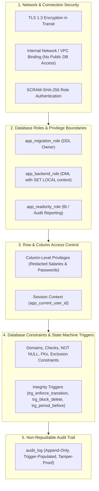
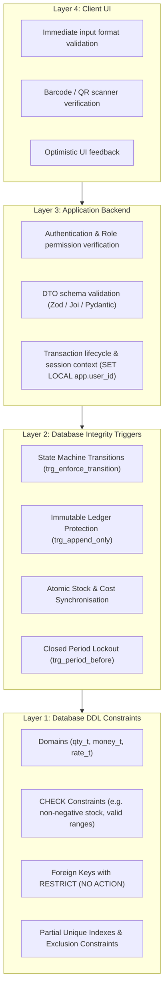
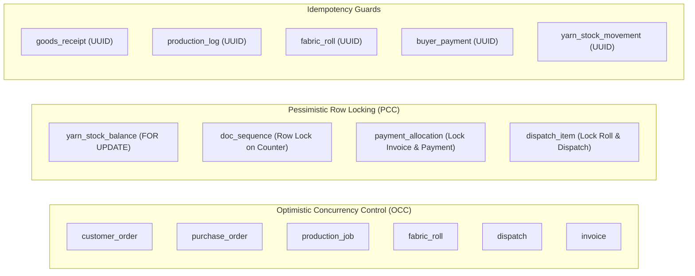
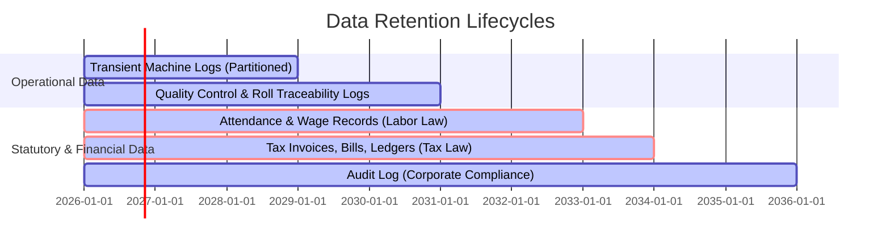
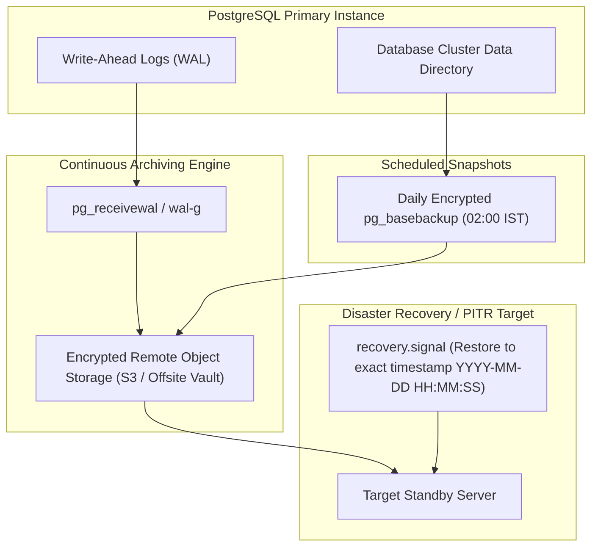

# 07 — Data Integrity and Security

**Project:** Textile Manufacturing System — Everest Textile Mills  
**Database:** PostgreSQL 15+ (single instance, schema `public`)  
**Depends on:** `01-requirements-analysis.md` (FR-x.y, BR-x), `03-entity-relationship-design.md` (entities 1–46, invariants INV-1…INV-11), `04-database-schema.md` (DDL, triggers, SQLSTATEs BR001…BR011), `05-data-flow-and-transactions.md` (WF-1…WF-15), `06-query-and-index-strategy.md` (views, queries, indexes).  
**Scope:** Complete security architecture, database roles, RBAC permissions matrix, sensitive data protection & column-level security, multi-tier validation model, concurrency safeguards, comprehensive audit logging implementation, lifecycle/retention rules, and enterprise disaster recovery (PITR/backup) plan.

---

## 1. Security and Integrity Architecture (Defense in Depth)

The security architecture of Everest Textile Mills enforces **defense in depth**. Integrity and access restrictions are guaranteed inside the PostgreSQL database engine, ensuring that no misconfigured API endpoint, buggy frontend, or compromised service can violate financial invariants, corrupt inventory balances, or expose payroll secrets.



---

## 2. Database Connection Roles & RBAC Architecture

### 2.1 Database Connection Roles (PostgreSQL Roles)

The application interacts with PostgreSQL through least-privilege service accounts:

```sql
-- ============================================================================
-- Migration 0010_security_roles.sql
-- Database Connection Roles and Base Privileges
-- ============================================================================

-- 1. Migration Role (Used strictly by CI/CD deployment pipelines for schema migrations)
CREATE ROLE app_migration_role WITH LOGIN PASSWORD 'USE_STRONG_SECRET_FROM_VAULT' NOINHERIT;

-- 2. Backend Application Role (Used by web application server pool)
CREATE ROLE app_backend_role WITH LOGIN PASSWORD 'USE_STRONG_SECRET_FROM_VAULT' NOINHERIT;

-- 3. Read-Only Analytics Role (Used for replica/reporting access)
CREATE ROLE app_readonly_role WITH LOGIN PASSWORD 'USE_STRONG_SECRET_FROM_VAULT' NOINHERIT;

-- ----------------------------------------------------------------------------
-- Base Table Privileges for app_backend_role
-- ----------------------------------------------------------------------------
GRANT USAGE ON SCHEMA public TO app_backend_role, app_readonly_role;
GRANT USAGE, SELECT ON ALL SEQUENCES IN SCHEMA public TO app_backend_role;

-- Grant SELECT on all tables and views
GRANT SELECT ON ALL TABLES IN SCHEMA public TO app_backend_role, app_readonly_role;

-- Grant INSERT on all operational tables and ledgers
GRANT INSERT ON 
    app_user, user_role, employee, supplier, buyer, unit_of_measure, yarn_type, colour,
    yarn_item, fabric_product, process_stage, machine, shift, defect_type,
    purchase_order, purchase_order_item, goods_receipt, goods_receipt_item,
    yarn_stock_movement, stock_alert, supplier_bill, supplier_bill_line,
    customer_order, order_item, order_status_history, order_material_requirement, yarn_reservation,
    production_job, production_log, machine_status_event,
    fabric_roll, qc_inspection, qc_defect, dispatch, dispatch_item,
    invoice, invoice_item, buyer_payment, payment_allocation,
    attendance_record, accounting_period, wage_record, cost_entry,
    doc_sequence
TO app_backend_role;

-- Grant UPDATE strictly on editable operational documents (INV-10: Ledgers are excluded)
GRANT UPDATE ON 
    app_user, employee, supplier, buyer, yarn_item, fabric_product, machine,
    customer_order, purchase_order, production_job, fabric_roll,
    dispatch, dispatch_item, invoice, stock_alert, yarn_reservation,
    attendance_record, wage_record, accounting_period, doc_sequence
TO app_backend_role;

-- Strictly REVOKE physical DELETE on all operational tables
REVOKE DELETE ON ALL TABLES IN SCHEMA public FROM app_backend_role, app_readonly_role;

-- Controlled carve-out: DELETE permitted only on unconfirmed draft line items
GRANT DELETE ON purchase_order_item, order_item, invoice_item TO app_backend_role;
```

---

### 2.2 Business Application Roles & Entity Permission Matrix

The business application roles defined in `role` table (`doc 04 §9`) map to business operations:

| Entity Category | Business Tables | Gate Store | Floor Operator | Prod. Manager | Quality Checker | Dispatch Staff | Sales Staff | Accounts Clerk | Mill Owner | Admin |
|---|---|---|---|---|---|---|---|---|---|---|
| **Access & Master** | `app_user`, `role`, `user_role` | — | — | — | — | — | — | — | R | CRUD |
| | `employee` (Public directory) | R | R | R | R | R | R | R | R | CRUD |
| | `employee` (`pay_rate` field) | — | — | — | — | — | — | R / U | R | CRUD |
| | `supplier`, `buyer`, `yarn_item`, `fabric_product`, `machine` | R | R | R / U | R | R | R / U | R / U | R | CRUD |
| **Raw Material** | `goods_receipt`, `goods_receipt_item` | CR | — | R | — | — | — | R | R | R |
| | `yarn_stock_movement` (Ledger) | C (Receipts) | — | C (Issues) | — | — | — | R | R | R |
| | `yarn_stock_balance` (Cache) | R | — | R | — | — | R | R | R | R |
| | `stock_alert` | R / U | — | R / U | — | — | — | R | R | R |
| | `supplier_bill`, `supplier_bill_line` | — | — | — | — | — | — | CRU | R | R |
| **Orders & Planning** | `customer_order`, `order_item` | — | — | R | — | R | CRU | R | R | R |
| | `order_material_requirement`, `yarn_reservation` | R | — | CRU | — | — | R | R | R | R |
| **Production Floor** | `production_job` | — | R | CRU | R | — | — | — | R | R |
| | `production_log` (Output Ledger) | — | CR | CR | — | — | — | — | R | R |
| | `machine_status_event` | — | CRU | CRU | — | — | — | — | R | R |
| **Quality Control** | `fabric_roll` | R (Shelf) | CR (Tags) | R | RU (QC) | RU (Load) | R | — | R | R |
| | `qc_inspection`, `qc_defect` | — | — | R | CR | — | — | — | R | R |
| **Dispatch & Sales** | `dispatch`, `dispatch_item` | — | — | — | — | CRU | R | R | R | R |
| | `invoice`, `invoice_item` | — | — | — | — | R | — | CRU | R | R |
| **Finance & HR** | `buyer_payment`, `payment_allocation` | — | — | — | — | — | — | CRU | R | R |
| | `attendance_record` | — | — | CRU | — | — | — | CRU | R | R |
| | `wage_record`, `accounting_period` | — | — | — | — | — | — | CRU | R | R |
| | `cost_entry` (Cost Ledger) | — | — | — | — | — | — | C (Direct) | R | R |
| **Audit & Views** | `audit_log` | — | — | — | — | — | — | — | R | R |
| | `v_monthly_pl`, `v_order_cost`, `v_roll_cost` | — | — | — | — | — | — | R | R | R |

*Key:* **C** = Create (INSERT), **R** = Read (SELECT), **U** = Update (Restricted/Optimistic), **D** = Delete (Draft lines only), **—** = Forbidden.

---

## 3. Data Protection & Column-Level Access Control

### 3.1 Sensitive Data Inventory

| Field | Sensitivity | Protection Requirement | Enforced Mechanism |
|---|---|---|---|
| `app_user.password_hash` | Critical Credential | Never exposed to application logs, API responses, or staff. | Hashed with Argon2id; excluded from general views. |
| `employee.pay_rate` | Highly Confidential | Accessible only by Accounts, Owner, and Admin. | Column-level GRANT + `v_employee_directory` redaction. |
| `wage_record.gross_amount` | Highly Confidential | Accessible only by Accounts, Owner, and Admin. | Column-level privilege restriction. |
| `buyer_payment.instrument_ref` | Financial Identifier | Bank cheque / UTR reference. | Accessible only by Accounts, Owner, Admin. |

### 3.2 Secure Password Hashing Policy
* **Algorithm:** **Argon2id** (RFC 9106) is mandatory for user password hashing.
* **Parameters:** Memory $m = 65536 \text{ KiB}$ (64 MiB), Time cost $t = 3$ iterations, Parallelism $p = 4$ threads.
* **Storage:** Stored in `app_user.password_hash` using standard PHC string format: `$argon2id$v=19$m=65536,t=3,p=4$<salt>$<hash>`.
* **Zero Plaintext Rule:** The database never accepts, processes, or logs plaintext passwords. Hashing is performed in backend memory before SQL query binding.

### 3.3 Redacted Employee Views & Column-Level SQL Grants

```sql
-- Create safe public directory view (accessible by all authenticated staff)
CREATE OR REPLACE VIEW v_employee_directory AS
SELECT 
    employee_id, employee_code, full_name, designation,
    pay_basis, is_active
FROM employee;

-- Restrict base employee table privileges
REVOKE SELECT ON employee FROM app_backend_role;
GRANT SELECT (employee_id, employee_code, full_name, designation, pay_basis, is_active, created_at, created_by, updated_at, updated_by) 
    ON employee TO app_backend_role;

-- Full salary access view granted only to privileged accounts session
CREATE OR REPLACE VIEW v_employee_payroll AS
SELECT 
    employee_id, employee_code, full_name, designation,
    pay_basis, pay_rate, is_active
FROM employee;
```

---

## 4. Multi-Tier Validation & Integrity Enforcement

Integrity enforcement is structured across 4 distinct layers:



### 4.1 Invariants (INV-1…INV-11) & Business Rules (BR-1…BR-11) Traceability Matrix

| ID | Invariant / Rule Description | Primary Enforcement Mechanism | Database Failure Code |
|---|---|---|---|
| **INV-1 / BR-1** | Stock balance = ledger sum; stock can never be negative. | `ck_balance_not_negative` on `yarn_stock_balance` + row-locking in `trg_movement_apply`. | `23514` (Check Violation) |
| **INV-2 / BR-7** | A roll can be on at most one active dispatch line (no double dispatch). | Partial unique index `uq_dispatch_item_one_active_roll` + `trg_dispatch_item_before`. | `23505` (Unique Violation) |
| **INV-3 / BR-3** | A machine has at most one running job and one open status event. | Partial unique indexes `uq_job_one_running_per_machine`, `uq_mse_one_open` + `ex_mse_no_overlap`. | `23505` / `23P01` |
| **INV-4** | Job machine and order item cannot change after job starts. | Trigger `trg_job_before` raising `BR003`. | `BR003` |
| **INV-5 / BR-6** | Only `in_stock` rolls that passed QC can be loaded onto a dispatch. | Trigger `trg_dispatch_item_before` row-locking `fabric_roll`. | `BR009` |
| **INV-6** | Payment allocations cannot exceed payment amount or invoice total. | Trigger `trg_alloc_before` with row locks on payment and invoice. | `BR008` |
| **INV-7 / BR-9** | Each cost entry has exactly one valid source and links to an order where required. | Check constraints `ck_cost_source` and `ck_cost_material_has_order`. | `23514` |
| **INV-8** | QC inspection and roll status change must succeed atomically. | Trigger `trg_qc_before` executing inside same transaction. | `BR002` |
| **INV-9** | Reserved yarn quantity cannot exceed on-hand stock. | Constraint `ck_reserved_within_on_hand` + `trg_reservation_apply`. | `23514` |
| **INV-10 / BR-10** | Ledgers (`yarn_stock_movement`, `production_log`, `cost_entry`) are append-only. | Triggers `trg_append_only`, `trg_block_delete`, `trg_no_truncate` + revoked DML. | `BR001` |
| **INV-11** | Closed accounting periods reject any new cost, wage, attendance, or invoice postings. | Trigger `trg_period_before`, function `period_for` raising `BR004`. | `BR004` |

---

## 5. Concurrency Control & Isolation Architecture

### 5.1 Concurrency Safeguards by Workflow



### 5.2 Optimistic Concurrency Control (OCC) Pattern
All editable documents carry an integer `version` column.
```sql
-- Application issues update verifying version
UPDATE customer_order 
SET promised_delivery_date = $2, status = $3
WHERE order_id = $1 AND version = $4;

-- If rows_affected == 0:
-- The application raises a 409 Conflict exception to the user:
-- "Record has been modified by another user. Reloading fresh data."
```

### 5.3 Deterministic Row-Lock Ordering (Deadlock Prevention)
To eliminate deadlocks under high concurrency, all transactions acquire locks in strict global order:
1. `dispatch` (by `dispatch_id` ASC)
2. `fabric_roll` (by `roll_id` ASC)
3. `production_job` (by `job_id` ASC)
4. `yarn_stock_balance` (by `yarn_item_id` ASC)
5. `buyer_payment` (by `payment_id` ASC), then `invoice` (by `invoice_id` ASC)
6. `doc_sequence` (by `series`, `fiscal_year`)

All application sessions execute with `SET LOCAL lock_timeout = '5s'`. If lock acquisition exceeds 5 seconds, PostgreSQL aborts the transaction with SQLSTATE `55P03` (`lock_not_available`), preventing connection pool starvation.

---

## 6. Comprehensive Audit Trail & Non-Repudiation

### 6.1 Audit Logging Trigger Implementation

The `audit_log` table captures full before/after state diffs in `jsonb` format for all sensitive master and financial operations.

```sql
-- ============================================================================
-- Migration 0011_audit_triggers.sql
-- Non-Repudiable Automated Audit Logging System
-- ============================================================================

CREATE OR REPLACE FUNCTION trg_audit() RETURNS trigger
LANGUAGE plpgsql SECURITY DEFINER AS $$
DECLARE
    v_actor_id bigint;
    v_entity_id text;
    v_before jsonb := NULL;
    v_after jsonb := NULL;
    v_reason text;
    v_source text;
BEGIN
    v_actor_id := app_current_user_id();
    IF v_actor_id IS NULL THEN
        -- Fallback to system user if running outside standard app session
        SELECT user_id INTO v_actor_id FROM app_user WHERE username = 'system';
    END IF;

    v_reason := NULLIF(current_setting('app.reason', true), '');
    v_source := NULLIF(current_setting('app.source', true), '');

    IF TG_OP = 'INSERT' THEN
        v_after := to_jsonb(NEW);
        -- Redact confidential hashes from audit payload
        IF TG_TABLE_NAME = 'app_user' THEN
            v_after := v_after - 'password_hash';
        END IF;
        EXECUTE format('SELECT ($1).%I::text', TG_ARGV[0]) INTO v_entity_id USING NEW;

    ELSIF TG_OP = 'UPDATE' THEN
        v_before := to_jsonb(OLD);
        v_after := to_jsonb(NEW);
        IF TG_TABLE_NAME = 'app_user' THEN
            v_before := v_before - 'password_hash';
            v_after := v_after - 'password_hash';
        END IF;
        EXECUTE format('SELECT ($1).%I::text', TG_ARGV[0]) INTO v_entity_id USING NEW;

    ELSIF TG_OP = 'DELETE' THEN
        v_before := to_jsonb(OLD);
        IF TG_TABLE_NAME = 'app_user' THEN
            v_before := v_before - 'password_hash';
        END IF;
        EXECUTE format('SELECT ($1).%I::text', TG_ARGV[0]) INTO v_entity_id USING OLD;
    END IF;

    INSERT INTO audit_log (actor_id, action, entity_name, entity_id, before_data, after_data, reason, source)
    VALUES (v_actor_id, TG_OP, TG_TABLE_NAME, v_entity_id, v_before, v_after, v_reason, v_source);

    RETURN CASE WHEN TG_OP = 'DELETE' THEN OLD ELSE NEW END;
END $$;

-- ----------------------------------------------------------------------------
-- Attach Audit Triggers to Sensitive Tables
-- ----------------------------------------------------------------------------
CREATE TRIGGER trg_audit_app_user AFTER INSERT OR UPDATE OR DELETE ON app_user
    FOR EACH ROW EXECUTE FUNCTION trg_audit('user_id');

CREATE TRIGGER trg_audit_user_role AFTER INSERT OR UPDATE OR DELETE ON user_role
    FOR EACH ROW EXECUTE FUNCTION trg_audit('user_id');

CREATE TRIGGER trg_audit_employee AFTER INSERT OR UPDATE OR DELETE ON employee
    FOR EACH ROW EXECUTE FUNCTION trg_audit('employee_id');

CREATE TRIGGER trg_audit_customer_order AFTER UPDATE OR DELETE ON customer_order
    FOR EACH ROW EXECUTE FUNCTION trg_audit('order_id');

CREATE TRIGGER trg_audit_supplier_bill AFTER UPDATE OR DELETE ON supplier_bill
    FOR EACH ROW EXECUTE FUNCTION trg_audit('bill_id');

CREATE TRIGGER trg_audit_buyer_payment AFTER UPDATE OR DELETE ON buyer_payment
    FOR EACH ROW EXECUTE FUNCTION trg_audit('payment_id');

CREATE TRIGGER trg_audit_wage_record AFTER INSERT OR UPDATE OR DELETE ON wage_record
    FOR EACH ROW EXECUTE FUNCTION trg_audit('wage_id');

CREATE TRIGGER trg_audit_accounting_period AFTER UPDATE OR DELETE ON accounting_period
    FOR EACH ROW EXECUTE FUNCTION trg_audit('period_id');
```

### 6.2 Tamper-Proofing the Audit Log
* Privileges: `REVOKE UPDATE, DELETE, TRUNCATE ON audit_log FROM PUBLIC, app_backend_role, app_readonly_role;`
* The table is append-only and written strictly by the `SECURITY DEFINER` function `trg_audit`.

---

## 7. Lifecycle, Deactivation & Data Retention Policies

### 7.1 Entity Lifecycle Matrix (No Physical Deletes)

| Entity | Action When Removed | Lifecycle State Change | Side Effects |
|---|---|---|---|
| Master Record (`supplier`, `buyer`, `yarn_item`, `machine`, `employee`) | Deactivate | `is_active = false` | Excluded from active drop-downs; existing foreign keys remain intact. |
| Customer Order | Cancel | `status: confirmed → cancelled` | Requires cancellation reason; blocked if production or dispatch is underway. |
| Goods Receipt | Cancel | `status: received → cancelled` | Posts compensating negative reversal in `yarn_stock_movement`. |
| Fabric Roll | Scrap | `status: rejected → scrapped` | Permanently removed from dispatchable shelf stock. |
| Invoice | Void | `status: issued → void` | Requires void reason; releases linked dispatch and reverses buyer ledger debit. |
| Buyer Payment | Reverse | `status: recorded → reversed` | Requires reason; unallocates payment links and removes credit balance. |
| Wage Record | Reverse | `status: approved → reversed` | Posts offsetting negative cost entry in `cost_entry`. |

### 7.2 Legal & Compliance Data Retention Schedule



1. **Tax Invoices, Bills & Financial Ledgers:** 8 Years retention in live database / online archives (statutory compliance under tax laws).
2. **Attendance & Wage Records:** 7 Years retention (compliance with labor laws).
3. **QC Inspections & Roll Traceability Logs:** 5 Years retention (supports long-term defect and customer dispute inquiries).
4. **Machine Status Events & Production Logs:** 3 Years in hot transactional storage, after which older partitions may be moved to cold compressed table spaces.

---

## 8. Backup, Disaster Recovery & High Availability Plan

### 8.1 Service Level Agreements (SLAs)
* **Recovery Point Objective (RPO):** **$< 5\text{ minutes}$** (Maximum allowable data loss in a catastrophic plant failure).
* **Recovery Time Objective (RTO):** **$< 1\text{ hour}$** (Time required to restore full transactional database operations).

### 8.2 Backup Architecture & PostgreSQL Point-In-Time Recovery (PITR)



### 8.3 Disaster Recovery Configuration & Execution Procedures

#### Configuration in `postgresql.conf`:
```ini
wal_level = replica
archive_mode = on
archive_command = 'test ! -f /var/lib/postgresql/wal_archive/%f && cp %p /var/lib/postgresql/wal_archive/%f'
archive_timeout = 300       # Force WAL switch every 5 minutes to guarantee RPO <= 5 min
```

#### Daily Automated Backup Routine (Cron Script at 02:00 IST):
```bash
#!/bin/bash
# automated_daily_backup.sh
BACKUP_DATE=$(date +%Y%m%d_%H%M%S)
BACKUP_DIR="/mnt/secure_backups/everest_textile"

# 1. Take physical base backup with WAL inclusion
pg_basebackup -h localhost -U backup_user -D "$BACKUP_DIR/base_$BACKUP_DATE" -Ft -z -Xs -P

# 2. Encrypt base backup with AES-256 GPG key
gpg --encrypt --recipient "security@everesttextile.com" "$BACKUP_DIR/base_$BACKUP_DATE.tar.gz"

# 3. Synchronize encrypted backup to off-site cloud bucket
aws s3 sync "$BACKUP_DIR/" s3://everest-textile-db-backups/base_backups/ --sse AES256

# 4. Prune local backups older than 14 days
find "$BACKUP_DIR" -type f -mtime +14 -delete
```

#### Point-In-Time Recovery (PITR) Execution Procedure (In Case of Corruption / Hardware Loss):
1. Stop the PostgreSQL instance: `systemctl stop postgresql`.
2. Clear the damaged PostgreSQL data directory: `rm -rf /var/lib/postgresql/15/main/*`.
3. Extract the latest physical base backup archive into `/var/lib/postgresql/15/main/`.
4. Create the signal file: `touch /var/lib/postgresql/15/main/recovery.signal`.
5. Append restore configuration to `postgresql.conf`:
   ```ini
   restore_command = 'cp /mnt/secure_backups/wal_archive/%f %p'
   recovery_target_time = '2026-10-10 14:15:00 IST'
   recovery_target_action = 'promote'
   ```
6. Start PostgreSQL: `systemctl start postgresql`.
7. PostgreSQL automatically replays WAL archives up to the exact target second and promotes itself to read-write primary.
8. Execute health verification check: `SELECT * FROM v_recon_stock_balance_vs_ledger;`.
