# Everest Textile Manufacturing System (TMS)
## Complete Database Tables, Workflow Architecture & Entity-Relationship Specifications

This document provides a comprehensive reference of all 46 database tables supporting the Everest Textile Manufacturing System, divided into three structured sections:
1. **Exhaustive Table-by-Table Data Dictionary**: Detailed list of all tables, purposes, keys, constraints, and column attributes.
2. **Workflow Solo Connection Diagram**: High-level structural flow connecting every table by title according to mill operational sequences.
3. **Multi-Attribute Entity-Relationship Diagram (ERD)**: Complete relational diagram containing all tables, primary keys, foreign keys, and attribute definitions with exact cardinality.

---

# SECTION 1: Exhaustive Listing of All Database Tables One-by-One

---

### Group 1: Access Control, Authentication & Workforce Master

#### 1. `role` (Master Reference)
* **Purpose**: Defines system-wide business roles and permissions for role-based access control (RBAC).
* **Primary Key**: `role_id` (INT)
* **Unique Keys**: `role_name` (VARCHAR)
* **Columns**:
  - `role_id` (`INT`, PK): Unique role identifier.
  - `role_name` (`VARCHAR(50)`, UK): Role code (`admin`, `owner`, `accounts`, `production_manager`, `operator`, `quality_checker`, `gate_store`, `dispatch`, `sales`, `staff_readonly`).
  - `description` (`TEXT`): Human-readable scope and duties description.
  - `created_at` (`TIMESTAMPTZ`): Record creation timestamp.

#### 2. `app_user` (Master Reference)
* **Purpose**: Application login accounts authenticated via Argon2id password hashes and JWT sessions.
* **Primary Key**: `user_id` (INT)
* **Foreign Keys**: `employee_id` → `employee(employee_id)` (Nullable)
* **Unique Keys**: `lower(username)` (VARCHAR)
* **Columns**:
  - `user_id` (`INT`, PK): Unique login account identifier.
  - `username` (`VARCHAR(50)`, UK): Case-insensitive unique username.
  - `password_hash` (`TEXT`): Argon2id RFC 9106 cryptographic hash.
  - `employee_id` (`INT`, FK, Optional): Associated staff/employee profile.
  - `is_active` (`BOOLEAN`): Account active status flag.
  - `last_login_at` (`TIMESTAMPTZ`): Timestamp of most recent authentication.
  - `created_at` (`TIMESTAMPTZ`): Record creation timestamp.

#### 3. `user_role` (Master Junction)
* **Purpose**: Many-to-many relationship mapping users to their granted business roles.
* **Primary Key**: Composite (`user_id`, `role_id`)
* **Foreign Keys**:
  - `user_id` → `app_user(user_id)` (ON DELETE CASCADE)
  - `role_id` → `role(role_id)` (ON DELETE RESTRICT)
* **Columns**:
  - `user_id` (`INT`, PK, FK): User account reference.
  - `role_id` (`INT`, PK, FK): Granted role reference.
  - `granted_at` (`TIMESTAMPTZ`): Timestamp when role was assigned.
  - `granted_by` (`INT`, FK): Admin user who granted the role.

#### 4. `employee` (Master Entity)
* **Purpose**: Physical mill workers, loom operators, inspectors, supervisors, and administrative personnel.
* **Primary Key**: `employee_id` (INT)
* **Unique Keys**: `employee_code` (VARCHAR)
* **Columns**:
  - `employee_id` (`INT`, PK): Internal employee identifier.
  - `employee_code` (`VARCHAR(20)`, UK): Physical badge / payroll identifier (e.g. `EMP-0401`).
  - `full_name` (`VARCHAR(100)`): Worker legal full name.
  - `designation` (`VARCHAR(50)`): Organizational position/title.
  - `pay_basis` (`VARCHAR(20)`): Remuneration mode (`monthly`, `daily`, `piece_rate`).
  - `pay_rate` (`NUMERIC(12,2)`): Rate per unit/day/month (Restricted Access).
  - `phone` (`VARCHAR(20)`): Contact telephone number.
  - `is_active` (`BOOLEAN`): Active employment status.
  - `created_at` (`TIMESTAMPTZ`): Record creation timestamp.

---

### Group 2: Industrial Master Data & Catalogues

#### 5. `supplier` (Master Entity)
* **Purpose**: Registered yarn spinning mills and raw material vendors.
* **Primary Key**: `supplier_id` (INT)
* **Unique Keys**: `supplier_code` (VARCHAR)
* **Columns**:
  - `supplier_id` (`INT`, PK): Unique supplier identifier.
  - `supplier_code` (`VARCHAR(20)`, UK): Unique vendor code (e.g. `SUP-VARD`).
  - `name` (`VARCHAR(150)`): Legal entity trade name.
  - `gstin` (`VARCHAR(15)`): Indian Goods and Services Tax Identification Number.
  - `contact_person` (`VARCHAR(100)`): Primary commercial contact.
  - `phone` (`VARCHAR(20)`): Contact phone number.
  - `address` (`TEXT`): Mill physical address.
  - `is_active` (`BOOLEAN`): Active procurement status.

#### 6. `buyer` (Master Entity)
* **Purpose**: Apparel manufacturers, export houses, and garment buying entities.
* **Primary Key**: `buyer_id` (INT)
* **Unique Keys**: `buyer_code` (VARCHAR)
* **Columns**:
  - `buyer_id` (`INT`, PK): Unique customer identifier.
  - `buyer_code` (`VARCHAR(20)`, UK): Unique customer reference (e.g. `BUY-RAYMOND`).
  - `name` (`VARCHAR(150)`): Registered company business name.
  - `gstin` (`VARCHAR(15)`): 15-digit GSTIN tax number.
  - `contact_person` (`VARCHAR(100)`): Account manager contact.
  - `phone` (`VARCHAR(20)`): Phone number for phone tracking desk.
  - `credit_limit` (`NUMERIC(14,2)`): Approved credit allowance.
  - `payment_terms_days` (`INT`): Standard credit duration in days (e.g. 30).
  - `is_active` (`BOOLEAN`): Account ordering eligibility.

#### 7. `unit_of_measure` (Master Reference)
* **Purpose**: Standardized engineering and commercial measurement units.
* **Primary Key**: `unit_id` (INT)
* **Unique Keys**: `unit_code` (VARCHAR)
* **Columns**:
  - `unit_id` (`INT`, PK): Internal unit identifier.
  - `unit_code` (`VARCHAR(10)`, UK): Standard symbol (`kg`, `m`, `pcs`).
  - `description` (`VARCHAR(50)`): Unit explanation (e.g. `Kilogram`, `Metre`).

#### 8. `yarn_type` (Master Specification)
* **Purpose**: Fiber construction and yarn counts (e.g., 30s Ne Combed Cotton, 150D Polyester).
* **Primary Key**: `yarn_type_id` (INT)
* **Unique Keys**: `name` (VARCHAR)
* **Columns**:
  - `yarn_type_id` (`INT`, PK): Unique yarn type identifier.
  - `name` (`VARCHAR(100)`, UK): Technical specification label.
  - `fiber_content` (`VARCHAR(100)`): Material composition (e.g. `100% Cotton`, `65/35 Poly-Viscose`).
  - `nominal_count` (`VARCHAR(50)`): Standard count / denier measurement.
  - `description` (`TEXT`): Technical notes.

#### 9. `colour` (Master Reference)
* **Purpose**: Standard mill shade codes and dye formulations for yarn and finished fabric.
* **Primary Key**: `colour_id` (INT)
* **Unique Keys**: `colour_code` (VARCHAR)
* **Columns**:
  - `colour_id` (`INT`, PK): Unique colour identifier.
  - `colour_code` (`VARCHAR(30)`, UK): Standard shade identifier (e.g. `OPT-WHITE-01`, `NAVY-02`).
  - `name` (`VARCHAR(100)`): Common shade name.
  - `pantone_ref` (`VARCHAR(50)`): Pantone shade reference.

#### 10. `yarn_item` (Master Stockable SKU)
* **Purpose**: The stockable raw material inventory unit representing a unique `yarn_type × colour` combination.
* **Primary Key**: `yarn_item_id` (INT)
* **Foreign Keys**:
  - `yarn_type_id` → `yarn_type(yarn_type_id)`
  - `colour_id` → `colour(colour_id)`
  - `unit_id` → `unit_of_measure(unit_id)`
* **Unique Keys**: Composite (`yarn_type_id`, `colour_id`)
* **Columns**:
  - `yarn_item_id` (`INT`, PK): Unique stockable SKU identifier.
  - `yarn_type_id` (`INT`, FK): Associated yarn specification.
  - `colour_id` (`INT`, FK): Associated shade/colour.
  - `unit_id` (`INT`, FK): Inventory measurement unit (typically `kg`).
  - `reorder_level` (`NUMERIC(12,3)`): Minimum safe inventory threshold triggering alert.
  - `is_active` (`BOOLEAN`): SKU procurement active status.

#### 11. `fabric_product` (Master Catalogue)
* **Purpose**: Finished fabric products ordered by customers (e.g., Greige Twill, Poplin).
* **Primary Key`**: `product_id` (INT)
* **Foreign Keys**: `unit_id` → `unit_of_measure(unit_id)`
* **Unique Keys**: `product_code` (VARCHAR)
* **Columns**:
  - `product_id` (`INT`, PK): Unique fabric product identifier.
  - `product_code` (`VARCHAR(30)`, UK): Catalog item code.
  - `name` (`VARCHAR(150)`): Commercial trade name.
  - `weave_type` (`VARCHAR(50)`): Plain, Twill, Satin, Oxford, Jacquard.
  - `nominal_gsm` (`NUMERIC(6,2)`): Grams per square meter.
  - `nominal_width_inches` (`NUMERIC(5,2)`): Usable fabric width.
  - `unit_id` (`INT`, FK): Trading unit (typically `m`).

#### 12. `process_stage` (Master Reference)
* **Purpose**: Distinct sequential stages in the mill manufacturing pipeline.
* **Primary Key**: `stage_id` (INT)
* **Unique Keys**: `name` (VARCHAR), `sequence_hint` (INT)
* **Columns**:
  - `stage_id` (`INT`, PK): Unique stage identifier.
  - `name` (`VARCHAR(50)`, UK): Stage label (`spinning`, `weaving`, `dyeing`, `finishing`).
  - `sequence_hint` (`INT`, UK): Ordering index in factory route.

#### 13. `machine` (Master Hardware Entity)
* **Purpose**: Physical shop-floor machines (e.g., Picanol Rapier Looms, Rieter Ring Frames).
* **Primary Key**: `machine_id` (INT)
* **Foreign Keys**: `stage_id` → `process_stage(stage_id)`
* **Unique Keys**: `machine_code` (VARCHAR)
* **Columns**:
  - `machine_id` (`INT`, PK): Unique machine identifier.
  - `machine_code` (`VARCHAR(30)`, UK): Physical machine plate code (e.g. `LOOM-04`).
  - `stage_id` (`INT`, FK): Production stage capable of execution.
  - `make_model` (`VARCHAR(100)`): Manufacturer and technical specification.
  - `rated_rpm` (`INT`): Optimal rated operating speed.
  - `is_active` (`BOOLEAN`): Machine operational commissioning flag.

#### 14. `shift` (Master Reference)
* **Purpose**: Factory shift definitions governing machine runs, output logs, and attendance.
* **Primary Key**: `shift_id` (INT)
* **Unique Keys**: `name` (VARCHAR)
* **Columns**:
  - `shift_id` (`INT`, PK): Unique shift identifier.
  - `name` (`VARCHAR(50)`, UK): Shift title (`Shift A (Day)`, `Shift B (Evening)`, `Shift C (Night)`).
  - `starts_at` (`TIME`): Shift commencement time (e.g. `07:00:00`).
  - `ends_at` (`TIME`): Shift conclusion time (e.g. `15:30:00`).

#### 15. `defect_type` (Master Quality Catalogue)
* **Purpose**: Standardized defect taxonomy under ASTM 4-point inspection system.
* **Primary Key**: `defect_type_id` (INT)
* **Unique Keys**: `name` (VARCHAR)
* **Columns**:
  - `defect_type_id` (`INT`, PK): Unique defect classification identifier.
  - `name` (`VARCHAR(100)`, UK): Defect name (`Broken Pick`, `Oil Spot`, `Slub`, `Reed Mark`).
  - `default_penalty_points` (`INT`): Default ASTM penalty point valuation (1–4).
  - `category` (`VARCHAR(50)`): Defect origin category (`yarn`, `weaving`, `dyeing`, `handling`).

---

### Group 3: Raw Material Procurement, Inward & Stock Ledger (W1)

#### 16. `purchase_order` (Transaction Header)
* **Purpose**: Formal purchase orders issued to yarn spinning mills.
* **Primary Key**: `po_id` (INT)
* **Foreign Keys**: `supplier_id` → `supplier(supplier_id)`
* **Unique Keys**: `po_no` (VARCHAR)
* **Columns**:
  - `po_id` (`INT`, PK): Unique purchase order identifier.
  - `po_no` (`VARCHAR(30)`, UK): Document tracking number (e.g. `PO-2026-0041`).
  - `supplier_id` (`INT`, FK): Receiving yarn supplier.
  - `order_date` (`DATE`): PO authorization date.
  - `expected_delivery_date` (`DATE`): Agreed arrival deadline.
  - `status` (`VARCHAR(20)`): State machine: `draft` → `sent` → `partially_received` → `closed` → `cancelled`.
  - `total_amount` (`NUMERIC(14,2)`): Total monetary commitment.
  - `created_by` (`INT`, FK): Authorizing user.

#### 17. `purchase_order_item` (Transaction Line)
* **Purpose**: Individual yarn items and target quantities on a purchase order.
* **Primary Key**: `po_item_id` (INT)
* **Foreign Keys**:
  - `po_id` → `purchase_order(po_id)`
  - `yarn_item_id` → `yarn_item(yarn_item_id)`
* **Columns**:
  - `po_item_id` (`INT`, PK): Unique PO item line identifier.
  - `po_id` (`INT`, FK): Parent purchase order header.
  - `yarn_item_id` (`INT`, FK): Specific yarn SKU ordered.
  - `quantity` (`NUMERIC(12,3)`): Target quantity ordered (kg).
  - `agreed_rate` (`NUMERIC(12,2)`): Agreed purchase price per kg.
  - `line_total` (`NUMERIC(14,2)`): Calculated value.

#### 18. `goods_receipt` (Transaction Header / Gate Inward)
* **Purpose**: Physical truck arrival record created at mill security gate for raw yarn.
* **Primary Key**: `receipt_id` (INT)
* **Foreign Keys**:
  - `supplier_id` → `supplier(supplier_id)`
  - `po_id` → `purchase_order(po_id)` (Optional)
  - `received_by` → `app_user(user_id)`
* **Unique Keys**: `receipt_no` (VARCHAR), `client_request_id` (UUID - Idempotency Guard)
* **Columns**:
  - `receipt_id` (`INT`, PK): Unique goods receipt identifier.
  - `receipt_no` (`VARCHAR(30)`, UK): GRN number (e.g. `GRN-2026-0089`).
  - `supplier_id` (`INT`, FK): Delivering supplier.
  - `po_id` (`INT`, FK, Optional): Linked purchase order.
  - `supplier_challan_no` (`VARCHAR(50)`): Physical delivery challan/docket number.
  - `vehicle_number` (`VARCHAR(20)`): Transport truck registration.
  - `received_at` (`TIMESTAMPTZ`): Gate inward timestamp.
  - `received_by` (`INT`, FK): Receiving gate storekeeper.
  - `client_request_id` (`UUID`, UK): Idempotent submission token preventing duplicate gate logs.
  - `status` (`VARCHAR(20)`): `received`, `cancelled`.

#### 19. `goods_receipt_item` (Transaction Line / Yarn Lot)
* **Purpose**: Distinct received yarn lot carrying barcode tag, net weight, and customer earmarks.
* **Primary Key**: `receipt_item_id` (INT)
* **Foreign Keys**:
  - `receipt_id` → `goods_receipt(receipt_id)`
  - `yarn_item_id` → `yarn_item(yarn_item_id)`
  - `earmarked_order_id` → `customer_order(order_id)` (Optional)
* **Unique Keys**: `lot_code` (VARCHAR)
* **Columns**:
  - `receipt_item_id` (`INT`, PK): Unique receipt line identifier.
  - `receipt_id` (`INT`, FK): Parent GRN header.
  - `yarn_item_id` (`INT`, FK): Specific yarn SKU received.
  - `lot_code` (`VARCHAR(50)`, UK): Unique lot identifier (e.g. `LOT-COT-2026-08`).
  - `quantity_received` (`NUMERIC(12,3)`): Net weight in kg.
  - `earmarked_order_id` (`INT`, FK, Optional): Customer order pre-assigned to this lot.
  - `storage_location` (`VARCHAR(50)`): Warehouse bin/rack location.

#### 20. `yarn_stock_movement` (Append-Only Inventory Ledger)
* **Purpose**: Single source of truth for all raw yarn material inventory additions and subtractions.
* **Primary Key**: `movement_id` (INT)
* **Foreign Keys**:
  - `yarn_item_id` → `yarn_item(yarn_item_id)`
  - `receipt_item_id` → `goods_receipt_item(receipt_item_id)` (Optional)
  - `production_job_id` → `production_job(job_id)` (Optional)
  - `reverses_movement_id` → `yarn_stock_movement(movement_id)` (Optional)
  - `created_by` → `app_user(user_id)`
* **Columns**:
  - `movement_id` (`INT`, PK): Ledger entry serial number.
  - `yarn_item_id` (`INT`, FK): Yarn SKU impacted.
  - `movement_type` (`VARCHAR(20)`): `receipt` (+), `issue` (-), `return` (+), `adjustment` (+/-), `reversal`.
  - `quantity` (`NUMERIC(12,3)`): Signed quantity delta in kg.
  - `unit_cost` (`NUMERIC(12,2)`): Historical valuation snapshot for FIFO/weighted average.
  - `receipt_item_id` (`INT`, FK, Optional): Associated lot for receipts.
  - `production_job_id` (`INT`, FK, Optional): Associated loom job for material issues.
  - `reverses_movement_id` (`INT`, FK, Optional): Corrected ledger entry.
  - `reason` (`VARCHAR(255)`): Audit justification (mandatory for adjustments).
  - `occurred_at` (`TIMESTAMPTZ`): Exact event timestamp.
  - `created_by` (`INT`, FK): User executing the transaction.

#### 21. `yarn_stock_balance` (Materialized State Cache)
* **Purpose**: High-speed materialized read cache of current on-hand and reserved yarn stock balances.
* **Primary Key**: `yarn_item_id` (INT)
* **Foreign Keys**: `yarn_item_id` → `yarn_item(yarn_item_id)`
* **Columns**:
  - `yarn_item_id` (`INT`, PK, FK): Yarn SKU.
  - `on_hand_qty` (`NUMERIC(12,3)`): Total physical warehouse stock (sum of ledger).
  - `reserved_qty` (`NUMERIC(12,3)`): Quantity committed to active customer orders.
  - `available_qty` (`NUMERIC(12,3)`): Computable available balance (`on_hand - reserved`).
  - `refreshed_at` (`TIMESTAMPTZ`): Cache synchronization timestamp.

#### 22. `stock_alert` (Operational Transaction)
* **Purpose**: Automated notifications generated when yarn inventory breaches `reorder_level`.
* **Primary Key**: `alert_id` (INT)
* **Foreign Keys**:
  - `yarn_item_id` → `yarn_item(yarn_item_id)`
  - `acknowledged_by` → `app_user(user_id)` (Optional)
* **Columns**:
  - `alert_id` (`INT`, PK): Unique alert identifier.
  - `yarn_item_id` (`INT`, FK): Breached yarn item.
  - `status` (`VARCHAR(20)`): `open` → `acknowledged` → `resolved`.
  - `balance_at_trigger` (`NUMERIC(12,3)`): Recorded available stock when breached.
  - `opened_at` (`TIMESTAMPTZ`): Trigger timestamp.
  - `acknowledged_by` (`INT`, FK, Optional): Purchase manager acknowledging alert.
  - `acknowledged_at` (`TIMESTAMPTZ`): Acknowledgment timestamp.
  - `resolved_at` (`TIMESTAMPTZ`): Resolved timestamp upon receipt of fresh PO.

#### 23. `supplier_bill` (Accounts Payable Header)
* **Purpose**: Formal tax invoice received from raw yarn supplier.
* **Primary Key**: `bill_id` (INT)
* **Foreign Keys**: `supplier_id` → `supplier(supplier_id)`
* **Columns**:
  - `bill_id` (`INT`, PK): Unique voucher identifier.
  - `supplier_bill_no` (`VARCHAR(50)`): Vendor's physical bill number.
  - `supplier_id` (`INT`, FK): Billing supplier.
  - `bill_date` (`DATE`): Vendor invoice date.
  - `due_date` (`DATE`): Commercial payment due date.
  - `subtotal` (`NUMERIC(14,2)`): Net taxable purchase value.
  - `tax_amount` (`NUMERIC(14,2)`): Input GST tax amount.
  - `total_amount` (`NUMERIC(14,2)`): Grand invoice payable total.
  - `status` (`VARCHAR(20)`): `pending_approval`, `approved`, `paid`, `void`.
  - `created_at` (`TIMESTAMPTZ`): Voucher creation timestamp.

#### 24. `supplier_bill_line` (Accounts Payable Line)
* **Purpose**: Line items on supplier bills matched against physical `goods_receipt_item` lots.
* **Primary Key**: `bill_line_id` (INT)
* **Foreign Keys**:
  - `bill_id` → `supplier_bill(bill_id)`
  - `receipt_item_id` → `goods_receipt_item(receipt_item_id)`
* **Columns**:
  - `bill_line_id` (`INT`, PK): Unique bill item identifier.
  - `bill_id` (`INT`, FK): Parent supplier bill voucher.
  - `receipt_item_id` (`INT`, FK): Matched physical yarn lot from GRN.
  - `billed_qty` (`NUMERIC(12,3)`): Quantity billed by supplier (kg).
  - `rate` (`NUMERIC(12,2)`): Final agreed rate per kg.
  - `amount` (`NUMERIC(14,2)`): Line item taxable amount.

---

### Group 4: Customer Orders & Material Feasibility Planning (W4)

#### 25. `customer_order` (Sales Order Header)
* **Purpose**: Commercial contracts placed by buyers for fabric manufacturing.
* **Primary Key**: `order_id` (INT)
* **Foreign Keys**:
  - `buyer_id` → `buyer(buyer_id)`
  - `created_by` → `app_user(user_id)`
* **Unique Keys**: `order_no` (VARCHAR)
* **Columns**:
  - `order_id` (`INT`, PK): Unique order identifier.
  - `order_no` (`VARCHAR(30)`, UK): Customer order number (e.g. `ORD-2026-001`).
  - `buyer_id` (`INT`, FK): Purchasing buyer entity.
  - `order_date` (`DATE`): Contract confirmation date.
  - `promised_delivery_date` (`DATE`): Guaranteed delivery date.
  - `status` (`VARCHAR(20)`): State machine: `draft` → `confirmed` → `in_production` → `ready_for_dispatch` → `dispatched` → `closed` → `cancelled`.
  - `version` (`INT`): Optimistic concurrency control lock.
  - `created_by` (`INT`, FK): Sales representative booking order.
  - `created_at` (`TIMESTAMPTZ`): Record creation timestamp.

#### 26. `order_item` (Sales Order Line)
* **Purpose**: Ordered fabric product, specified shade/colour, target meterage, and agreed rate.
* **Primary Key**: `order_item_id` (INT)
* **Foreign Keys**:
  - `order_id` → `customer_order(order_id)`
  - `product_id` → `fabric_product(product_id)`
  - `colour_id` → `colour(colour_id)`
  - `unit_id` → `unit_of_measure(unit_id)`
* **Columns**:
  - `order_item_id` (`INT`, PK): Unique order line identifier.
  - `order_id` (`INT`, FK): Parent order header.
  - `line_no` (`INT`): Position sequence in order.
  - `product_id` (`INT`, FK): Ordered fabric specification.
  - `colour_id` (`INT`, FK): Specified colour shade.
  - `ordered_qty` (`NUMERIC(12,2)`): Target length in meters.
  - `unit_id` (`INT`, FK): Unit reference (`m`).
  - `agreed_rate` (`NUMERIC(12,2)`): Contract price per meter.
  - `line_total` (`NUMERIC(14,2)`): Total line value.

#### 27. `order_status_history` (Audit Log Entity)
* **Purpose**: Immutable history of commercial status transitions for an order.
* **Primary Key**: `history_id` (INT)
* **Foreign Keys**:
  - `order_id` → `customer_order(order_id)`
  - `changed_by` → `app_user(user_id)`
* **Columns**:
  - `history_id` (`INT`, PK): Unique transition log identifier.
  - `order_id` (`INT`, FK): Target order.
  - `from_status` (`VARCHAR(20)`): Prior state.
  - `to_status` (`VARCHAR(20)`): New state.
  - `reason` (`VARCHAR(255)`): Transition rationale / trigger.
  - `changed_by` (`INT`, FK): User executing transition.
  - `changed_at` (`TIMESTAMPTZ`): Exact transition timestamp.

#### 28. `order_material_requirement` (BOM Explosion)
* **Purpose**: Bill of Materials (BOM) explosion defining exact yarn kg needed for each order item.
* **Primary Key**: `requirement_id` (INT)
* **Foreign Keys**:
  - `order_item_id` → `order_item(order_item_id)`
  - `yarn_item_id` → `yarn_item(yarn_item_id)`
* **Columns**:
  - `requirement_id` (`INT`, PK): Unique requirement identifier.
  - `order_item_id` (`INT`, FK): Order line consuming material.
  - `yarn_item_id` (`INT`, FK): Raw yarn item required.
  - `required_qty` (`NUMERIC(12,3)`): Total calculated yarn demand in kg.
  - `waste_factor_pct` (`NUMERIC(5,2)`): Loom process loss allowance (e.g. 3.5%).

#### 29. `yarn_reservation` (Material Allocation)
* **Purpose**: Soft/hard commitment of on-hand yarn stock to protect material from being stolen by other jobs.
* **Primary Key**: `reservation_id` (INT)
* **Foreign Keys**:
  - `requirement_id` → `order_material_requirement(requirement_id)`
* **Columns**:
  - `reservation_id` (`INT`, PK): Unique reservation identifier.
  - `requirement_id` (`INT`, FK): Linked material requirement.
  - `reserved_qty` (`NUMERIC(12,3)`): Quantity locked in kg.
  - `status` (`VARCHAR(20)`): `active` → `consumed` (issued to floor) → `released` (order cancelled).
  - `created_at` (`TIMESTAMPTZ`): Reservation timestamp.

---

### Group 5: Production Floor Execution & Machine Monitoring (W2)

#### 30. `production_job` (Floor Work Order Ticket)
* **Purpose**: Represents an order item being manufactured at a specific process stage on a specific machine.
* **Primary Key**: `job_id` (INT)
* **Foreign Keys**:
  - `order_item_id` → `order_item(order_item_id)`
  - `stage_id` → `process_stage(stage_id)`
  - `machine_id` → `machine(machine_id)`
* **Unique Keys**: `job_no` (VARCHAR)
* **Columns**:
  - `job_id` (`INT`, PK): Unique job ticket identifier.
  - `job_no` (`VARCHAR(30)`, UK): Shop floor job identifier (e.g. `JOB-902`).
  - `order_item_id` (`INT`, FK): Source customer order item.
  - `stage_id` (`INT`, FK): Active process stage (`spinning`, `weaving`, `dyeing`).
  - `machine_id` (`INT`, FK): Assigned physical machine (e.g. `LOOM-04`).
  - `planned_qty` (`NUMERIC(12,2)`): Target output meterage.
  - `status` (`VARCHAR(20)`): `planned` → `running` → `interrupted` → `completed` → `cancelled`.
  - `priority` (`VARCHAR(20)`): `Low`, `Medium`, `High`, `Urgent`.
  - `started_at` (`TIMESTAMPTZ`): Job start time on machine.
  - `ended_at` (`TIMESTAMPTZ`): Job completion time.
  - `version` (`INT`): Concurrency lock version.

#### 31. `production_log` (Append-Only Shift Output)
* **Purpose**: Touchscreen shift output records logged by loom operators at shift handovers.
* **Primary Key**: `log_id` (INT)
* **Foreign Keys**:
  - `job_id` → `production_job(job_id)`
  - `shift_id` → `shift(shift_id)`
  - `operator_id` → `employee(employee_id)`
* **Unique Keys**: `client_request_id` (UUID - Idempotent Kiosk Token)
* **Columns**:
  - `log_id` (`INT`, PK): Unique shift output log identifier.
  - `job_id` (`INT`, FK): Active production job running.
  - `shift_id` (`INT`, FK): Operating shift (`Shift A`, `Shift B`, `Shift C`).
  - `operator_id` (`INT`, FK): Machine master/operator on duty.
  - `output_qty` (`NUMERIC(12,2)`): Net fabric output produced (meters).
  - `scrap_qty` (`NUMERIC(12,2)`): Wastage / yarn scrap (kg).
  - `power_kwh` (`NUMERIC(10,2)`): Sub-meter energy consumed.
  - `logged_at` (`TIMESTAMPTZ`): Timestamp recorded.
  - `client_request_id` (`UUID`, UK): Kiosk transaction idempotency token.

#### 32. `machine_status_event` (Machine Telemetry & Downtime)
* **Purpose**: Tracks machine states (running, idle, breakdown, maintenance) and MTTR.
* **Primary Key**: `event_id` (INT)
* **Foreign Keys**:
  - `machine_id` → `machine(machine_id)`
  - `reported_by` → `employee(employee_id)`
  - `resolved_by` → `employee(employee_id)` (Optional)
* **Columns**:
  - `event_id` (`INT`, PK): Unique state change serial identifier.
  - `machine_id` (`INT`, FK): Affected machinery.
  - `state` (`VARCHAR(20)`): `running`, `idle`, `breakdown`, `maintenance`.
  - `started_at` (`TIMESTAMPTZ`): Event commencement timestamp.
  - `ended_at` (`TIMESTAMPTZ`, Nullable): Conclusion timestamp (`NULL` while incident active).
  - `duration_minutes` (`INT`, Computed): Total duration of stoppage.
  - `category` (`VARCHAR(50)`): `Mechanical`, `Electrical`, `Yarn Breakage`, `Maintenance`.
  - `note` (`TEXT`): Failure description.
  - `reported_by` (`INT`, FK): Operator reporting stoppage.
  - `resolution` (`TEXT`): Corrective action taken.
  - `resolved_by` (`INT`, FK, Optional): Maintenance engineer completing repair.

---

### Group 6: Finished Fabric Rolls & Quality Control (W3)

#### 33. `fabric_roll` (Finished Product Unit of Traceability)
* **Purpose**: Core traceability hub representing an individual fabric roll with digital barcode tag.
* **Primary Key**: `roll_id` (INT)
* **Foreign Keys**:
  - `job_id` → `production_job(job_id)`
  - `operator_id` → `employee(employee_id)`
* **Unique Keys**: `roll_code` (VARCHAR)
* **Columns**:
  - `roll_id` (`INT`, PK): Internal roll identifier.
  - `roll_code` (`VARCHAR(50)`, UK): Unique printed barcode identifier (e.g. `ROLL-2026-901`).
  - `job_id` (`INT`, FK): Source production job (links machine, order item, order, buyer).
  - `operator_id` (`INT`, FK): Weaving master who produced the roll.
  - `length_m` (`NUMERIC(10,2)`): Net fabric length in meters.
  - `weight_kg` (`NUMERIC(10,3)`): Physical roll weight in kg.
  - `gsm` (`NUMERIC(6,2)`): Measured grams per square meter.
  - `width_inches` (`NUMERIC(5,2)`): Measured fabric width.
  - `status` (`VARCHAR(20)`): `pending_qc` → `in_stock` → `rework` → `rejected` → `loaded` → `dispatched` → `scrapped`.
  - `shelf_location` (`VARCHAR(50)`): Warehouse racking position (e.g. `RACK-B-04`).
  - `created_at` (`TIMESTAMPTZ`): Doffing / roll creation timestamp.
  - `version` (`INT`): Concurrency lock version.

#### 34. `qc_inspection` (Inspection Event Log)
* **Purpose**: Formal audit event evaluating a roll under ASTM 4-point grading standards.
* **Primary Key**: `inspection_id` (INT)
* **Foreign Keys**:
  - `roll_id` → `fabric_roll(roll_id)`
  - `inspector_id` → `employee(employee_id)`
* **Columns**:
  - `inspection_id` (`INT`, PK): Unique inspection record identifier.
  - `roll_id` (`INT`, FK): Target fabric roll inspected.
  - `inspector_id` (`INT`, FK): Quality assurance auditor.
  - `attempt_no` (`INT`): Inspection cycle attempt (1 for initial, 2+ post-rework).
  - `result` (`VARCHAR(20)`): `passed` (Grade A/B), `rework` (Minor trim), `rejected` (Grade C/Scrap).
  - `assigned_grade` (`VARCHAR(10)`): Commercial grade: `A`, `B`, `C`, `Rejection`.
  - `total_penalty_points` (`INT`): Aggregate ASTM D5430 4-point penalty score.
  - `points_per_100_sq_yd` (`NUMERIC(6,2)`): Normalized score benchmark.
  - `inspected_at` (`TIMESTAMPTZ`): Inspection timestamp.
  - `remarks` (`TEXT`): Auditor observations.

#### 35. `qc_defect` (Defect Itemization)
* **Purpose**: Specific defects detected on a roll during QC inspection.
* **Primary Key**: `defect_id` (INT)
* **Foreign Keys**:
  - `inspection_id` → `qc_inspection(inspection_id)`
  - `defect_type_id` → `defect_type(defect_type_id)`
* **Columns**:
  - `defect_id` (`INT`, PK): Unique defect incident identifier.
  - `inspection_id` (`INT`, FK): Parent QC inspection event.
  - `defect_type_id` (`INT`, FK): Standard defect catalogue classification.
  - `penalty_points` (`INT`): 1, 2, 3, or 4 penalty points based on physical length.
  - `position_meters` (`NUMERIC(10,2)`): Linear meter location along roll length.
  - `severity` (`VARCHAR(20)`): `minor`, `major`, `critical`.

---

### Group 7: Outward Logistics, Truck Loading & Gate Passes (W5)

#### 36. `dispatch` (Transport Manifest / Gate Pass Header)
* **Purpose**: A transport vehicle departure carrying customer fabric rolls.
* **Primary Key**: `dispatch_id` (INT)
* **Foreign Keys**:
  - `buyer_id` → `buyer(buyer_id)`
  - `order_id` → `customer_order(order_id)`
  - `invoice_id` → `invoice(invoice_id)` (Optional until invoiced)
* **Unique Keys**: `dispatch_no` (VARCHAR)
* **Columns**:
  - `dispatch_id` (`INT`, PK): Unique dispatch identifier.
  - `dispatch_no` (`VARCHAR(30)`, UK): Lorry Receipt / Gate Pass reference (e.g. `DISP-2026-041`).
  - `buyer_id` (`INT`, FK): Receiving customer.
  - `order_id` (`INT`, FK): Fulfilled customer order.
  - `invoice_id` (`INT`, FK, Optional): Linked sales tax invoice.
  - `vehicle_no` (`VARCHAR(20)`): Transport truck registration plate.
  - `driver_name` (`VARCHAR(100)`): Truck driver name.
  - `driver_phone` (`VARCHAR(20)`): Driver mobile number.
  - `destination` (`VARCHAR(150)`): Delivery destination.
  - `status` (`VARCHAR(20)`): `draft` → `loading` → `dispatched` → `cancelled`.
  - `dispatched_at` (`TIMESTAMPTZ`): Final security gate outward clearance timestamp.
  - `version` (`INT`): Concurrency lock version.

#### 37. `dispatch_item` (Scanned Roll Manifest Line)
* **Purpose**: Scanned rolls loaded onto a truck with strict double-dispatch collision prevention.
* **Primary Key**: `dispatch_item_id` (INT)
* **Foreign Keys**:
  - `dispatch_id` → `dispatch(dispatch_id)`
  - `roll_id` → `fabric_roll(roll_id)`
  - `scanned_by` → `app_user(user_id)`
* **Unique Keys**: `(roll_id)` WHERE `state = 'active'` (Guarantees zero double-dispatch across entire database)
* **Columns**:
  - `dispatch_item_id` (`INT`, PK): Manifest line item identifier.
  - `dispatch_id` (`INT`, FK): Parent transport manifest.
  - `roll_id` (`INT`, FK): Scanned fabric roll.
  - `scanned_at` (`TIMESTAMPTZ`): Exact barcode scan time.
  - `scanned_by` (`INT`, FK): Dispatch worker operating scanner.
  - `state` (`VARCHAR(20)`): `active` (loaded in truck), `removed` (offloaded prior to departure).

---

### Group 8: Financial Invoicing, Payments, Workforce Wages & Cost Ledger (W6)

#### 38. `invoice` (GST Commercial Tax Invoice Header)
* **Purpose**: Official GST tax invoice issued to buyers for dispatched goods.
* **Primary Key**: `invoice_id` (INT)
* **Foreign Keys**: `buyer_id` → `buyer(buyer_id)`
* **Unique Keys**: `invoice_no` (VARCHAR)
* **Columns**:
  - `invoice_id` (`INT`, PK): Unique invoice identifier.
  - `invoice_no` (`VARCHAR(30)`, UK): Tax invoice number (e.g. `INV-2026-108`).
  - `buyer_id` (`INT`, FK): Billed customer.
  - `invoice_date` (`DATE`): Date of tax invoice creation.
  - `due_date` (`DATE`): Payment due date under credit terms.
  - `subtotal` (`NUMERIC(14,2)`): Net taxable fabric value.
  - `tax_rate` (`NUMERIC(5,2)`): Applicable GST rate (5.00% under HSN 5208).
  - `tax_amount` (`NUMERIC(14,2)`): Calculated CGST + SGST tax.
  - `total_amount` (`NUMERIC(14,2)`): Total invoice receivable amount.
  - `status` (`VARCHAR(20)`): `draft` → `issued` → `void`.
  - `created_at` (`TIMESTAMPTZ`): Record creation timestamp.
  - `version` (`INT`): Concurrency lock version.

#### 39. `invoice_item` (Tax Invoice Line)
* **Purpose**: Line items detailing fabric products, quantities, rates, and HSN codes on invoices.
* **Primary Key**: `invoice_item_id` (INT)
* **Foreign Keys**:
  - `invoice_id` → `invoice(invoice_id)`
  - `order_item_id` → `order_item(order_item_id)`
* **Columns**:
  - `invoice_item_id` (`INT`, PK): Unique invoice line identifier.
  - `invoice_id` (`INT`, FK): Parent tax invoice header.
  - `order_item_id` (`INT`, FK): Linked customer order line.
  - `hsn_code` (`VARCHAR(10)`): Harmonized System Nomenclature (e.g. `5208`).
  - `quantity` (`NUMERIC(12,2)`): Dispatched meterage invoiced.
  - `rate` (`NUMERIC(12,2)`): Agreed price per meter snapshot.
  - `amount` (`NUMERIC(14,2)`): Line taxable subtotal.

#### 40. `buyer_payment` (Accounts Receivable Receipt)
* **Purpose**: Bank receipts (NEFT, RTGS, Cheque, LC) collected from customers.
* **Primary Key**: `payment_id` (INT)
* **Foreign Keys**:
  - `buyer_id` → `buyer(buyer_id)`
  - `created_by` → `app_user(user_id)`
* **Unique Keys**: `payment_ref` (VARCHAR), `client_request_id` (UUID - Idempotency Guard)
* **Columns**:
  - `payment_id` (`INT`, PK): Unique payment receipt identifier.
  - `payment_ref` (`VARCHAR(50)`, UK): Bank UTR / Cheque reference (e.g. `HDFC9988771122`).
  - `buyer_id` (`INT`, FK): Remitting customer.
  - `received_on` (`DATE`): Payment receipt credit date.
  - `amount` (`NUMERIC(14,2)`): Remitted monetary amount in INR.
  - `mode` (`VARCHAR(30)`): `NEFT/RTGS`, `Cheque`, `UPI`, `LC`.
  - `status` (`VARCHAR(20)`): `recorded`, `reversed`.
  - `client_request_id` (`UUID`, UK): Transaction idempotency guard token.
  - `created_by` (`INT`, FK): Accounts executive logging receipt.

#### 41. `payment_allocation` (AR Reconciliation Junction)
* **Purpose**: Many-to-many allocation matching customer payments against specific open invoices.
* **Primary Key**: `allocation_id` (INT)
* **Foreign Keys**:
  - `payment_id` → `buyer_payment(payment_id)`
  - `invoice_id` → `invoice(invoice_id)`
* **Columns**:
  - `allocation_id` (`INT`, PK): Unique allocation identifier.
  - `payment_id` (`INT`, FK): Source bank payment receipt.
  - `invoice_id` (`INT`, FK): Target tax invoice being settled.
  - `allocated_amount` (`NUMERIC(14,2)`): Amount applied against invoice.
  - `allocated_at` (`TIMESTAMPTZ`): Allocation timestamp.

#### 42. `attendance_record` (Daily Workforce Muster)
* **Purpose**: Daily digital shift muster logging worker attendance, shift, and hours worked.
* **Primary Key**: `attendance_id` (INT)
* **Foreign Keys**:
  - `employee_id` → `employee(employee_id)`
  - `shift_id` → `shift(shift_id)`
* **Unique Keys**: Composite (`employee_id`, `work_date`, `shift_id`)
* **Columns**:
  - `attendance_id` (`INT`, PK): Unique attendance identifier.
  - `employee_id` (`INT`, FK): Worker profile.
  - `work_date` (`DATE`): Date of attendance.
  - `shift_id` (`INT`, FK): Assigned shift.
  - `status` (`VARCHAR(20)`): `present`, `absent`, `half_day`, `leave`, `overtime`.
  - `hours_worked` (`NUMERIC(4,2)`): Number of productive hours.

#### 43. `accounting_period` (Financial Period Lock)
* **Purpose**: Monthly accounting periods locked to freeze historical cost ledgers and prevent backdated modifications.
* **Primary Key**: `period_id` (INT)
* **Unique Keys**: Composite (`period_start`, `period_end`)
* **Columns**:
  - `period_id` (`INT`, PK): Unique period identifier.
  - `name` (`VARCHAR(30)`): Period label (e.g. `October 2026`).
  - `period_start` (`DATE`): First calendar date of period.
  - `period_end` (`DATE`): Final calendar date of period.
  - `status` (`VARCHAR(20)`): `open`, `closed`.
  - `closed_at` (`TIMESTAMPTZ`, Nullable): Freeze timestamp.
  - `closed_by` (`INT`, FK, Nullable): Authorizing financial officer.

#### 44. `wage_record` (Payroll Calculation)
* **Purpose**: Monthly wage calculation combining fixed salaries, attendance, and loom piece-rate meterage bonuses.
* **Primary Key**: `wage_id` (INT)
* **Foreign Keys**:
  - `employee_id` → `employee(employee_id)`
  - `period_id` → `accounting_period(period_id)`
* **Columns**:
  - `wage_id` (`INT`, PK): Unique wage calculation identifier.
  - `employee_id` (`INT`, FK): Beneficiary worker.
  - `period_id` (`INT`, FK): Financial accounting period.
  - `base_amount` (`NUMERIC(12,2)`): Base salary.
  - `piece_rate_amount` (`NUMERIC(12,2)`): Meterage-based incentive.
  - `bonus_overtime` (`NUMERIC(12,2)`): Overtime and attendance allowance.
  - `gross_amount` (`NUMERIC(12,2)`): Total gross earnings.
  - `status` (`VARCHAR(20)`): `draft` → `approved` → `disbursed` → `reversed`.

#### 45. `cost_entry` (Manufacturing Cost Ledger)
* **Purpose**: Detailed cost absorption ledger assigning direct material, direct labor, power, and overhead to jobs, machines, rolls, and orders.
* **Primary Key**: `cost_id` (INT)
* **Foreign Keys**:
  - `period_id` → `accounting_period(period_id)`
  - `order_id` → `customer_order(order_id)` (Optional)
  - `machine_id` → `machine(machine_id)` (Optional)
  - `roll_id` → `fabric_roll(roll_id)` (Optional)
  - `movement_id` → `yarn_stock_movement(movement_id)` (Optional)
  - `wage_id` → `wage_record(wage_id)` (Optional)
* **Columns**:
  - `cost_id` (`INT`, PK): Unique cost entry identifier.
  - `cost_type` (`VARCHAR(30)`): `material`, `wage`, `power`, `maintenance`, `overhead`.
  - `amount` (`NUMERIC(14,2)`): Allocated cost in INR.
  - `period_id` (`INT`, FK): Accounting period.
  - `order_id` (`INT`, FK, Optional): Targeted customer order.
  - `machine_id` (`INT`, FK, Optional): Machine absorbing maintenance/power.
  - `roll_id` (`INT`, FK, Optional): Specific fabric roll absorbing cost.
  - `movement_id` (`INT`, FK, Optional): Material stock ledger source.
  - `wage_id` (`INT`, FK, Optional): Workforce wage source.
  - `created_at` (`TIMESTAMPTZ`): Entry timestamp.

---

### Group 9: Cryptographic Audit & Compliance

#### 46. `audit_log` (Immutable Forensic Trail)
* **Purpose**: Cryptographically verifiable forensic audit trail capturing all insert, update, and delete actions with before/after state diffs.
* **Primary Key**: `audit_id` (INT)
* **Columns**:
  - `audit_id` (`INT`, PK): Serial sequence identifier.
  - `occurred_at` (`TIMESTAMPTZ`): Exact event timestamp.
  - `actor_id` (`INT`): Authenticated user executing the transaction.
  - `actor_username` (`VARCHAR(50)`): User login handle.
  - `action` (`VARCHAR(20)`): `INSERT`, `UPDATE`, `DELETE`, `RECONCILE`.
  - `entity_name` (`VARCHAR(50)`): Target database table name.
  - `entity_id` (`VARCHAR(50)`): Primary key of the affected record.
  - `before_data` (`JSONB`, Optional): Full record JSON snapshot before mutation.
  - `after_data` (`JSONB`, Optional): Full record JSON snapshot after mutation.
  - `client_ip` (`VARCHAR(45)`): Client IP address.
  - `reason` (`VARCHAR(255)`): Explicit business justification.

---

# SECTION 2: Solo Connection Diagram (Workflow Title Flowchart)

This diagram shows all 46 database tables connected **only by their titles/names**, structured according to the end-to-end operational flow of the textile manufacturing mill:

```mermaid
flowchart TD
    %% Styling Classes
    classDef master fill:#E8DEF8,stroke:#6750A4,stroke-width:2px,color:#1D192B;
    classDef procurement fill:#EADDFF,stroke:#4F378B,stroke-width:2px,color:#21005D;
    classDef orders fill:#D0BCFF,stroke:#381E72,stroke-width:2px,color:#1C1B1F;
    classDef production fill:#FFD8E4,stroke:#7D5260,stroke-width:2px,color:#31111D;
    classDef quality fill:#C8E6C9,stroke:#2E7D32,stroke-width:2px,color:#1B5E20;
    classDef dispatch fill:#BBDEFB,stroke:#1565C0,stroke-width:2px,color:#0D47A1;
    classDef finance fill:#FFF9C4,stroke:#F57F17,stroke-width:2px,color:#F57F17;
    classDef audit fill:#EEEEEE,stroke:#616161,stroke-width:2px,color:#212121;

    %% 1. Access & Reference Master
    role[role]:::master
    user_role[user_role]:::master
    app_user[app_user]:::master
    employee[employee]:::master
    unit_of_measure[unit_of_measure]:::master
    yarn_type[yarn_type]:::master
    colour[colour]:::master
    yarn_item[yarn_item]:::master
    fabric_product[fabric_product]:::master
    process_stage[process_stage]:::master
    machine[machine]:::master
    shift[shift]:::master
    defect_type[defect_type]:::master
    supplier[supplier]:::master
    buyer[buyer]:::master

    %% 2. Procurement & Raw Materials
    purchase_order[purchase_order]:::procurement
    purchase_order_item[purchase_order_item]:::procurement
    goods_receipt[goods_receipt]:::procurement
    goods_receipt_item[goods_receipt_item]:::procurement
    yarn_stock_movement[yarn_stock_movement]:::procurement
    yarn_stock_balance[yarn_stock_balance]:::procurement
    stock_alert[stock_alert]:::procurement
    supplier_bill[supplier_bill]:::procurement
    supplier_bill_line[supplier_bill_line]:::procurement

    %% 3. Customer Orders & Feasibility
    customer_order[customer_order]:::orders
    order_item[order_item]:::orders
    order_status_history[order_status_history]:::orders
    order_material_requirement[order_material_requirement]:::orders
    yarn_reservation[yarn_reservation]:::orders

    %% 4. Production Floor Execution
    production_job[production_job]:::production
    production_log[production_log]:::production
    machine_status_event[machine_status_event]:::production

    %% 5. Quality Control & Storage
    fabric_roll[fabric_roll]:::quality
    qc_inspection[qc_inspection]:::quality
    qc_defect[qc_defect]:::quality

    %% 6. Outward Dispatch & Logistics
    dispatch[dispatch]:::dispatch
    dispatch_item[dispatch_item]:::dispatch

    %% 7. Invoicing, Payments, Payroll & Costing
    invoice[invoice]:::finance
    invoice_item[invoice_item]:::finance
    buyer_payment[buyer_payment]:::finance
    payment_allocation[payment_allocation]:::finance
    attendance_record[attendance_record]:::finance
    accounting_period[accounting_period]:::finance
    wage_record[wage_record]:::finance
    cost_entry[cost_entry]:::finance

    %% 8. Audit Trail
    audit_log[audit_log]:::audit

    %% RELATIONSHIPS / WORKFLOW CONNECTIONS

    %% Access Setup
    role --> user_role
    app_user --> user_role
    employee -.-> app_user

    %% Master Assembly
    yarn_type --> yarn_item
    colour --> yarn_item
    unit_of_measure --> yarn_item
    unit_of_measure --> fabric_product
    process_stage --> machine

    %% Procurement Flow
    supplier --> purchase_order
    purchase_order --> purchase_order_item
    yarn_item --> purchase_order_item
    supplier --> goods_receipt
    purchase_order -.-> goods_receipt
    goods_receipt --> goods_receipt_item
    yarn_item --> goods_receipt_item
    goods_receipt_item --> yarn_stock_movement
    yarn_item --> yarn_stock_movement
    yarn_item --> yarn_stock_balance
    yarn_item --> stock_alert
    supplier --> supplier_bill
    supplier_bill --> supplier_bill_line
    goods_receipt_item --> supplier_bill_line

    %% Order Booking Flow
    buyer --> customer_order
    customer_order --> order_item
    fabric_product --> order_item
    colour --> order_item
    unit_of_measure --> order_item
    customer_order --> order_status_history
    order_item --> order_material_requirement
    yarn_item --> order_material_requirement
    order_material_requirement --> yarn_reservation
    customer_order -.-> goods_receipt_item

    %% Production Execution Flow
    order_item --> production_job
    process_stage --> production_job
    machine --> production_job
    production_job --> yarn_stock_movement
    production_job --> production_log
    shift --> production_log
    employee --> production_log
    machine --> machine_status_event
    employee --> machine_status_event

    %% Quality & Roll Creation Flow
    production_job --> fabric_roll
    employee --> fabric_roll
    fabric_roll --> qc_inspection
    employee --> qc_inspection
    qc_inspection --> qc_defect
    defect_type --> qc_defect

    %% Dispatch Flow
    buyer --> dispatch
    customer_order --> dispatch
    dispatch --> dispatch_item
    fabric_roll --> dispatch_item

    %% Invoicing & AR Flow
    buyer --> invoice
    customer_order -.-> invoice
    dispatch -.-> invoice
    invoice --> invoice_item
    order_item --> invoice_item
    buyer --> buyer_payment
    buyer_payment --> payment_allocation
    invoice --> payment_allocation

    %% Workforce Payroll & Costing Flow
    employee --> attendance_record
    shift --> attendance_record
    accounting_period --> wage_record
    employee --> wage_record
    accounting_period --> cost_entry
    yarn_stock_movement --> cost_entry
    wage_record --> cost_entry
    customer_order --> cost_entry
    machine --> cost_entry
    fabric_roll --> cost_entry

    %% Universal Forensic Monitoring
    customer_order -.-> audit_log
    goods_receipt -.-> audit_log
    production_job -.-> audit_log
    fabric_roll -.-> audit_log
    invoice -.-> audit_log
    buyer_payment -.-> audit_log
    wage_record -.-> audit_log
```

---

# SECTION 3: Multi-Attribute Entity-Relationship Diagram (Complete ERD)

This multi-attribute ERD details all **46 tables**, their internal column attributes, data types, primary keys (`PK`), foreign keys (`FK`), and relational cardinality:

```mermaid
erDiagram

    %% ==========================================
    %% 1. ACCESS CONTROL & PEOPLE
    %% ==========================================
    ROLE ||--o{ USER_ROLE : "granted"
    APP_USER ||--o{ USER_ROLE : "assigned"
    EMPLOYEE |o--o| APP_USER : "authenticates as"

    ROLE {
        int role_id PK
        string role_name UK
        string description
        timestamp created_at
    }

    APP_USER {
        int user_id PK
        string username UK
        string password_hash
        int employee_id FK
        boolean is_active
        timestamp last_login_at
        timestamp created_at
    }

    USER_ROLE {
        int user_id PK, FK
        int role_id PK, FK
        timestamp granted_at
        int granted_by FK
    }

    EMPLOYEE {
        int employee_id PK
        string employee_code UK
        string full_name
        string designation
        string pay_basis
        decimal pay_rate
        string phone
        boolean is_active
        timestamp created_at
    }

    %% ==========================================
    %% 2. MASTER CATALOGUES & INFRASTRUCTURE
    %% ==========================================
    UNIT_OF_MEASURE ||--o{ YARN_ITEM : "measures"
    UNIT_OF_MEASURE ||--o{ FABRIC_PRODUCT : "measures"
    UNIT_OF_MEASURE ||--o{ ORDER_ITEM : "measures"

    YARN_TYPE ||--o{ YARN_ITEM : "defines"
    COLOUR ||--o{ YARN_ITEM : "dyes"
    COLOUR ||--o{ ORDER_ITEM : "specifies"

    PROCESS_STAGE ||--o{ MACHINE : "configures"
    PROCESS_STAGE ||--o{ PRODUCTION_JOB : "operates"

    SUPPLIER ||--o{ PURCHASE_ORDER : "receives"
    SUPPLIER ||--o{ GOODS_RECEIPT : "delivers"
    SUPPLIER ||--o{ SUPPLIER_BILL : "bills"

    BUYER ||--o{ CUSTOMER_ORDER : "places"
    BUYER ||--o{ DISPATCH : "receives"
    BUYER ||--o{ INVOICE : "invoiced"
    BUYER ||--o{ BUYER_PAYMENT : "remits"

    UNIT_OF_MEASURE {
        int unit_id PK
        string unit_code UK
        string description
    }

    YARN_TYPE {
        int yarn_type_id PK
        string name UK
        string fiber_content
        string nominal_count
        string description
    }

    COLOUR {
        int colour_id PK
        string colour_code UK
        string name
        string pantone_ref
    }

    YARN_ITEM {
        int yarn_item_id PK
        int yarn_type_id FK
        int colour_id FK
        int unit_id FK
        decimal reorder_level
        boolean is_active
    }

    FABRIC_PRODUCT {
        int product_id PK
        string product_code UK
        string name
        string weave_type
        decimal nominal_gsm
        decimal nominal_width_inches
        int unit_id FK
    }

    PROCESS_STAGE {
        int stage_id PK
        string name UK
        int sequence_hint UK
    }

    MACHINE {
        int machine_id PK
        string machine_code UK
        int stage_id FK
        string make_model
        int rated_rpm
        boolean is_active
    }

    SHIFT {
        int shift_id PK
        string name UK
        time starts_at
        time ends_at
    }

    DEFECT_TYPE {
        int defect_type_id PK
        string name UK
        int default_penalty_points
        string category
    }

    SUPPLIER {
        int supplier_id PK
        string supplier_code UK
        string name
        string gstin
        string contact_person
        string phone
        string address
        boolean is_active
    }

    BUYER {
        int buyer_id PK
        string buyer_code UK
        string name
        string gstin
        string contact_person
        string phone
        decimal credit_limit
        int payment_terms_days
        boolean is_active
    }

    %% ==========================================
    %% 3. RAW MATERIALS & GATE STORE (W1)
    %% ==========================================
    PURCHASE_ORDER ||--|{ PURCHASE_ORDER_ITEM : "contains"
    YARN_ITEM ||--o{ PURCHASE_ORDER_ITEM : "orders"
    PURCHASE_ORDER |o--o{ GOODS_RECEIPT : "fulfills"

    GOODS_RECEIPT ||--|{ GOODS_RECEIPT_ITEM : "checks_in"
    YARN_ITEM ||--o{ GOODS_RECEIPT_ITEM : "received_as"
    CUSTOMER_ORDER |o--o{ GOODS_RECEIPT_ITEM : "earmarked_for"

    GOODS_RECEIPT_ITEM ||--o{ YARN_STOCK_MOVEMENT : "source_lot"
    YARN_ITEM ||--o{ YARN_STOCK_MOVEMENT : "moves"
    YARN_ITEM ||--|| YARN_STOCK_BALANCE : "caches_balance"
    YARN_ITEM ||--o{ STOCK_ALERT : "triggers"

    SUPPLIER_BILL ||--|{ SUPPLIER_BILL_LINE : "items"
    GOODS_RECEIPT_ITEM ||--o{ SUPPLIER_BILL_LINE : "matched_with"

    PURCHASE_ORDER {
        int po_id PK
        string po_no UK
        int supplier_id FK
        date order_date
        date expected_delivery_date
        string status
        decimal total_amount
        int created_by FK
    }

    PURCHASE_ORDER_ITEM {
        int po_item_id PK
        int po_id FK
        int yarn_item_id FK
        decimal quantity
        decimal agreed_rate
        decimal line_total
    }

    GOODS_RECEIPT {
        int receipt_id PK
        string receipt_no UK
        int supplier_id FK
        int po_id FK
        string supplier_challan_no
        string vehicle_number
        timestamp received_at
        int received_by FK
        uuid client_request_id UK
        string status
    }

    GOODS_RECEIPT_ITEM {
        int receipt_item_id PK
        int receipt_id FK
        int yarn_item_id FK
        string lot_code UK
        decimal quantity_received
        int earmarked_order_id FK
        string storage_location
    }

    YARN_STOCK_MOVEMENT {
        int movement_id PK
        int yarn_item_id FK
        string movement_type
        decimal quantity
        decimal unit_cost
        int receipt_item_id FK
        int production_job_id FK
        int reverses_movement_id FK
        string reason
        timestamp occurred_at
        int created_by FK
    }

    YARN_STOCK_BALANCE {
        int yarn_item_id PK, FK
        decimal on_hand_qty
        decimal reserved_qty
        decimal available_qty
        timestamp refreshed_at
    }

    STOCK_ALERT {
        int alert_id PK
        int yarn_item_id FK
        string status
        decimal balance_at_trigger
        timestamp opened_at
        int acknowledged_by FK
        timestamp acknowledged_at
        timestamp resolved_at
    }

    SUPPLIER_BILL {
        int bill_id PK
        string supplier_bill_no
        int supplier_id FK
        date bill_date
        date due_date
        decimal subtotal
        decimal tax_amount
        decimal total_amount
        string status
        timestamp created_at
    }

    SUPPLIER_BILL_LINE {
        int bill_line_id PK
        int bill_id FK
        int receipt_item_id FK
        decimal billed_qty
        decimal rate
        decimal amount
    }

    %% ==========================================
    %% 4. CUSTOMER ORDERS & PLANNING (W4)
    %% ==========================================
    CUSTOMER_ORDER ||--|{ ORDER_ITEM : "contains"
    CUSTOMER_ORDER ||--o{ ORDER_STATUS_HISTORY : "tracks"
    FABRIC_PRODUCT ||--o{ ORDER_ITEM : "specifies"

    ORDER_ITEM ||--o{ ORDER_MATERIAL_REQUIREMENT : "explodes_bom"
    YARN_ITEM ||--o{ ORDER_MATERIAL_REQUIREMENT : "requires"
    ORDER_MATERIAL_REQUIREMENT ||--o{ YARN_RESERVATION : "reserves"

    CUSTOMER_ORDER {
        int order_id PK
        string order_no UK
        int buyer_id FK
        date order_date
        date promised_delivery_date
        string status
        int version
        int created_by FK
        timestamp created_at
    }

    ORDER_ITEM {
        int order_item_id PK
        int order_id FK
        int line_no
        int product_id FK
        int colour_id FK
        decimal ordered_qty
        int unit_id FK
        decimal agreed_rate
        decimal line_total
    }

    ORDER_STATUS_HISTORY {
        int history_id PK
        int order_id FK
        string from_status
        string to_status
        string reason
        int changed_by FK
        timestamp changed_at
    }

    ORDER_MATERIAL_REQUIREMENT {
        int requirement_id PK
        int order_item_id FK
        int yarn_item_id FK
        decimal required_qty
        decimal waste_factor_pct
    }

    YARN_RESERVATION {
        int reservation_id PK
        int requirement_id FK
        decimal reserved_qty
        string status
        timestamp created_at
    }

    %% ==========================================
    %% 5. PRODUCTION FLOOR & TELEMETRY (W2)
    %% ==========================================
    ORDER_ITEM ||--o{ PRODUCTION_JOB : "manufactured_via"
    MACHINE ||--o{ PRODUCTION_JOB : "executes"
    PRODUCTION_JOB ||--o{ YARN_STOCK_MOVEMENT : "consumes_yarn"

    PRODUCTION_JOB ||--o{ PRODUCTION_LOG : "logs_output"
    SHIFT ||--o{ PRODUCTION_LOG : "logged_during"
    EMPLOYEE ||--o{ PRODUCTION_LOG : "produced_by"

    MACHINE ||--o{ MACHINE_STATUS_EVENT : "monitored_by"
    EMPLOYEE ||--o{ MACHINE_STATUS_EVENT : "reported_by"
    EMPLOYEE |o--o{ MACHINE_STATUS_EVENT : "resolved_by"

    PRODUCTION_JOB {
        int job_id PK
        string job_no UK
        int order_item_id FK
        int stage_id FK
        int machine_id FK
        decimal planned_qty
        string status
        string priority
        timestamp started_at
        timestamp ended_at
        int version
    }

    PRODUCTION_LOG {
        int log_id PK
        int job_id FK
        int shift_id FK
        int operator_id FK
        decimal output_qty
        decimal scrap_qty
        decimal power_kwh
        timestamp logged_at
        uuid client_request_id UK
    }

    MACHINE_STATUS_EVENT {
        int event_id PK
        int machine_id FK
        string state
        timestamp started_at
        timestamp ended_at
        int duration_minutes
        string category
        string note
        int reported_by FK
        string resolution
        int resolved_by FK
    }

    %% ==========================================
    %% 6. FABRIC ROLLS & QC (W3)
    %% ==========================================
    PRODUCTION_JOB ||--o{ FABRIC_ROLL : "doffs"
    EMPLOYEE ||--o{ FABRIC_ROLL : "woven_by"

    FABRIC_ROLL ||--o{ QC_INSPECTION : "inspected"
    EMPLOYEE ||--o{ QC_INSPECTION : "inspected_by"

    QC_INSPECTION ||--o{ QC_DEFECT : "records"
    DEFECT_TYPE ||--o{ QC_DEFECT : "categorizes"

    FABRIC_ROLL {
        int roll_id PK
        string roll_code UK
        int job_id FK
        int operator_id FK
        decimal length_m
        decimal weight_kg
        decimal gsm
        decimal width_inches
        string status
        string shelf_location
        timestamp created_at
        int version
    }

    QC_INSPECTION {
        int inspection_id PK
        int roll_id FK
        int inspector_id FK
        int attempt_no
        string result
        string assigned_grade
        int total_penalty_points
        decimal points_per_100_sq_yd
        timestamp inspected_at
        string remarks
    }

    QC_DEFECT {
        int defect_id PK
        int inspection_id FK
        int defect_type_id FK
        int penalty_points
        decimal position_meters
        string severity
    }

    %% ==========================================
    %% 7. DISPATCH & LOGISTICS (W5)
    %% ==========================================
    CUSTOMER_ORDER ||--o{ DISPATCH : "ships"
    DISPATCH ||--|{ DISPATCH_ITEM : "contains"
    FABRIC_ROLL ||--o{ DISPATCH_ITEM : "scanned_as"
    APP_USER ||--o{ DISPATCH_ITEM : "scanned_by"
    INVOICE |o--o{ DISPATCH : "covers"

    DISPATCH {
        int dispatch_id PK
        string dispatch_no UK
        int buyer_id FK
        int order_id FK
        int invoice_id FK
        string vehicle_no
        string driver_name
        string driver_phone
        string destination
        string status
        timestamp dispatched_at
        int version
    }

    DISPATCH_ITEM {
        int dispatch_item_id PK
        int dispatch_id FK
        int roll_id FK
        timestamp scanned_at
        int scanned_by FK
        string state
    }

    %% ==========================================
    %% 8. BILLING, PAYMENTS, WAGES & COSTING (W6)
    %% ==========================================
    INVOICE ||--|{ INVOICE_ITEM : "lines"
    ORDER_ITEM ||--o{ INVOICE_ITEM : "bills"

    BUYER_PAYMENT ||--o{ PAYMENT_ALLOCATION : "splits"
    INVOICE ||--o{ PAYMENT_ALLOCATION : "settled_by"
    APP_USER ||--o{ BUYER_PAYMENT : "received_by"

    EMPLOYEE ||--o{ ATTENDANCE_RECORD : "records_muster"
    SHIFT ||--o{ ATTENDANCE_RECORD : "assigned_shift"

    ACCOUNTING_PERIOD ||--o{ WAGE_RECORD : "calculates_for"
    EMPLOYEE ||--o{ WAGE_RECORD : "earns_wages"

    ACCOUNTING_PERIOD ||--o{ COST_ENTRY : "anchors"
    YARN_STOCK_MOVEMENT |o--o{ COST_ENTRY : "material_cost"
    WAGE_RECORD |o--o{ COST_ENTRY : "labor_cost"
    CUSTOMER_ORDER |o--o{ COST_ENTRY : "order_cost"
    MACHINE |o--o{ COST_ENTRY : "machine_cost"
    FABRIC_ROLL |o--o{ COST_ENTRY : "roll_cost"

    INVOICE {
        int invoice_id PK
        string invoice_no UK
        int buyer_id FK
        date invoice_date
        date due_date
        decimal subtotal
        decimal tax_rate
        decimal tax_amount
        decimal total_amount
        string status
        timestamp created_at
        int version
    }

    INVOICE_ITEM {
        int invoice_item_id PK
        int invoice_id FK
        int order_item_id FK
        string hsn_code
        decimal quantity
        decimal rate
        decimal amount
    }

    BUYER_PAYMENT {
        int payment_id PK
        string payment_ref UK
        int buyer_id FK
        date received_on
        decimal amount
        string mode
        string status
        uuid client_request_id UK
        int created_by FK
    }

    PAYMENT_ALLOCATION {
        int allocation_id PK
        int payment_id FK
        int invoice_id FK
        decimal allocated_amount
        timestamp allocated_at
    }

    ATTENDANCE_RECORD {
        int attendance_id PK
        int employee_id FK
        date work_date
        int shift_id FK
        string status
        decimal hours_worked
    }

    ACCOUNTING_PERIOD {
        int period_id PK
        string name
        date period_start
        date period_end
        string status
        timestamp closed_at
        int closed_by FK
    }

    WAGE_RECORD {
        int wage_id PK
        int employee_id FK
        int period_id FK
        decimal base_amount
        decimal piece_rate_amount
        decimal bonus_overtime
        decimal gross_amount
        string status
    }

    COST_ENTRY {
        int cost_id PK
        string cost_type
        decimal amount
        int period_id FK
        int order_id FK
        int machine_id FK
        int roll_id FK
        int movement_id FK
        int wage_id FK
        timestamp created_at
    }

    %% ==========================================
    %% 9. AUDIT & FORENSIC TRAIL
    %% ==========================================
    AUDIT_LOG {
        int audit_id PK
        timestamp occurred_at
        int actor_id
        string actor_username
        string action
        string entity_name
        string entity_id
        jsonb before_data
        jsonb after_data
        string client_ip
        string reason
    }
```

