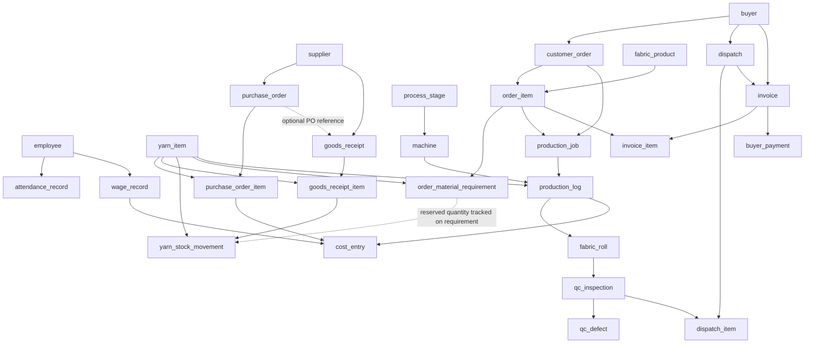

# Everest Textile Manufacturing System (TMS)
## Lean 30-Table Database Design

**Scope:** a deliberately reduced logical schema with exactly **30 canonical base tables**, selected from the original 46-table design. The reduction removes low-priority supporting tables, replaces some small catalogues with controlled attributes on their owning records, and derives stock balances instead of storing them as an independent source of truth. It is designed around the mill workflow described in the supplied schema and problem statement: yarn procurement and inwarding, inventory, customer orders, production, roll-level quality, dispatch, invoicing/receipts, attendance, and wages.

**Counting rule:** only the 30 tables listed in Section 1 are canonical base tables. Views/materialized views and application-level lookups described later are not additional base tables. This is a proposed logical design, not a migration script.

## Table inventory (30)

1. `employee`
2. `supplier`
3. `buyer`
4. `unit_of_measure`
5. `yarn_type`
6. `yarn_item`
7. `fabric_product`
8. `process_stage`
9. `machine`
10. `purchase_order`
11. `purchase_order_item`
12. `goods_receipt`
13. `goods_receipt_item`
14. `yarn_stock_movement`
15. `customer_order`
16. `order_item`
17. `order_material_requirement`
18. `production_job`
19. `production_log`
20. `fabric_roll`
21. `qc_inspection`
22. `qc_defect`
23. `dispatch`
24. `dispatch_item`
25. `invoice`
26. `invoice_item`
27. `buyer_payment`
28. `attendance_record`
29. `wage_record`
30. `cost_entry`

# SECTION 1: Canonical Table Definitions

## People and core reference data

### 1. `employee` (Master Entity)
* **Purpose**: Physical mill workers, loom operators, inspectors, supervisors, and administrative personnel.
* **Primary Key**: `employee_id` (INT)
* **Unique Keys**: `employee_code` (VARCHAR)
* **Columns**:
  - `employee_id` (`INT`, PK): Internal employee identifier.
  - `employee_code` (`VARCHAR(20)`, UK): Physical badge / payroll identifier (e.g. `EMP-0401`).
  - `full_name` (`VARCHAR(100)`): Worker legal full name.
  - `designation` (`VARCHAR(50)`): Organizational position/title.
  - `pay_basis` (`VARCHAR(20)`): Remuneration mode (`monthly`, `daily`, `piece_rate`).
  - `pay_rate` (`NUMERIC(12,2)`): Rate per unit/day/month (Restricted Access).
  - `phone` (`VARCHAR(20)`): Contact telephone number.
  - `is_active` (`BOOLEAN`): Active employment status.
  - `created_at` (`TIMESTAMPTZ`): Record creation timestamp.

### 2. `supplier` (Master Entity)
* **Purpose**: Registered yarn spinning mills and raw material vendors.
* **Primary Key**: `supplier_id` (INT)
* **Unique Keys**: `supplier_code` (VARCHAR)
* **Columns**:
  - `supplier_id` (`INT`, PK): Unique supplier identifier.
  - `supplier_code` (`VARCHAR(20)`, UK): Unique vendor code (e.g. `SUP-VARD`).
  - `name` (`VARCHAR(150)`): Legal entity trade name.
  - `gstin` (`VARCHAR(15)`): Indian Goods and Services Tax Identification Number.
  - `contact_person` (`VARCHAR(100)`): Primary commercial contact.
  - `phone` (`VARCHAR(20)`): Contact phone number.
  - `address` (`TEXT`): Mill physical address.
  - `is_active` (`BOOLEAN`): Active procurement status.

### 3. `buyer` (Master Entity)
* **Purpose**: Apparel manufacturers, export houses, and garment buying entities.
* **Primary Key**: `buyer_id` (INT)
* **Unique Keys**: `buyer_code` (VARCHAR)
* **Columns**:
  - `buyer_id` (`INT`, PK): Unique customer identifier.
  - `buyer_code` (`VARCHAR(20)`, UK): Unique customer reference (e.g. `BUY-RAYMOND`).
  - `name` (`VARCHAR(150)`): Registered company business name.
  - `gstin` (`VARCHAR(15)`): 15-digit GSTIN tax number.
  - `contact_person` (`VARCHAR(100)`): Account manager contact.
  - `phone` (`VARCHAR(20)`): Phone number for phone tracking desk.
  - `credit_limit` (`NUMERIC(14,2)`): Approved credit allowance.
  - `payment_terms_days` (`INT`): Standard credit duration in days (e.g. 30).
  - `is_active` (`BOOLEAN`): Account ordering eligibility.

### 4. `unit_of_measure` (Master Reference)
* **Purpose**: Standardized engineering and commercial measurement units.
* **Primary Key**: `unit_id` (INT)
* **Unique Keys**: `unit_code` (VARCHAR)
* **Columns**:
  - `unit_id` (`INT`, PK): Internal unit identifier.
  - `unit_code` (`VARCHAR(10)`, UK): Standard symbol (`kg`, `m`, `pcs`).
  - `description` (`VARCHAR(50)`): Unit explanation (e.g. `Kilogram`, `Metre`).

### 5. `yarn_type` (Master Specification)
* **Purpose**: Fiber construction and yarn counts (e.g., 30s Ne Combed Cotton, 150D Polyester).
* **Primary Key**: `yarn_type_id` (INT)
* **Unique Keys**: `name` (VARCHAR)
* **Columns**:
  - `yarn_type_id` (`INT`, PK): Unique yarn type identifier.
  - `name` (`VARCHAR(100)`, UK): Technical specification label.
  - `fiber_content` (`VARCHAR(100)`): Material composition (e.g. `100% Cotton`, `65/35 Poly-Viscose`).
  - `nominal_count` (`VARCHAR(50)`): Standard count / denier measurement.
  - `description` (`TEXT`): Technical notes.

### 6. `yarn_item` (Master Stockable SKU)
* **Purpose**: The stockable raw material inventory unit representing a unique `yarn_type × colour` combination.
* **Primary Key**: `yarn_item_id` (INT)
* **Foreign Keys**:
  - `yarn_type_id` → `yarn_type(yarn_type_id)`
* **Unique Keys**: Composite (`yarn_type_id`, `colour_code`)
* **Columns**:
  - `yarn_item_id` (`INT`, PK): Unique stockable SKU identifier.
  - `yarn_type_id` (`INT`, FK): Associated yarn specification.
  - `colour_code` (`VARCHAR(30)`): Mill shade code stored directly on the SKU.
  - `colour_name` (`VARCHAR(100)`): Human-readable shade name.
  - `unit_id` (`INT`, FK): Inventory measurement unit (typically `kg`).
  - `reorder_level` (`NUMERIC(12,3)`): Minimum safe inventory threshold triggering alert.
  - `is_active` (`BOOLEAN`): SKU procurement active status.

### 7. `fabric_product` (Master Catalogue)
* **Purpose**: Finished fabric products ordered by customers (e.g., Greige Twill, Poplin).
* **Primary Key`**: `product_id` (INT)
* **Foreign Keys**: `unit_id` → `unit_of_measure(unit_id)`
* **Unique Keys**: `product_code` (VARCHAR)
* **Columns**:
  - `product_id` (`INT`, PK): Unique fabric product identifier.
  - `product_code` (`VARCHAR(30)`, UK): Catalog item code.
  - `name` (`VARCHAR(150)`): Commercial trade name.
  - `weave_type` (`VARCHAR(50)`): Plain, Twill, Satin, Oxford, Jacquard.
  - `nominal_gsm` (`NUMERIC(6,2)`): Grams per square meter.
  - `nominal_width_inches` (`NUMERIC(5,2)`): Usable fabric width.
  - `unit_id` (`INT`, FK): Trading unit (typically `m`).

### 8. `process_stage` (Master Reference)
* **Purpose**: Distinct sequential stages in the mill manufacturing pipeline.
* **Primary Key**: `stage_id` (INT)
* **Unique Keys**: `name` (VARCHAR), `sequence_hint` (INT)
* **Columns**:
  - `stage_id` (`INT`, PK): Unique stage identifier.
  - `name` (`VARCHAR(50)`, UK): Stage label (`spinning`, `weaving`, `dyeing`, `finishing`).
  - `sequence_hint` (`INT`, UK): Ordering index in factory route.

### 9. `machine` (Master Hardware Entity)
* **Purpose**: Physical shop-floor machines (e.g., Picanol Rapier Looms, Rieter Ring Frames).
* **Primary Key**: `machine_id` (INT)
* **Foreign Keys**: `stage_id` → `process_stage(stage_id)`
* **Unique Keys**: `machine_code` (VARCHAR)
* **Columns**:
  - `machine_id` (`INT`, PK): Unique machine identifier.
  - `machine_code` (`VARCHAR(30)`, UK): Physical machine plate code (e.g. `LOOM-04`).
  - `stage_id` (`INT`, FK): Production stage capable of execution.
  - `make_model` (`VARCHAR(100)`): Manufacturer and technical specification.
  - `rated_rpm` (`INT`): Optimal rated operating speed.
  - `is_active` (`BOOLEAN`): Machine operational commissioning flag.
  - `current_status` (`VARCHAR(20)`): Current machine state (for example `running`, `idle`, `maintenance`, `stopped`).
  - `last_status_changed_at` (`TIMESTAMPTZ`): Time the current state was last updated.

## Procurement and raw-material inventory

### 10. `purchase_order` (Transaction Header)
* **Purpose**: Formal purchase orders issued to yarn spinning mills.
* **Primary Key**: `po_id` (INT)
* **Foreign Keys**: `supplier_id` → `supplier(supplier_id)`
* **Unique Keys**: `po_no` (VARCHAR)
* **Columns**:
  - `po_id` (`INT`, PK): Unique purchase order identifier.
  - `po_no` (`VARCHAR(30)`, UK): Document tracking number (e.g. `PO-2026-0041`).
  - `supplier_id` (`INT`, FK): Receiving yarn supplier.
  - `order_date` (`DATE`): PO authorization date.
  - `expected_delivery_date` (`DATE`): Agreed arrival deadline.
  - `status` (`VARCHAR(20)`): State machine: `draft` → `sent` → `partially_received` → `closed` → `cancelled`.
  - `total_amount` (`NUMERIC(14,2)`): Total monetary commitment.
  - `created_by` (`INT`, FK): Authorizing user.

### 11. `purchase_order_item` (Transaction Line)
* **Purpose**: Individual yarn items and target quantities on a purchase order.
* **Primary Key**: `po_item_id` (INT)
* **Foreign Keys**:
  - `po_id` → `purchase_order(po_id)`
  - `yarn_item_id` → `yarn_item(yarn_item_id)`
* **Columns**:
  - `po_item_id` (`INT`, PK): Unique PO item line identifier.
  - `po_id` (`INT`, FK): Parent purchase order header.
  - `yarn_item_id` (`INT`, FK): Specific yarn SKU ordered.
  - `quantity` (`NUMERIC(12,3)`): Target quantity ordered (kg).
  - `agreed_rate` (`NUMERIC(12,2)`): Agreed purchase price per kg.
  - `line_total` (`NUMERIC(14,2)`): Calculated value.

### 12. `goods_receipt` (Transaction Header / Gate Inward)
* **Purpose**: Physical truck arrival record created at mill security gate for raw yarn.
* **Primary Key**: `receipt_id` (INT)
* **Foreign Keys**:
  - `supplier_id` → `supplier(supplier_id)`
  - `po_id` → `purchase_order(po_id)` (Optional)
  - `received_by_employee_id` → `employee(employee_id)`
* **Unique Keys**: `receipt_no` (VARCHAR), `client_request_id` (UUID - Idempotency Guard)
* **Columns**:
  - `receipt_id` (`INT`, PK): Unique goods receipt identifier.
  - `receipt_no` (`VARCHAR(30)`, UK): GRN number (e.g. `GRN-2026-0089`).
  - `supplier_id` (`INT`, FK): Delivering supplier.
  - `po_id` (`INT`, FK, Optional): Linked purchase order.
  - `supplier_challan_no` (`VARCHAR(50)`): Physical delivery challan/docket number.
  - `vehicle_number` (`VARCHAR(20)`): Transport truck registration.
  - `received_at` (`TIMESTAMPTZ`): Gate inward timestamp.
  - `received_by_employee_id` (`INT`, FK): Receiving gate storekeeper.
  - `client_request_id` (`UUID`, UK): Idempotent submission token preventing duplicate gate logs.
  - `status` (`VARCHAR(20)`): `received`, `cancelled`.

### 13. `goods_receipt_item` (Transaction Line / Yarn Lot)
* **Purpose**: Distinct received yarn lot carrying barcode tag, net weight, and customer earmarks.
* **Primary Key**: `receipt_item_id` (INT)
* **Foreign Keys**:
  - `receipt_id` → `goods_receipt(receipt_id)`
  - `yarn_item_id` → `yarn_item(yarn_item_id)`
  - `earmarked_order_id` → `customer_order(order_id)` (Optional)
* **Unique Keys**: `lot_code` (VARCHAR)
* **Columns**:
  - `receipt_item_id` (`INT`, PK): Unique receipt line identifier.
  - `receipt_id` (`INT`, FK): Parent GRN header.
  - `yarn_item_id` (`INT`, FK): Specific yarn SKU received.
  - `lot_code` (`VARCHAR(50)`, UK): Unique lot identifier (e.g. `LOT-COT-2026-08`).
  - `quantity_received` (`NUMERIC(12,3)`): Net weight in kg.
  - `earmarked_order_id` (`INT`, FK, Optional): Customer order pre-assigned to this lot.
  - `storage_location` (`VARCHAR(50)`): Warehouse bin/rack location.

### 14. `yarn_stock_movement` (Append-Only Inventory Ledger)
* **Purpose**: Single source of truth for all raw yarn material inventory additions and subtractions.
* **Primary Key**: `movement_id` (INT)
* **Foreign Keys**:
  - `yarn_item_id` → `yarn_item(yarn_item_id)`
  - `receipt_item_id` → `goods_receipt_item(receipt_item_id)` (Optional)
  - `production_job_id` → `production_job(job_id)` (Optional)
  - `reverses_movement_id` → `yarn_stock_movement(movement_id)` (Optional)
  - `created_by_employee_id` → `employee(employee_id)`
* **Columns**:
  - `movement_id` (`INT`, PK): Ledger entry serial number.
  - `yarn_item_id` (`INT`, FK): Yarn SKU impacted.
  - `movement_type` (`VARCHAR(20)`): `receipt` (+), `issue` (-), `return` (+), `adjustment` (+/-), `reversal`.
  - `quantity` (`NUMERIC(12,3)`): Signed quantity delta in kg.
  - `unit_cost` (`NUMERIC(12,2)`): Historical valuation snapshot for FIFO/weighted average.
  - `receipt_item_id` (`INT`, FK, Optional): Associated lot for receipts.
  - `production_job_id` (`INT`, FK, Optional): Associated loom job for material issues.
  - `reverses_movement_id` (`INT`, FK, Optional): Corrected ledger entry.
  - `reason` (`VARCHAR(255)`): Audit justification (mandatory for adjustments).
  - `occurred_at` (`TIMESTAMPTZ`): Exact event timestamp.
  - `created_by_employee_id` (`INT`, FK): Employee executing the transaction.

## Customer orders and material planning

### 15. `customer_order` (Sales Order Header)
* **Purpose**: Commercial contracts placed by buyers for fabric manufacturing.
* **Primary Key**: `order_id` (INT)
* **Foreign Keys**:
  - `buyer_id` → `buyer(buyer_id)`
  - `created_by_employee_id` → `employee(employee_id)`
* **Unique Keys**: `order_no` (VARCHAR)
* **Columns**:
  - `order_id` (`INT`, PK): Unique order identifier.
  - `order_no` (`VARCHAR(30)`, UK): Customer order number (e.g. `ORD-2026-001`).
  - `buyer_id` (`INT`, FK): Purchasing buyer entity.
  - `order_date` (`DATE`): Contract confirmation date.
  - `promised_delivery_date` (`DATE`): Guaranteed delivery date.
  - `status` (`VARCHAR(20)`): State machine: `draft` → `confirmed` → `in_production` → `ready_for_dispatch` → `dispatched` → `closed` → `cancelled`.
  - `version` (`INT`): Optimistic concurrency control lock.
  - `created_by_employee_id` (`INT`, FK): Sales representative booking order.
  - `created_at` (`TIMESTAMPTZ`): Record creation timestamp.

### 16. `order_item` (Sales Order Line)
* **Purpose**: Ordered fabric product, specified shade/colour, target meterage, and agreed rate.
* **Primary Key**: `order_item_id` (INT)
* **Foreign Keys**:
  - `order_id` → `customer_order(order_id)`
  - `product_id` → `fabric_product(product_id)`
* **Columns**:
  - `order_item_id` (`INT`, PK): Unique order line identifier.
  - `order_id` (`INT`, FK): Parent order header.
  - `line_no` (`INT`): Position sequence in order.
  - `product_id` (`INT`, FK): Ordered fabric specification.
  - `colour_code` (`VARCHAR(30)`): Requested shade code stored on the order line.
  - `ordered_qty` (`NUMERIC(12,2)`): Target length in meters.
  - `unit_id` (`INT`, FK): Unit reference (`m`).
  - `agreed_rate` (`NUMERIC(12,2)`): Contract price per meter.
  - `line_total` (`NUMERIC(14,2)`): Total line value.

### 17. `order_material_requirement` (BOM Explosion)
* **Purpose**: Bill of Materials (BOM) explosion defining exact yarn kg needed for each order item.
* **Primary Key**: `requirement_id` (INT)
* **Foreign Keys**:
  - `order_item_id` → `order_item(order_item_id)`
  - `yarn_item_id` → `yarn_item(yarn_item_id)`
* **Columns**:
  - `requirement_id` (`INT`, PK): Unique requirement identifier.
  - `order_item_id` (`INT`, FK): Order line consuming material.
  - `yarn_item_id` (`INT`, FK): Raw yarn item required.
  - `required_qty` (`NUMERIC(12,3)`): Total calculated yarn demand in kg.
  - `waste_factor_pct` (`NUMERIC(5,2)`): Loom process loss allowance (e.g. 3.5%).
  - `reserved_qty` (`NUMERIC(14,3)`): Quantity reserved against this requirement; maintained transactionally with stock movements.
  - `allocation_status` (`VARCHAR(20)`): Requirement allocation state (for example `unallocated`, `partial`, `reserved`).

## Production execution

### 18. `production_job` (Floor Work Order Ticket)
* **Purpose**: Represents an order item being manufactured at a specific process stage on a specific machine.
* **Primary Key**: `job_id` (INT)
* **Foreign Keys**:
  - `order_item_id` → `order_item(order_item_id)`
  - `stage_id` → `process_stage(stage_id)`
  - `machine_id` → `machine(machine_id)`
* **Unique Keys**: `job_no` (VARCHAR)
* **Columns**:
  - `job_id` (`INT`, PK): Unique job ticket identifier.
  - `job_no` (`VARCHAR(30)`, UK): Shop floor job identifier (e.g. `JOB-902`).
  - `order_item_id` (`INT`, FK): Source customer order item.
  - `stage_id` (`INT`, FK): Active process stage (`spinning`, `weaving`, `dyeing`).
  - `machine_id` (`INT`, FK): Assigned physical machine (e.g. `LOOM-04`).
  - `planned_qty` (`NUMERIC(12,2)`): Target output meterage.
  - `status` (`VARCHAR(20)`): `planned` → `running` → `interrupted` → `completed` → `cancelled`.
  - `priority` (`VARCHAR(20)`): `Low`, `Medium`, `High`, `Urgent`.
  - `started_at` (`TIMESTAMPTZ`): Job start time on machine.
  - `ended_at` (`TIMESTAMPTZ`): Job completion time.
  - `version` (`INT`): Concurrency lock version.

### 19. `production_log` (Append-Only Shift Output)
* **Purpose**: Touchscreen shift output records logged by loom operators at shift handovers.
* **Primary Key**: `log_id` (INT)
* **Foreign Keys**:
  - `job_id` → `production_job(job_id)`
  - `operator_id` → `employee(employee_id)`
* **Unique Keys**: `client_request_id` (UUID - Idempotent Kiosk Token)
* **Columns**:
  - `log_id` (`INT`, PK): Unique shift output log identifier.
  - `job_id` (`INT`, FK): Active production job running.
  - `shift_code` (`VARCHAR(30)`): Operating shift code stored on the log.
  - `operator_id` (`INT`, FK): Machine master/operator on duty.
  - `output_qty` (`NUMERIC(12,2)`): Net fabric output produced (meters).
  - `scrap_qty` (`NUMERIC(12,2)`): Wastage / yarn scrap (kg).
  - `power_kwh` (`NUMERIC(10,2)`): Sub-meter energy consumed.
  - `logged_at` (`TIMESTAMPTZ`): Timestamp recorded.
  - `client_request_id` (`UUID`, UK): Kiosk transaction idempotency token.

## Finished rolls and quality control

### 20. `fabric_roll` (Finished Product Unit of Traceability)
* **Purpose**: Core traceability hub representing an individual fabric roll with digital barcode tag.
* **Primary Key**: `roll_id` (INT)
* **Foreign Keys**:
  - `job_id` → `production_job(job_id)`
  - `operator_id` → `employee(employee_id)`
* **Unique Keys**: `roll_code` (VARCHAR)
* **Columns**:
  - `roll_id` (`INT`, PK): Internal roll identifier.
  - `roll_code` (`VARCHAR(50)`, UK): Unique printed barcode identifier (e.g. `ROLL-2026-901`).
  - `job_id` (`INT`, FK): Source production job (links machine, order item, order, buyer).
  - `operator_id` (`INT`, FK): Weaving master who produced the roll.
  - `length_m` (`NUMERIC(10,2)`): Net fabric length in meters.
  - `weight_kg` (`NUMERIC(10,3)`): Physical roll weight in kg.
  - `gsm` (`NUMERIC(6,2)`): Measured grams per square meter.
  - `width_inches` (`NUMERIC(5,2)`): Measured fabric width.
  - `status` (`VARCHAR(20)`): `pending_qc` → `in_stock` → `rework` → `rejected` → `loaded` → `dispatched` → `scrapped`.
  - `shelf_location` (`VARCHAR(50)`): Warehouse racking position (e.g. `RACK-B-04`).
  - `created_at` (`TIMESTAMPTZ`): Doffing / roll creation timestamp.
  - `version` (`INT`): Concurrency lock version.

### 21. `qc_inspection` (Inspection Event Log)
* **Purpose**: Formal audit event evaluating a roll under ASTM 4-point grading standards.
* **Primary Key**: `inspection_id` (INT)
* **Foreign Keys**:
  - `roll_id` → `fabric_roll(roll_id)`
  - `inspector_id` → `employee(employee_id)`
* **Columns**:
  - `inspection_id` (`INT`, PK): Unique inspection record identifier.
  - `roll_id` (`INT`, FK): Target fabric roll inspected.
  - `inspector_id` (`INT`, FK): Quality assurance auditor.
  - `attempt_no` (`INT`): Inspection cycle attempt (1 for initial, 2+ post-rework).
  - `result` (`VARCHAR(20)`): `passed` (Grade A/B), `rework` (Minor trim), `rejected` (Grade C/Scrap).
  - `assigned_grade` (`VARCHAR(10)`): Commercial grade: `A`, `B`, `C`, `Rejection`.
  - `total_penalty_points` (`INT`): Aggregate ASTM D5430 4-point penalty score.
  - `points_per_100_sq_yd` (`NUMERIC(6,2)`): Normalized score benchmark.
  - `inspected_at` (`TIMESTAMPTZ`): Inspection timestamp.
  - `remarks` (`TEXT`): Auditor observations.

### 22. `qc_defect` (Defect Itemization)
* **Purpose**: Specific defects detected on a roll during QC inspection.
* **Primary Key**: `defect_id` (INT)
* **Foreign Keys**:
  - `inspection_id` → `qc_inspection(inspection_id)`
* **Columns**:
  - `defect_id` (`INT`, PK): Unique defect incident identifier.
  - `inspection_id` (`INT`, FK): Parent QC inspection event.
  - `defect_code` (`VARCHAR(30)`): Standardized defect code.
  - `defect_name` (`VARCHAR(100)`): Human-readable defect description.
  - `penalty_points` (`INT`): 1, 2, 3, or 4 penalty points based on physical length.
  - `position_meters` (`NUMERIC(10,2)`): Linear meter location along roll length.
  - `severity` (`VARCHAR(20)`): `minor`, `major`, `critical`.

## Dispatch and delivery

### 23. `dispatch` (Transport Manifest / Gate Pass Header)
* **Purpose**: A transport vehicle departure carrying customer fabric rolls.
* **Primary Key**: `dispatch_id` (INT)
* **Foreign Keys**:
  - `buyer_id` → `buyer(buyer_id)`
  - `order_id` → `customer_order(order_id)`
  - `invoice_id` → `invoice(invoice_id)` (Optional until invoiced)
* **Unique Keys**: `dispatch_no` (VARCHAR)
* **Columns**:
  - `dispatch_id` (`INT`, PK): Unique dispatch identifier.
  - `dispatch_no` (`VARCHAR(30)`, UK): Lorry Receipt / Gate Pass reference (e.g. `DISP-2026-041`).
  - `buyer_id` (`INT`, FK): Receiving customer.
  - `order_id` (`INT`, FK): Fulfilled customer order.
  - `invoice_id` (`INT`, FK, Optional): Linked sales tax invoice.
  - `vehicle_no` (`VARCHAR(20)`): Transport truck registration plate.
  - `driver_name` (`VARCHAR(100)`): Truck driver name.
  - `driver_phone` (`VARCHAR(20)`): Driver mobile number.
  - `destination` (`VARCHAR(150)`): Delivery destination.
  - `status` (`VARCHAR(20)`): `draft` → `loading` → `dispatched` → `cancelled`.
  - `dispatched_at` (`TIMESTAMPTZ`): Final security gate outward clearance timestamp.
  - `version` (`INT`): Concurrency lock version.

### 24. `dispatch_item` (Scanned Roll Manifest Line)
* **Purpose**: Scanned rolls loaded onto a truck with strict double-dispatch collision prevention.
* **Primary Key**: `dispatch_item_id` (INT)
* **Foreign Keys**:
  - `dispatch_id` → `dispatch(dispatch_id)`
  - `roll_id` → `fabric_roll(roll_id)`
  - `scanned_by_employee_id` → `employee(employee_id)`
* **Unique Keys**: `(roll_id)` WHERE `state = 'active'` (Guarantees zero double-dispatch across entire database)
* **Columns**:
  - `dispatch_item_id` (`INT`, PK): Manifest line item identifier.
  - `dispatch_id` (`INT`, FK): Parent transport manifest.
  - `roll_id` (`INT`, FK): Scanned fabric roll.
  - `scanned_at` (`TIMESTAMPTZ`): Exact barcode scan time.
  - `scanned_by_employee_id` (`INT`, FK): Dispatch worker operating scanner.
  - `state` (`VARCHAR(20)`): `active` (loaded in truck), `removed` (offloaded prior to departure).

## Invoicing and receipts

### 25. `invoice` (GST Commercial Tax Invoice Header)
* **Purpose**: Official GST tax invoice issued to buyers for dispatched goods.
* **Primary Key**: `invoice_id` (INT)
* **Foreign Keys**: `buyer_id` → `buyer(buyer_id)`
* **Unique Keys**: `invoice_no` (VARCHAR)
* **Columns**:
  - `invoice_id` (`INT`, PK): Unique invoice identifier.
  - `invoice_no` (`VARCHAR(30)`, UK): Tax invoice number (e.g. `INV-2026-108`).
  - `buyer_id` (`INT`, FK): Billed customer.
  - `invoice_date` (`DATE`): Date of tax invoice creation.
  - `due_date` (`DATE`): Payment due date under credit terms.
  - `subtotal` (`NUMERIC(14,2)`): Net taxable fabric value.
  - `tax_rate` (`NUMERIC(5,2)`): Applicable GST rate (5.00% under HSN 5208).
  - `tax_amount` (`NUMERIC(14,2)`): Calculated CGST + SGST tax.
  - `total_amount` (`NUMERIC(14,2)`): Total invoice receivable amount.
  - `status` (`VARCHAR(20)`): `draft` → `issued` → `void`.
  - `created_at` (`TIMESTAMPTZ`): Record creation timestamp.
  - `version` (`INT`): Concurrency lock version.

### 26. `invoice_item` (Tax Invoice Line)
* **Purpose**: Line items detailing fabric products, quantities, rates, and HSN codes on invoices.
* **Primary Key**: `invoice_item_id` (INT)
* **Foreign Keys**:
  - `invoice_id` → `invoice(invoice_id)`
  - `order_item_id` → `order_item(order_item_id)`
* **Columns**:
  - `invoice_item_id` (`INT`, PK): Unique invoice line identifier.
  - `invoice_id` (`INT`, FK): Parent tax invoice header.
  - `order_item_id` (`INT`, FK): Linked customer order line.
  - `hsn_code` (`VARCHAR(10)`): Harmonized System Nomenclature (e.g. `5208`).
  - `quantity` (`NUMERIC(12,2)`): Dispatched meterage invoiced.
  - `rate` (`NUMERIC(12,2)`): Agreed price per meter snapshot.
  - `amount` (`NUMERIC(14,2)`): Line taxable subtotal.

### 27. `buyer_payment` (Accounts Receivable Receipt)
* **Purpose**: Bank receipts (NEFT, RTGS, Cheque, LC) collected from customers.
* **Primary Key**: `payment_id` (INT)
* **Foreign Keys**:
  - `buyer_id` → `buyer(buyer_id)`
  - `created_by_employee_id` → `employee(employee_id)`
* **Unique Keys**: `payment_ref` (VARCHAR), `client_request_id` (UUID - Idempotency Guard)
* **Columns**:
  - `payment_id` (`INT`, PK): Unique payment receipt identifier.
  - `payment_ref` (`VARCHAR(50)`, UK): Bank UTR / Cheque reference (e.g. `HDFC9988771122`).
  - `buyer_id` (`INT`, FK): Remitting customer.
  - `invoice_id` (`INT`, FK): Invoice to which this receipt is applied; one receipt is linked to one invoice in this reduced design.
  - `received_on` (`DATE`): Payment receipt credit date.
  - `amount` (`NUMERIC(14,2)`): Remitted monetary amount in INR.
  - `mode` (`VARCHAR(30)`): `NEFT/RTGS`, `Cheque`, `UPI`, `LC`.
  - `status` (`VARCHAR(20)`): `recorded`, `reversed`.
  - `client_request_id` (`UUID`, UK): Transaction idempotency guard token.
  - `created_by_employee_id` (`INT`, FK): Accounts employee logging receipt.

## Attendance, wages, and costing

### 28. `attendance_record` (Daily Workforce Muster)
* **Purpose**: Daily digital shift muster logging worker attendance, shift, and hours worked.
* **Primary Key**: `attendance_id` (INT)
* **Foreign Keys**:
  - `employee_id` → `employee(employee_id)`
* **Unique Keys**: Composite (`employee_id`, `work_date`, `shift_code`)
* **Columns**:
  - `attendance_id` (`INT`, PK): Unique attendance identifier.
  - `employee_id` (`INT`, FK): Worker profile.
  - `work_date` (`DATE`): Date of attendance.
  - `shift_code` (`VARCHAR(30)`): Assigned shift code stored on the attendance record.
  - `status` (`VARCHAR(20)`): `present`, `absent`, `half_day`, `leave`, `overtime`.
  - `hours_worked` (`NUMERIC(4,2)`): Number of productive hours.

### 29. `wage_record` (Payroll Calculation)
* **Purpose**: Monthly wage calculation combining fixed salaries, attendance, and loom piece-rate meterage bonuses.
* **Primary Key**: `wage_id` (INT)
* **Unique Keys**: Composite (`employee_id`, `payroll_month`)
* **Foreign Keys**:
  - `employee_id` → `employee(employee_id)`
* **Columns**:
  - `wage_id` (`INT`, PK): Unique wage calculation identifier.
  - `employee_id` (`INT`, FK): Beneficiary worker.
  - `payroll_month` (`DATE`): Payroll month, stored as its first calendar date.
  - `base_amount` (`NUMERIC(12,2)`): Base salary.
  - `piece_rate_amount` (`NUMERIC(12,2)`): Meterage-based incentive.
  - `bonus_overtime` (`NUMERIC(12,2)`): Overtime and attendance allowance.
  - `gross_amount` (`NUMERIC(12,2)`): Total gross earnings.
  - `status` (`VARCHAR(20)`): `draft` → `approved` → `disbursed` → `reversed`.

### 30. `cost_entry` (Manufacturing Cost Ledger)
* **Purpose**: Detailed cost absorption ledger assigning direct material, direct labor, power, and overhead to jobs, machines, rolls, and orders.
* **Primary Key**: `cost_id` (INT)
* **Foreign Keys**:
  - `order_id` → `customer_order(order_id)` (Optional)
  - `machine_id` → `machine(machine_id)` (Optional)
  - `roll_id` → `fabric_roll(roll_id)` (Optional)
  - `movement_id` → `yarn_stock_movement(movement_id)` (Optional)
  - `wage_id` → `wage_record(wage_id)` (Optional)
* **Columns**:
  - `cost_id` (`INT`, PK): Unique cost entry identifier.
  - `cost_type` (`VARCHAR(30)`): `material`, `wage`, `power`, `maintenance`, `overhead`.
  - `amount` (`NUMERIC(14,2)`): Allocated cost in INR.
  - `cost_date` (`DATE`): Cost recognition date, used for monthly grouping.
  - `order_id` (`INT`, FK, Optional): Targeted customer order.
  - `machine_id` (`INT`, FK, Optional): Machine absorbing maintenance/power.
  - `roll_id` (`INT`, FK, Optional): Specific fabric roll absorbing cost.
  - `movement_id` (`INT`, FK, Optional): Material stock ledger source.
  - `wage_id` (`INT`, FK, Optional): Workforce wage source.
  - `created_at` (`TIMESTAMPTZ`): Entry timestamp.

# SECTION 2: Workflow Connection Diagram

The flow below shows the 30 canonical tables and the operational path between them. It omits supporting tables that were intentionally removed from the base schema.

# SECTION 3: Multi-Attribute ERD (Exactly 30 Canonical Tables)

The ERD includes one entity block for each canonical table. Relationships are shown only where the source schema provides a direct relationship or where the reduced design explicitly owns the reference.

```mermaid
erDiagram
    SUPPLIER ||--o{ PURCHASE_ORDER : places
    PURCHASE_ORDER ||--o{ PURCHASE_ORDER_ITEM : contains
    YARN_ITEM ||--o{ PURCHASE_ORDER_ITEM : ordered_as
    SUPPLIER ||--o{ GOODS_RECEIPT : supplies
    PURCHASE_ORDER o|--o{ GOODS_RECEIPT : may_reference
    GOODS_RECEIPT ||--o{ GOODS_RECEIPT_ITEM : contains
    YARN_ITEM ||--o{ GOODS_RECEIPT_ITEM : received_as
    GOODS_RECEIPT_ITEM o|--o{ YARN_STOCK_MOVEMENT : posts
    YARN_ITEM ||--o{ YARN_STOCK_MOVEMENT : moves
    BUYER ||--o{ CUSTOMER_ORDER : places
    CUSTOMER_ORDER ||--o{ ORDER_ITEM : contains
    FABRIC_PRODUCT ||--o{ ORDER_ITEM : specifies
    ORDER_ITEM ||--o{ ORDER_MATERIAL_REQUIREMENT : requires
    YARN_ITEM ||--o{ ORDER_MATERIAL_REQUIREMENT : material
    PROCESS_STAGE ||--o{ MACHINE : stage_capability
    ORDER_ITEM ||--o{ PRODUCTION_JOB : manufactured_by
    PROCESS_STAGE ||--o{ PRODUCTION_JOB : runs_at_stage
    MACHINE ||--o{ PRODUCTION_JOB : executes
    PRODUCTION_JOB ||--o{ PRODUCTION_LOG : records
    EMPLOYEE ||--o{ PRODUCTION_LOG : operates
    PRODUCTION_JOB ||--o{ FABRIC_ROLL : produces
    EMPLOYEE ||--o{ FABRIC_ROLL : doffs
    FABRIC_ROLL ||--o{ QC_INSPECTION : inspected_in
    EMPLOYEE ||--o{ QC_INSPECTION : inspects
    QC_INSPECTION ||--o{ QC_DEFECT : identifies
    BUYER ||--o{ DISPATCH : receives
    CUSTOMER_ORDER ||--o{ DISPATCH : fulfilled_by
    DISPATCH ||--o{ DISPATCH_ITEM : contains
    FABRIC_ROLL ||--o{ DISPATCH_ITEM : loaded_as
    BUYER ||--o{ INVOICE : billed
    INVOICE ||--o{ INVOICE_ITEM : contains
    ORDER_ITEM ||--o{ INVOICE_ITEM : billed_line
    INVOICE ||--o{ BUYER_PAYMENT : receives
    BUYER ||--o{ BUYER_PAYMENT : remits
    EMPLOYEE ||--o{ ATTENDANCE_RECORD : records
    EMPLOYEE ||--o{ WAGE_RECORD : earns
    EMPLOYEE ||--o{ GOODS_RECEIPT : receives
    EMPLOYEE ||--o{ YARN_STOCK_MOVEMENT : records
    EMPLOYEE ||--o{ CUSTOMER_ORDER : creates
    EMPLOYEE ||--o{ DISPATCH_ITEM : scans
    EMPLOYEE ||--o{ BUYER_PAYMENT : records
    YARN_STOCK_MOVEMENT o|--o{ COST_ENTRY : cost_source
    CUSTOMER_ORDER o|--o{ COST_ENTRY : order_cost
    MACHINE o|--o{ COST_ENTRY : machine_cost
    FABRIC_ROLL o|--o{ COST_ENTRY : roll_cost
    WAGE_RECORD o|--o{ COST_ENTRY : wage_cost

    EMPLOYEE {
        int employee_id PK
        string employee_code UK
        string full_name
        string designation
        string pay_basis
        decimal pay_rate
        string phone
        boolean is_active
        timestamp created_at
    }

    SUPPLIER {
        int supplier_id PK
        string supplier_code UK
        string name
        string gstin
        string contact_person
        string phone
        string address
        boolean is_active
    }

    BUYER {
        int buyer_id PK
        string buyer_code UK
        string name
        string gstin
        string contact_person
        string phone
        decimal credit_limit
        int payment_terms_days
        boolean is_active
    }

    UNIT_OF_MEASURE {
        int unit_id PK
        string unit_code UK
        string description
    }

    YARN_TYPE {
        int yarn_type_id PK
        string name UK
        string fiber_content
        string nominal_count
        string description
    }

    YARN_ITEM {
        string colour_code
        string colour_name
        int yarn_item_id PK
        int yarn_type_id FK
        int unit_id FK
        decimal reorder_level
        boolean is_active
    }

    FABRIC_PRODUCT {
        int product_id PK
        string product_code UK
        string name
        string weave_type
        decimal nominal_gsm
        decimal nominal_width_inches
        int unit_id FK
    }

    PROCESS_STAGE {
        int stage_id PK
        string name UK
        int sequence_hint UK
    }

    MACHINE {
        string current_status
        timestamp last_status_changed_at
        int machine_id PK
        string machine_code UK
        int stage_id FK
        string make_model
        int rated_rpm
        boolean is_active
    }

    PURCHASE_ORDER {
        int po_id PK
        string po_no UK
        int supplier_id FK
        date order_date
        date expected_delivery_date
        string status
        decimal total_amount
    }

    PURCHASE_ORDER_ITEM {
        int po_item_id PK
        int po_id FK
        int yarn_item_id FK
        decimal quantity
        decimal agreed_rate
        decimal line_total
    }

    GOODS_RECEIPT {
        int received_by_employee_id FK
        int receipt_id PK
        string receipt_no UK
        int supplier_id FK
        int po_id FK
        string supplier_challan_no
        string vehicle_number
        timestamp received_at
        uuid client_request_id UK
        string status
    }

    GOODS_RECEIPT_ITEM {
        int receipt_item_id PK
        int receipt_id FK
        int yarn_item_id FK
        string lot_code UK
        decimal quantity_received
        int earmarked_order_id FK
        string storage_location
    }

    YARN_STOCK_MOVEMENT {
        int created_by_employee_id FK
        int movement_id PK
        int yarn_item_id FK
        string movement_type
        decimal quantity
        decimal unit_cost
        int receipt_item_id FK
        int production_job_id FK
        int reverses_movement_id FK
        string reason
        timestamp occurred_at
    }

    CUSTOMER_ORDER {
        int created_by_employee_id FK
        int order_id PK
        string order_no UK
        int buyer_id FK
        date order_date
        date promised_delivery_date
        string status
        int version
        timestamp created_at
    }

    ORDER_ITEM {
        string colour_code
        int order_item_id PK
        int order_id FK
        int line_no
        int product_id FK
        decimal ordered_qty
        decimal agreed_rate
        decimal line_total
    }

    ORDER_MATERIAL_REQUIREMENT {
        decimal reserved_qty
        string allocation_status
        int requirement_id PK
        int order_item_id FK
        int yarn_item_id FK
        decimal required_qty
        decimal waste_factor_pct
    }

    PRODUCTION_JOB {
        int job_id PK
        string job_no UK
        int order_item_id FK
        int stage_id FK
        int machine_id FK
        decimal planned_qty
        string status
        string priority
        timestamp started_at
        timestamp ended_at
        int version
    }

    PRODUCTION_LOG {
        string shift_code
        int log_id PK
        int job_id FK
        int operator_id FK
        decimal output_qty
        decimal scrap_qty
        decimal power_kwh
        timestamp logged_at
        uuid client_request_id UK
    }

    FABRIC_ROLL {
        int roll_id PK
        string roll_code UK
        int job_id FK
        int operator_id FK
        decimal length_m
        decimal weight_kg
        decimal gsm
        decimal width_inches
        string status
        string shelf_location
        timestamp created_at
        int version
    }

    QC_INSPECTION {
        int inspection_id PK
        int roll_id FK
        int inspector_id FK
        int attempt_no
        string result
        string assigned_grade
        int total_penalty_points
        decimal points_per_100_sq_yd
        timestamp inspected_at
        string remarks
    }

    QC_DEFECT {
        string defect_code
        string defect_name
        int defect_id PK
        int inspection_id FK
        int penalty_points
        decimal position_meters
        string severity
    }

    DISPATCH {
        int dispatch_id PK
        string dispatch_no UK
        int buyer_id FK
        int order_id FK
        int invoice_id FK
        string vehicle_no
        string driver_name
        string driver_phone
        string destination
        string status
        timestamp dispatched_at
        int version
    }

    DISPATCH_ITEM {
        int scanned_by_employee_id FK
        int dispatch_item_id PK
        int dispatch_id FK
        int roll_id FK
        timestamp scanned_at
        string state
    }

    INVOICE {
        int invoice_id PK
        string invoice_no UK
        int buyer_id FK
        date invoice_date
        date due_date
        decimal subtotal
        decimal tax_rate
        decimal tax_amount
        decimal total_amount
        string status
        timestamp created_at
        int version
    }

    INVOICE_ITEM {
        int invoice_item_id PK
        int invoice_id FK
        int order_item_id FK
        string hsn_code
        decimal quantity
        decimal rate
        decimal amount
    }

    BUYER_PAYMENT {
        int invoice_id FK
        int created_by_employee_id FK
        int payment_id PK
        string payment_ref UK
        int buyer_id FK
        date received_on
        decimal amount
        string mode
        string status
        uuid client_request_id UK
    }

    ATTENDANCE_RECORD {
        string shift_code
        int attendance_id PK
        int employee_id FK
        date work_date
        string status
        decimal hours_worked
    }

    WAGE_RECORD {
        date payroll_month
        int wage_id PK
        int employee_id FK
        decimal base_amount
        decimal piece_rate_amount
        decimal bonus_overtime
        decimal gross_amount
        string status
    }

    COST_ENTRY {
        date cost_date
        int cost_id PK
        string cost_type
        decimal amount
        int order_id FK
        int machine_id FK
        int roll_id FK
        int movement_id FK
        int wage_id FK
        timestamp created_at
    }
```

# SECTION 4: Reduction Decisions and Performance Rules

## Tables intentionally not retained as canonical base tables

The original schema contains 46 tables. The following 16 original tables are not separate base tables in this 30-table design; their roles are consolidated, derived, or explicitly out of scope:

- `role`, `app_user`, `user_role`: role-based application access control and login assignment are outside this mill-operational core; restore them together if the deployed application requires database-managed RBAC.
- `colour`: colour code/name are stored on `yarn_item` and order lines. Enforce consistent codes through database/application validation.
- `shift`: `shift_code` is stored on `production_log`.
- `defect_type`: `defect_code` and `defect_name` are stored on `qc_defect`.
- `yarn_stock_balance`: derive stock from `yarn_stock_movement`; a materialized view/cache may be added as a non-canonical projection.
- `stock_alert`: calculate reorder warnings from derived stock and `yarn_item.reorder_level`; persist alerts only if acknowledgement/history is needed.
- `supplier_bill`, `supplier_bill_line`: separate supplier-invoice/AP matching is outside the reduced scope; restore them if vendor bill reconciliation is required.
- `order_status_history`: `customer_order` stores current status only; a separate status timeline is not retained.
- `yarn_reservation`: `reserved_qty` and `allocation_status` are stored on `order_material_requirement`. If one requirement must be allocated across multiple yarn SKUs/lots, restore a separate allocation table.
- `machine_status_event`: `machine.current_status` stores the current state; a full machine-status event timeline is not retained.
- `payment_allocation`: `buyer_payment` references one `invoice`, allowing multiple receipts per invoice but not one receipt allocated across multiple invoices. Restore this table if cross-invoice allocation is required.
- `accounting_period`: separate period-close/lock state is outside this reduced scope.
- `audit_log`: application-level forensic history is not represented as a base table under the 30-table limit; use infrastructure logging or reinstate it if required.

## Integrity and query-performance recommendations

1. Add indexes to every foreign-key column used for joins and deletes, especially order/item, purchase/receipt, production/roll, inspection/defect, dispatch/roll, invoice/payment, and employee/payroll relationships.
2. Add unique constraints for business identifiers such as supplier code, buyer code, yarn SKU code, product code, purchase-order number, goods-receipt number, customer-order number, roll number, dispatch number, invoice number, and employee code.
3. Keep `yarn_stock_movement` append-only. Record corrections as reversing movements rather than overwriting posted stock history.
4. Use database transactions for goods receipt + stock movement, order material allocation, production completion + roll creation, dispatch scanning, invoice posting, and payment receipt.
5. Use check constraints for non-negative quantities, valid status values, positive rates, valid tax percentages, and sensible dates. Avoid application-only validation for inventory arithmetic.
6. Store timestamps consistently in `TIMESTAMPTZ`; use `NUMERIC` for quantities and money where exact decimal arithmetic is required.
7. Add composite indexes matching real filters, such as `(status, created_at)`, `(buyer_id, order_date)`, `(yarn_item_id, occurred_at)`, `(production_job_id, logged_at)`, and `(invoice_id, payment_date)`, after checking query plans.
8. Do not create indexes speculatively on every column. Validate with actual workload and `EXPLAIN (ANALYZE, BUFFERS)` in a staging environment.
9. Treat `colour_code`, `shift_code`, and `defect_code` as controlled vocabularies despite removing their lookup tables; enforce consistent values at the database/application boundary.
10. Before migration, confirm actual fields and FKs against the live database, reports, and transaction rules. This Markdown is a logical proposal, not a drop-table migration plan.
