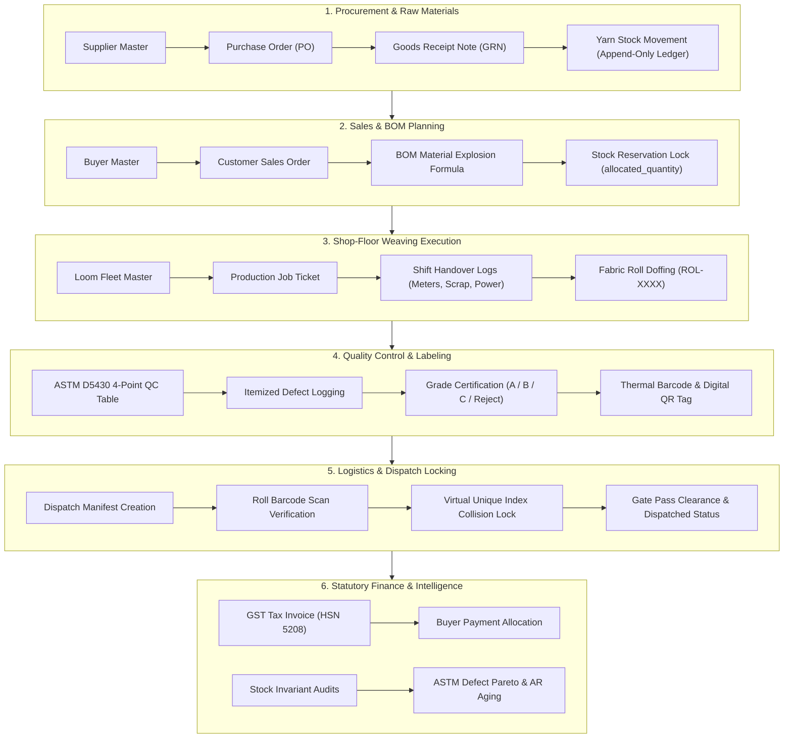
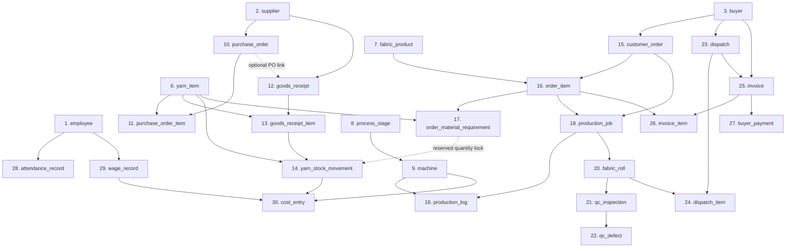

# Everest Textile Manufacturing ERP (T95)

> **Industrial-Grade Enterprise Resource Planning & Manufacturing Execution System for Modern Textile Weaving Mills.**

An enterprise-grade, high-throughput manufacturing execution and enterprise resource planning platform engineered specifically for textile weaving mills. Built with **Node.js**, **Express.js**, **MySQL 8.0+** (`mysql2/promise`), **React 18**, **Vite**, **Tailwind CSS**, and **Zod** validation.

The system enforces strict append-only double-entry material accounting, automated Bill of Materials (BOM) yarn explosion, high-speed loom execution, ASTM D5430 4-point quality inspection scoring, virtual-index double-dispatch concurrency locks, statutory GST invoicing (HSN 5208), and shop-floor kiosk idempotency.

---

## Table of Contents
1. [System Architecture & Workflow](#system-architecture--workflow)
2. [Core Operational Modules](#core-operational-modules)
3. [Lean 30-Table Database Design](#lean-30-table-database-design)
   - [Architectural Scope & Consolidation Rules](#architectural-scope--consolidation-rules)
   - [Single Entity & Multi-Attribute Entity Definitions (30 Canonical Tables)](#single-entity--multi-attribute-entity-definitions-30-canonical-tables)
   - [Workflow Connection Diagram](#workflow-connection-diagram)
   - [Complete Multi-Attribute Entity-Relationship Diagram (ERD)](#complete-multi-attribute-entity-relationship-diagram-erd)
   - [Tables Intentionally Consolidated (16 Out-of-Scope Tables)](#tables-intentionally-consolidated-16-out-of-scope-tables)
   - [Database Integrity, Indexing & Concurrency Guarantees](#database-integrity-indexing--concurrency-guarantees)
4. [Key Business Rules & Manufacturing Invariants](#key-business-rules--manufacturing-invariants)
5. [Full-Stack Technology Stack](#full-stack-technology-stack)
6. [Project Directory Structure](#project-directory-structure)
7. [Prerequisites & Environment Setup](#prerequisites--environment-setup)
8. [Database Migration, Reset & Seeding](#database-migration-reset--seeding)
9. [Running the Application](#running-the-application)
10. [RESTful API Endpoint Reference](#restful-api-endpoint-reference)
11. [Automated Testing](#automated-testing)
12. [Documentation Index](#documentation-index)

---

## System Architecture & Workflow

The platform bridges shop-floor machinery with enterprise commercial accounting across 6 primary stages:



---

## Core Operational Modules

1. **Master Data Foundations**: Centralized registry for Mill Employees, Spinning Suppliers, Export Buyers, Units of Measure, Yarn Types, Stockable SKUs, Fabric Products, Process Stages, and Machinery.
2. **Raw Material Procurement & Inwarding**: PO lifecycles with real-time delivery progress bars, GRN weighbridge tracking, and atomic inventory ledger crediting.
3. **Yarn Inventory & Live Stock Breakdown**: Real-time warehouse balance evaluation displaying Physical Current Stock, Allocated/Reserved Stock, and Free Available Stock.
4. **Sales Orders & Automated BOM Yarn Explosion**: Converts woven meterage requirements into exact fiber weight (kg) via standard engineering formulas:
   $$\text{Yarn Required (kg)} = \frac{\text{Order Meters} \times \text{Width (in)} \times \text{Fabric GSM}}{1000 \times 39.37} \times 1.05 \text{ (crimp \& waste factor)}$$
5. **Shop-Floor Loom Execution**: Machine scheduling (Air-Jet, Rapier, Projectile), shift output logging (meters, scrap kg, kWh consumed), and kiosk idempotency protection.
6. **Fabric Roll Doffing & ASTM D5430 4-Point QC**: Normalized penalty scoring per 100 sq. yards, automated grade classification (Grade A, B, C, Reject), and high-density printable thermal QR/Barcode tags.
7. **Dispatch Logistics & Double-Dispatch Collision Prevention**: Vehicle manifest assignment with storage-engine level concurrency locking preventing concurrent roll double-loading.
8. **Statutory GST Billing & Accounts Receivable**: Indian GST compliance (HSN 5208, 5% GST split into CGST/SGST or IGST), customer remittances, and payment aging tracking.
9. **Operational Intelligence & Invariant Audits**: Mathematical stock invariant verification, QC defect Pareto analytics, and financial ledger reconciliations.

---

## Lean 30-Table Database Design

### Architectural Scope & Consolidation Rules

The database schema is deliberately optimized into **exactly 30 canonical base tables** selected from an initial 46-table enterprise design. The design removes low-priority auxiliary tables, replaces granular catalogues with controlled enumerations/attributes on owning records, and derives stock balances from append-only movement logs rather than maintaining mutable stock balance records.

```
Canonical Table Inventory (Exactly 30 Base Tables):
 1. employee                  11. purchase_order_item       21. qc_inspection
 2. supplier                  12. goods_receipt             22. qc_defect
 3. buyer                     13. goods_receipt_item        23. dispatch
 4. unit_of_measure           14. yarn_stock_movement       24. dispatch_item
 5. yarn_type                 15. customer_order            25. invoice
 6. yarn_item                 16. order_item                26. invoice_item
 7. fabric_product            17. order_material_requirement 27. buyer_payment
 8. process_stage             18. production_job            28. attendance_record
 9. machine                   19. production_log            29. wage_record
10. purchase_order            20. fabric_roll               30. cost_entry
```

---

### Single Entity & Multi-Attribute Entity Definitions (30 Canonical Tables)

#### Group A: People and Core Master Data (Entities 1–9)

##### 1. `employee` (Master Entity)
* **Purpose**: Physical mill workers, loom masters, QC inspectors, supervisors, and administrative personnel.
* **Primary Key**: `employee_id` (`INT AUTO_INCREMENT`)
* **Unique Key**: `employee_code` (`VARCHAR(20)`)
* **Columns**:
  - `employee_id` (`INT`, PK): Internal worker ID.
  - `employee_code` (`VARCHAR(20)`, UK): Physical badge / payroll code (e.g. `EMP-0401`).
  - `full_name` (`VARCHAR(100)`): Legal full name.
  - `designation` (`VARCHAR(50)`): Role / title (`Plant Head`, `Loom Master`, `QC Inspector`).
  - `pay_basis` (`VARCHAR(20)`): Remuneration basis (`monthly`, `daily`, `piece_rate`).
  - `pay_rate` (`DECIMAL(12,2)`): Rate per month/day/meter.
  - `phone` (`VARCHAR(20)`): Contact phone.
  - `is_active` (`TINYINT(1)`): Active status flag.
  - `created_at` (`DATETIME(3)`): Record creation timestamp.

##### 2. `supplier` (Master Entity)
* **Purpose**: Registered yarn spinning mills and raw material vendors.
* **Primary Key**: `supplier_id` (`INT AUTO_INCREMENT`)
* **Unique Key**: `supplier_code` (`VARCHAR(20)`)
* **Columns**:
  - `supplier_id` (`INT`, PK): Unique supplier identifier.
  - `supplier_code` (`VARCHAR(20)`, UK): Vendor identifier (e.g. `SUP-VARD`).
  - `name` (`VARCHAR(150)`): Legal registered business name.
  - `gstin` (`VARCHAR(15)`): Statutory 15-digit GSTIN tax number.
  - `contact_person` (`VARCHAR(100)`): Commercial contact representative.
  - `phone` (`VARCHAR(20)`): Telephone contact.
  - `address` (`TEXT`): Mill physical address.
  - `is_active` (`TINYINT(1)`): Procurement eligibility status.

##### 3. `buyer` (Master Entity)
* **Purpose**: Garment manufacturers, apparel brands, and textile export houses.
* **Primary Key**: `buyer_id` (`INT AUTO_INCREMENT`)
* **Unique Key**: `buyer_code` (`VARCHAR(20)`)
* **Columns**:
  - `buyer_id` (`INT`, PK): Unique customer identifier.
  - `buyer_code` (`VARCHAR(20)`, UK): Client code (e.g. `BUY-ZARA`).
  - `name` (`VARCHAR(150)`): Legal trade name.
  - `gstin` (`VARCHAR(15)`): 15-digit GSTIN tax number.
  - `contact_person` (`VARCHAR(100)`): Merchandising contact person.
  - `phone` (`VARCHAR(20)`): Contact phone number.
  - `credit_limit` (`DECIMAL(14,2)`): Approved credit ceiling.
  - `payment_terms_days` (`INT`): Payment credit period in days (e.g. 30, 45).
  - `is_active` (`TINYINT(1)`): Ordering eligibility status.

##### 4. `unit_of_measure` (Master Reference)
* **Purpose**: Standardized engineering and inventory measurement units.
* **Primary Key**: `unit_id` (`INT AUTO_INCREMENT`)
* **Unique Key**: `unit_code` (`VARCHAR(10)`)
* **Columns**:
  - `unit_id` (`INT`, PK): Unit identifier.
  - `unit_code` (`VARCHAR(10)`, UK): Standard unit code (`kg`, `m`, `pcs`, `lbs`, `cone`).
  - `description` (`VARCHAR(50)`): Descriptive explanation.

##### 5. `yarn_type` (Master Technical Specification)
* **Purpose**: Fiber construction and nominal yarn count specifications.
* **Primary Key**: `yarn_type_id` (`INT AUTO_INCREMENT`)
* **Unique Key**: `name` (`VARCHAR(100)`)
* **Columns**:
  - `yarn_type_id` (`INT`, PK): Type identifier.
  - `name` (`VARCHAR(100)`, UK): Specification label (e.g. `100% Combed Cotton`).
  - `fiber_content` (`VARCHAR(100)`): Fiber blend composition (e.g. `100% Cotton`, `65/35 Poly-Cotton`).
  - `nominal_count` (`VARCHAR(50)`): Count measurement (e.g. `30s Ne`, `40s Ne`).
  - `description` (`TEXT`): Technical notes and tolerances.

##### 6. `yarn_item` (Stockable SKU Entity)
* **Purpose**: Stockable raw material inventory SKU representing a unique `yarn_type × shade/colour` combination.
* **Primary Key**: `yarn_item_id` (`INT AUTO_INCREMENT`)
* **Foreign Keys**: `yarn_type_id` &rarr; `yarn_type(yarn_type_id)`, `unit_id` &rarr; `unit_of_measure(unit_id)`
* **Unique Key**: Composite (`yarn_type_id`, `colour_code`)
* **Columns**:
  - `yarn_item_id` (`INT`, PK): Stockable SKU identifier.
  - `yarn_type_id` (`INT`, FK): Associated yarn specification.
  - `colour_code` (`VARCHAR(30)`): Mill shade identifier (e.g. `RAW-WHT`, `OPT-WHT`).
  - `colour_name` (`VARCHAR(100)`): Human-readable shade name.
  - `unit_id` (`INT`, FK): Inventory unit (typically `kg`).
  - `reorder_level` (`DECIMAL(12,3)`): Minimum safety threshold triggering replenishment.
  - `is_active` (`TINYINT(1)`): Active procurement status.

##### 7. `fabric_product` (Master Product Catalog)
* **Purpose**: Commercial woven fabric products ordered by customers.
* **Primary Key**: `product_id` (`INT AUTO_INCREMENT`)
* **Foreign Keys**: `unit_id` &rarr; `unit_of_measure(unit_id)`
* **Unique Key**: `product_code` (`VARCHAR(30)`)
* **Columns**:
  - `product_id` (`INT`, PK): Product identifier.
  - `product_code` (`VARCHAR(30)`, UK): Fabric SKU code (e.g. `FAB-TWILL-180`).
  - `name` (`VARCHAR(150)`): Commercial description.
  - `weave_type` (`VARCHAR(50)`): Weave construction (`plain`, `twill`, `satin`, `oxford`).
  - `nominal_gsm` (`DECIMAL(6,2)`): Grams per square meter.
  - `nominal_width_inches` (`DECIMAL(5,2)`): Usable finished fabric width in inches.
  - `unit_id` (`INT`, FK): Trading unit of measurement (typically `m`).

##### 8. `process_stage` (Master Workflow Reference)
* **Purpose**: Sequential production stages across the mill manufacturing pipeline.
* **Primary Key**: `stage_id` (`INT AUTO_INCREMENT`)
* **Unique Keys**: `name` (`VARCHAR(50)`), `sequence_hint` (`INT`)
* **Columns**:
  - `stage_id` (`INT`, PK): Stage identifier.
  - `name` (`VARCHAR(50)`, UK): Stage label (`Winding`, `Warping`, `Sizing`, `Weaving`, `Inspection`).
  - `sequence_hint` (`INT`, UK): Execution sequence order.

##### 9. `machine` (Master Hardware Entity)
* **Purpose**: Shop-floor loom fleet and textile processing machinery.
* **Primary Key**: `machine_id` (`INT AUTO_INCREMENT`)
* **Foreign Keys**: `stage_id` &rarr; `process_stage(stage_id)`
* **Unique Key**: `machine_code` (`VARCHAR(20)`)
* **Columns**:
  - `machine_id` (`INT`, PK): Hardware identifier.
  - `machine_code` (`VARCHAR(20)`, UK): Equipment ID (e.g. `LOOM-01`).
  - `stage_id` (`INT`, FK): Manufacturing stage capability.
  - `make_model` (`VARCHAR(100)`): Manufacturer and machine type (e.g. `Tsudakoma ZAX9100 Air-Jet`).
  - `rated_rpm` (`INT`): Operating speed rating.
  - `is_active` (`TINYINT(1)`): Operational availability status.
  - `current_status` (`VARCHAR(20)`): Real-time machine state (`running`, `idle`, `maintenance`, `breakdown`).

---

#### Group B: Procurement & Inventory Transactions (Entities 10–14)

##### 10. `purchase_order` (Procurement Header)
* **Purpose**: Commercial purchase contract issued to spinning mills for raw yarn supply.
* **Primary Key**: `po_id` (`INT AUTO_INCREMENT`)
* **Foreign Keys**: `supplier_id` &rarr; `supplier(supplier_id)`, `created_by` &rarr; `employee(employee_id)`
* **Unique Key**: `po_no` (`VARCHAR(30)`)
* **Columns**:
  - `po_id` (`INT`, PK): PO primary identifier.
  - `po_no` (`VARCHAR(30)`, UK): PO reference number (e.g. `PO-2026-001`).
  - `supplier_id` (`INT`, FK): Spinning mill vendor.
  - `order_date` (`DATE`): Issuance date.
  - `expected_delivery_date` (`DATE`): Delivery SLA deadline.
  - `status` (`VARCHAR(20)`): State (`draft`, `sent`, `partial`, `fulfilled`, `cancelled`).
  - `total_amount` (`DECIMAL(14,2)`): Total monetary order value.
  - `created_by` (`INT`, FK): Procurement officer.

##### 11. `purchase_order_item` (Procurement Line Item)
* **Purpose**: Itemized yarn SKUs and agreed unit commercial rates under a PO.
* **Primary Key**: `po_item_id` (`INT AUTO_INCREMENT`)
* **Foreign Keys**: `po_id` &rarr; `purchase_order(po_id)`, `yarn_item_id` &rarr; `yarn_item(yarn_item_id)`
* **Columns**:
  - `po_item_id` (`INT`, PK): Line item identifier.
  - `po_id` (`INT`, FK): Parent purchase order.
  - `yarn_item_id` (`INT`, FK): Raw yarn SKU.
  - `quantity` (`DECIMAL(12,3)`): Ordered weight in kg.
  - `agreed_rate` (`DECIMAL(10,2)`): Unit price per kg.
  - `line_total` (`DECIMAL(14,2)`): Computed line cost.

##### 12. `goods_receipt` (Inward Gate Header)
* **Purpose**: Material Goods Receipt Note (GRN) logged upon truck arrival at mill gate.
* **Primary Key**: `receipt_id` (`INT AUTO_INCREMENT`)
* **Foreign Keys**: `supplier_id` &rarr; `supplier(supplier_id)`, `po_id` &rarr; `purchase_order(po_id)` (Optional), `received_by_employee_id` &rarr; `employee(employee_id)`
* **Unique Keys**: `receipt_no` (`VARCHAR(30)`), `client_request_id` (`CHAR(36)`)
* **Columns**:
  - `receipt_id` (`INT`, PK): GRN identifier.
  - `receipt_no` (`VARCHAR(30)`, UK): Document number (e.g. `GRN-2026-001`).
  - `supplier_id` (`INT`, FK): Sourcing supplier.
  - `po_id` (`INT`, FK, Optional): Linked PO reference.
  - `supplier_challan_no` (`VARCHAR(50)`): Vendor delivery challan number.
  - `vehicle_number` (`VARCHAR(30)`): Inward transport truck registration.
  - `received_at` (`DATETIME(3)`): Gate inward timestamp.
  - `received_by_employee_id` (`INT`, FK): Receiving storekeeper.
  - `client_request_id` (`CHAR(36)`, UK): UUID idempotency guard.
  - `status` (`VARCHAR(20)`): `received`, `inspected`, `cancelled`.

##### 13. `goods_receipt_item` (Inward Gate Line Item & Lot)
* **Purpose**: Inward lot weights, lot codes, and warehouse bay bin locations.
* **Primary Key**: `receipt_item_id` (`INT AUTO_INCREMENT`)
* **Foreign Keys**: `receipt_id` &rarr; `goods_receipt(receipt_id)`, `yarn_item_id` &rarr; `yarn_item(yarn_item_id)`
* **Unique Key**: `lot_code` (`VARCHAR(50)`)
* **Columns**:
  - `receipt_item_id` (`INT`, PK): Inward item identifier.
  - `receipt_id` (`INT`, FK): Parent GRN.
  - `yarn_item_id` (`INT`, FK): Received yarn SKU.
  - `lot_code` (`VARCHAR(50)`, UK): Physical spinning lot number.
  - `quantity_received` (`DECIMAL(12,3)`): Inward net weight (kg).
  - `earmarked_order_id` (`INT`, FK, Optional): Pre-allocated customer order.
  - `storage_location` (`VARCHAR(60)`): Physical warehouse rack/bay.

##### 14. `yarn_stock_movement` (Append-Only Inventory Ledger)
* **Purpose**: Single source of truth for raw material accounting; strict double-entry append-only ledger.
* **Primary Key**: `movement_id` (`INT AUTO_INCREMENT`)
* **Foreign Keys**: `yarn_item_id` &rarr; `yarn_item(yarn_item_id)`, `receipt_item_id` &rarr; `goods_receipt_item(receipt_item_id)` (Optional), `production_job_id` &rarr; `production_job(job_id)` (Optional), `created_by_employee_id` &rarr; `employee(employee_id)`
* **Columns**:
  - `movement_id` (`INT`, PK): Ledger entry ID.
  - `yarn_item_id` (`INT`, FK): Affected yarn SKU.
  - `movement_type` (`VARCHAR(30)`): Signed delta type (`receipt` [+], `issue` [-], `return` [+], `adjustment` [±], `scrap` [-]).
  - `quantity` (`DECIMAL(12,3)`): Transaction quantity in kg.
  - `unit_cost` (`DECIMAL(10,2)`): Cost valuation per kg.
  - `receipt_item_id` (`INT`, FK, Optional): Originating GRN item.
  - `production_job_id` (`INT`, FK, Optional): Job consuming the material.
  - `reverses_movement_id` (`INT`, FK, Optional): Audit reversal link.
  - `reason` (`VARCHAR(255)`): Audit trail explanation.
  - `occurred_at` (`DATETIME(3)`): Event timestamp.
  - `created_by_employee_id` (`INT`, FK): Authorizing employee.

---

#### Group C: Sales, BOM Planning & Production Execution (Entities 15–19)

##### 15. `customer_order` (Sales Order Header)
* **Purpose**: Commercial woven fabric sales contract placed by a buyer.
* **Primary Key**: `order_id` (`INT AUTO_INCREMENT`)
* **Foreign Keys**: `buyer_id` &rarr; `buyer(buyer_id)`, `created_by_employee_id` &rarr; `employee(employee_id)`
* **Unique Key**: `order_no` (`VARCHAR(30)`)
* **Columns**:
  - `order_id` (`INT`, PK): Order identifier.
  - `order_no` (`VARCHAR(30)`, UK): Sales contract reference (e.g. `SO-2026-101`).
  - `buyer_id` (`INT`, FK): Ordering customer.
  - `order_date` (`DATE`): Contract booking date.
  - `promised_delivery_date` (`DATE`): Committed dispatch SLA date.
  - `status` (`VARCHAR(20)`): State (`draft`, `confirmed`, `in_production`, `completed`, `cancelled`).
  - `version` (`INT`): Optimistic concurrency locking counter.
  - `created_by_employee_id` (`INT`, FK): Sales manager.
  - `created_at` (`DATETIME(3)`): Order creation timestamp.

##### 16. `order_item` (Sales Order Line Item)
* **Purpose**: Itemized fabric product specifications, meters ordered, and agreed selling rates.
* **Primary Key**: `order_item_id` (`INT AUTO_INCREMENT`)
* **Foreign Keys**: `order_id` &rarr; `customer_order(order_id)`, `product_id` &rarr; `fabric_product(product_id)`, `unit_id` &rarr; `unit_of_measure(unit_id)`
* **Columns**:
  - `order_item_id` (`INT`, PK): Line identifier.
  - `order_id` (`INT`, FK): Parent sales order.
  - `line_no` (`INT`): Sequential line index.
  - `product_id` (`INT`, FK): Ordered fabric product.
  - `colour_code` (`VARCHAR(30)`): Target shade code.
  - `ordered_qty` (`DECIMAL(12,2)`): Contracted length in meters.
  - `unit_id` (`INT`, FK): Trading unit (`m`).
  - `agreed_rate` (`DECIMAL(10,2)`): Price per meter.
  - `line_total` (`DECIMAL(14,2)`): Line amount.

##### 17. `order_material_requirement` (BOM Yarn Reservation)
* **Purpose**: Bill of Materials (BOM) material explosion linking ordered fabric to raw yarn reservations.
* **Primary Key**: `requirement_id` (`INT AUTO_INCREMENT`)
* **Foreign Keys**: `order_item_id` &rarr; `order_item(order_item_id)`, `yarn_item_id` &rarr; `yarn_item(yarn_item_id)`
* **Columns**:
  - `requirement_id` (`INT`, PK): BOM requirement identifier.
  - `order_item_id` (`INT`, FK): Fabric order line.
  - `yarn_item_id` (`INT`, FK): Required yarn SKU.
  - `required_qty` (`DECIMAL(12,3)`): Calculated yarn mass in kg.
  - `waste_factor_pct` (`DECIMAL(5,2)`): Crimp & weaving allowance (e.g. 2.50%).
  - `reserved_qty` (`DECIMAL(12,3)`): Hard-reserved yarn stock.
  - `allocation_status` (`VARCHAR(20)`): `unallocated`, `partial`, `reserved`, `issued`.

##### 18. `production_job` (Shop-Floor Work Ticket)
* **Purpose**: Production ticket routing an order to a specific high-speed loom and stage.
* **Primary Key**: `job_id` (`INT AUTO_INCREMENT`)
* **Foreign Keys**: `order_item_id` &rarr; `order_item(order_item_id)`, `stage_id` &rarr; `process_stage(stage_id)`, `machine_id` &rarr; `machine(machine_id)`
* **Unique Key**: `job_no` (`VARCHAR(30)`)
* **Columns**:
  - `job_id` (`INT`, PK): Job identifier.
  - `job_no` (`VARCHAR(30)`, UK): Job ticket code (e.g. `JOB-2026-001`).
  - `order_item_id` (`INT`, FK): Targeted order line item.
  - `stage_id` (`INT`, FK): Execution stage (`Weaving`).
  - `machine_id` (`INT`, FK): Assigned loom hardware.
  - `planned_qty` (`DECIMAL(12,2)`): Target output meterage.
  - `status` (`VARCHAR(20)`): `scheduled`, `running`, `paused`, `completed`, `cancelled`.
  - `priority` (`VARCHAR(10)`): `low`, `normal`, `high`, `urgent`.
  - `started_at` (`DATETIME(3)`): Loom initiation time.
  - `ended_at` (`DATETIME(3)`): Job completion time.
  - `version` (`INT`): Concurrency version counter.

##### 19. `production_log` (Shift Output & Handover Log)
* **Purpose**: Touchscreen kiosk shift output logging (meters, scrap kg, and power consumption).
* **Primary Key**: `log_id` (`INT AUTO_INCREMENT`)
* **Foreign Keys**: `job_id` &rarr; `production_job(job_id)`, `operator_id` &rarr; `employee(employee_id)`
* **Unique Key**: `client_request_id` (`CHAR(36)`)
* **Columns**:
  - `log_id` (`INT`, PK): Shift entry identifier.
  - `job_id` (`INT`, FK): Associated job ticket.
  - `shift_code` (`VARCHAR(30)`): Active shift (`shift_1`, `shift_2`, `shift_3`).
  - `operator_id` (`INT`, FK): Shift operator in-charge.
  - `output_qty` (`DECIMAL(12,2)`): Woven length produced in meters.
  - `scrap_qty` (`DECIMAL(10,2)`): Hard waste / yarn scrap produced in kg.
  - `power_kwh` (`DECIMAL(10,2)`): Power meter consumption (kWh).
  - `logged_at` (`DATETIME(3)`): Shift log timestamp.
  - `client_request_id` (`CHAR(36)`, UK): Kiosk idempotency key.

---

#### Group D: Fabric Rolls & Quality Control (Entities 20–22)

##### 20. `fabric_roll` (Finished Roll Entity)
* **Purpose**: Cut fabric roll doffed from the loom, tracked with length, weight, and barcode.
* **Primary Key**: `roll_id` (`INT AUTO_INCREMENT`)
* **Foreign Keys**: `job_id` &rarr; `production_job(job_id)`, `operator_id` &rarr; `employee(employee_id)`
* **Unique Key**: `roll_code` (`VARCHAR(30)`)
* **Columns**:
  - `roll_id` (`INT`, PK): Unique roll identifier.
  - `roll_code` (`VARCHAR(30)`, UK): Mill barcode / QR identifier (e.g. `ROL-2026-0001`).
  - `job_id` (`INT`, FK): Producing job ticket.
  - `operator_id` (`INT`, FK): Doffing operator.
  - `length_m` (`DECIMAL(8,2)`): Cuttable piece length in meters.
  - `weight_kg` (`DECIMAL(8,2)`): Net piece weight in kg.
  - `gsm` (`DECIMAL(6,2)`): Measured piece fabric GSM.
  - `width_inches` (`DECIMAL(5,2)`): Measured piece cuttable width in inches.
  - `status` (`VARCHAR(20)`): State (`pending_qc`, `in_stock`, `allocated`, `dispatched`, `rejected`).
  - `shelf_location` (`VARCHAR(60)`): Warehouse inspection/storage rack.
  - `created_at` (`DATETIME(3)`): Doffing timestamp.
  - `version` (`INT`): Optimistic concurrency version counter.

##### 21. `qc_inspection` (ASTM D5430 Inspection Certification)
* **Purpose**: Formal ASTM 4-Point quality grading examination header.
* **Primary Key**: `inspection_id` (`INT AUTO_INCREMENT`)
* **Foreign Keys**: `roll_id` &rarr; `fabric_roll(roll_id)`, `inspector_id` &rarr; `employee(employee_id)`
* **Columns**:
  - `inspection_id` (`INT`, PK): Inspection identifier.
  - `roll_id` (`INT`, FK): Examined fabric roll.
  - `inspector_id` (`INT`, FK): Certified QA inspector.
  - `attempt_no` (`INT`): Inspection attempt counter (default `1`).
  - `result` (`VARCHAR(20)`): `passed`, `failed`, `conditional`.
  - `assigned_grade` (`CHAR(1)`): ASTM certified grade (`A`, `B`, `C`, `R`).
  - `total_penalty_points` (`INT`): Cumulative defect penalty points.
  - `points_per_100_sq_yd` (`DECIMAL(6,2)`): Normalized ASTM score:
    $$\text{Points / 100 sq. yd} = \frac{\text{Total Points} \times 3600}{\text{Length (yds)} \times \text{Width (in)}}$$
  - `inspected_at` (`DATETIME(3)`): Inspection completion timestamp.
  - `remarks` (`TEXT`): Inspector quality notes.

##### 22. `qc_defect` (Itemized QC Defect Marker)
* **Purpose**: Itemized defect instances marked with physical meter position and penalty points.
* **Primary Key**: `defect_id` (`INT AUTO_INCREMENT`)
* **Foreign Keys**: `inspection_id` &rarr; `qc_inspection(inspection_id)`
* **Columns**:
  - `defect_id` (`INT`, PK): Defect marker identifier.
  - `inspection_id` (`INT`, FK): Parent inspection report.
  - `defect_code` (`VARCHAR(30)`): Defect catalog code (`DEF-SLUB`, `DEF-FLY`, `DEF-FLOAT`, `DEF-HOLE`).
  - `defect_name` (`VARCHAR(100)`): Human-readable defect description.
  - `penalty_points` (`INT`): ASTM penalty points (1, 2, 3, or 4).
  - `position_meters` (`DECIMAL(8,2)`): Distance from roll start in meters.
  - `severity` (`VARCHAR(20)`): `minor`, `major`, `critical`.

---

#### Group E: Logistics, Dispatch & Invoicing (Entities 23–27)

##### 23. `dispatch` (Outbound Transport Manifest)
* **Purpose**: Delivery manifest and gate pass clearance for transport vehicles.
* **Primary Key**: `dispatch_id` (`INT AUTO_INCREMENT`)
* **Foreign Keys**: `buyer_id` &rarr; `buyer(buyer_id)`, `order_id` &rarr; `customer_order(order_id)` (Optional), `invoice_id` &rarr; `invoice(invoice_id)` (Optional)
* **Unique Key**: `dispatch_no` (`VARCHAR(30)`)
* **Columns**:
  - `dispatch_id` (`INT`, PK): Manifest identifier.
  - `dispatch_no` (`VARCHAR(30)`, UK): Document number (e.g. `DSP-2026-001`).
  - `buyer_id` (`INT`, FK): Consignee buyer.
  - `order_id` (`INT`, FK, Optional): Fulfilled customer order.
  - `invoice_id` (`INT`, FK, Optional): Accompanying tax invoice.
  - `vehicle_no` (`VARCHAR(30)`): Transport truck registration (e.g. `MH-12-TX-9988`).
  - `driver_name` (`VARCHAR(100)`): Driver full name.
  - `driver_phone` (`VARCHAR(20)`): Driver mobile contact.
  - `destination` (`VARCHAR(200)`): Delivery CFS or warehouse destination.
  - `status` (`VARCHAR(20)`): `draft`, `loaded`, `dispatched`, `delivered`, `cancelled`.
  - `dispatched_at` (`DATETIME(3)`): Gate departure timestamp.
  - `version` (`INT`): Concurrency version counter.

##### 24. `dispatch_item` (Manifest Scanned Roll Item)
* **Purpose**: Scanned fabric rolls loaded onto a truck manifest, secured against double-dispatch collisions.
* **Primary Key**: `dispatch_item_id` (`INT AUTO_INCREMENT`)
* **Foreign Keys**: `dispatch_id` &rarr; `dispatch(dispatch_id)`, `roll_id` &rarr; `fabric_roll(roll_id)`, `scanned_by_employee_id` &rarr; `employee(employee_id)`
* **Concurrency Lock**: Virtual generated unique index preventing concurrent double-dispatch:
  $$\text{active\_roll\_id} = \text{CASE WHEN state} \ne \text{'cancelled' THEN roll\_id ELSE NULL END}$$
* **Columns**:
  - `dispatch_item_id` (`INT`, PK): Line item identifier.
  - `dispatch_id` (`INT`, FK): Parent manifest.
  - `roll_id` (`INT`, FK): Scanned fabric roll.
  - `scanned_at` (`DATETIME(3)`): Barcode scan timestamp.
  - `scanned_by_employee_id` (`INT`, FK): Storekeeper.
  - `state` (`VARCHAR(20)`): `active`, `removed`, `cancelled`.

##### 25. `invoice` (GST Commercial Tax Invoice Header)
* **Purpose**: Indian GST tax invoice issued upon outward goods clearance (HSN 5208).
* **Primary Key**: `invoice_id` (`INT AUTO_INCREMENT`)
* **Foreign Keys**: `buyer_id` &rarr; `buyer(buyer_id)`
* **Unique Key**: `invoice_no` (`VARCHAR(30)`)
* **Columns**:
  - `invoice_id` (`INT`, PK): Invoice identifier.
  - `invoice_no` (`VARCHAR(30)`, UK): Bill reference (e.g. `INV-2026-001`).
  - `buyer_id` (`INT`, FK): Billed buyer entity.
  - `invoice_date` (`DATE`): Issuance date.
  - `due_date` (`DATE`): Payment term due date.
  - `subtotal` (`DECIMAL(14,2)`): Total taxable value.
  - `tax_rate` (`DECIMAL(5,2)`): Statutory GST rate (5.00%).
  - `tax_amount` (`DECIMAL(14,2)`): Computed GST tax sum.
  - `total_amount` (`DECIMAL(14,2)`): Grand invoice payable amount.
  - `status` (`VARCHAR(20)`): `draft`, `issued`, `partially_paid`, `paid`, `cancelled`.
  - `created_at` (`DATETIME(3)`): Creation timestamp.
  - `version` (`INT`): Concurrency version counter.

##### 26. `invoice_item` (Tax Invoice Line Item)
* **Purpose**: Itemized fabric charges with statutory Indian HSN codes and exact decimal line extensions.
* **Primary Key**: `invoice_item_id` (`INT AUTO_INCREMENT`)
* **Foreign Keys**: `invoice_id` &rarr; `invoice(invoice_id)`, `order_item_id` &rarr; `order_item(order_item_id)`
* **Columns**:
  - `invoice_item_id` (`INT`, PK): Invoice line ID.
  - `invoice_id` (`INT`, FK): Parent invoice.
  - `order_item_id` (`INT`, FK): Linked customer order line.
  - `hsn_code` (`VARCHAR(10)`): Indian statutory tax code (`5208` for Woven Cotton Fabrics).
  - `quantity` (`DECIMAL(12,2)`): Invoiced meterage.
  - `rate` (`DECIMAL(10,2)`): Invoiced rate per meter.
  - `amount` (`DECIMAL(14,2)`): Taxable line total ($\text{Quantity} \times \text{Rate}$).

##### 27. `buyer_payment` (Accounts Receivable Receipt)
* **Purpose**: Bank remittance receipts allocated against invoices with idempotent deduplication.
* **Primary Key**: `payment_id` (`INT AUTO_INCREMENT`)
* **Foreign Keys**: `buyer_id` &rarr; `buyer(buyer_id)`, `invoice_id` &rarr; `invoice(invoice_id)`, `created_by_employee_id` &rarr; `employee(employee_id)`
* **Unique Keys**: `payment_ref` (`VARCHAR(50)`), `client_request_id` (`CHAR(36)`)
* **Columns**:
  - `payment_id` (`INT`, PK): Receipt identifier.
  - `payment_ref` (`VARCHAR(50)`, UK): Bank reference / UTR number (e.g. `PAY-2026-001`).
  - `buyer_id` (`INT`, FK): Paying customer.
  - `invoice_id` (`INT`, FK): Reconciled tax invoice.
  - `received_on` (`DATE`): Bank value date.
  - `amount` (`DECIMAL(14,2)`): Collected remittance in INR.
  - `mode` (`VARCHAR(30)`): Payment channel (`NEFT/RTGS`, `Cheque`, `LC`).
  - `status` (`VARCHAR(20)`): `recorded`, `cleared`, `bounced`, `reversed`.
  - `client_request_id` (`CHAR(36)`, UK): Payment idempotency key.
  - `created_by_employee_id` (`INT`, FK): Accounts executive.

---

#### Group F: Workforce, Payroll & Cost Absorption (Entities 28–30)

##### 28. `attendance_record` (Daily Muster Roll)
* **Purpose**: Daily worker muster attendance, shift assignments, and productive hours worked.
* **Primary Key**: `attendance_id` (`INT AUTO_INCREMENT`)
* **Foreign Keys**: `employee_id` &rarr; `employee(employee_id)`
* **Unique Key**: Composite (`employee_id`, `work_date`, `shift_code`)
* **Columns**:
  - `attendance_id` (`INT`, PK): Muster record ID.
  - `employee_id` (`INT`, FK): Worker profile.
  - `work_date` (`DATE`): Attendance calendar date.
  - `shift_code` (`VARCHAR(30)`): Shift code (`shift_1`, `shift_2`, `shift_3`).
  - `status` (`VARCHAR(20)`): `present`, `absent`, `half_day`, `leave`, `overtime`.
  - `hours_worked` (`DECIMAL(4,2)`): Productive shift hours.

##### 29. `wage_record` (Monthly Payroll Calculation)
* **Purpose**: Monthly payroll combining base pay, muster attendance, and loom piece-rate bonuses.
* **Primary Key**: `wage_id` (`INT AUTO_INCREMENT`)
* **Foreign Keys**: `employee_id` &rarr; `employee(employee_id)`
* **Unique Key**: Composite (`employee_id`, `payroll_month`)
* **Columns**:
  - `wage_id` (`INT`, PK): Payroll voucher ID.
  - `employee_id` (`INT`, FK): Beneficiary worker.
  - `payroll_month` (`DATE`): Payroll month (stored as first calendar date).
  - `base_amount` (`DECIMAL(12,2)`): Base monthly salary.
  - `piece_rate_amount` (`DECIMAL(12,2)`): Meterage incentive bonus.
  - `bonus_overtime` (`DECIMAL(12,2)`): Overtime and attendance allowance.
  - `gross_amount` (`DECIMAL(12,2)`): Total gross earnings.
  - `status` (`VARCHAR(20)`): `draft`, `approved`, `disbursed`, `reversed`.

##### 30. `cost_entry` (Manufacturing Cost Absorption Ledger)
* **Purpose**: Cost absorption ledger allocating direct material, labor, electricity, and overheads across jobs, rolls, and machines.
* **Primary Key**: `cost_id` (`INT AUTO_INCREMENT`)
* **Foreign Keys**: `order_id` &rarr; `customer_order(order_id)` (Optional), `machine_id` &rarr; `machine(machine_id)` (Optional), `roll_id` &rarr; `fabric_roll(roll_id)` (Optional), `movement_id` &rarr; `yarn_stock_movement(movement_id)` (Optional), `wage_id` &rarr; `wage_record(wage_id)` (Optional)
* **Columns**:
  - `cost_id` (`INT`, PK): Cost ledger entry ID.
  - `cost_type` (`VARCHAR(30)`): Expense category (`material`, `wage`, `power`, `maintenance`, `overhead`).
  - `amount` (`DECIMAL(14,2)`): Absorbed cost in INR.
  - `cost_date` (`DATE`): Cost accounting recognition date.
  - `order_id` (`INT`, FK, Optional): Absorbing customer sales order.
  - `machine_id` (`INT`, FK, Optional): Absorbing loom machine.
  - `roll_id` (`INT`, FK, Optional): Absorbing fabric roll.
  - `movement_id` (`INT`, FK, Optional): Raw material movement source.
  - `wage_id` (`INT`, FK, Optional): Labor wage source.
  - `created_at` (`DATETIME(3)`): Cost posting timestamp.

---

### Workflow Connection Diagram



---

### Complete Multi-Attribute Entity-Relationship Diagram (ERD)

```mermaid
erDiagram
    SUPPLIER ||--o{ PURCHASE_ORDER : places
    PURCHASE_ORDER ||--o{ PURCHASE_ORDER_ITEM : contains
    YARN_ITEM ||--o{ PURCHASE_ORDER_ITEM : ordered_as
    SUPPLIER ||--o{ GOODS_RECEIPT : supplies
    PURCHASE_ORDER o|--o{ GOODS_RECEIPT : may_reference
    GOODS_RECEIPT ||--o{ GOODS_RECEIPT_ITEM : contains
    YARN_ITEM ||--o{ GOODS_RECEIPT_ITEM : received_as
    GOODS_RECEIPT_ITEM o|--o{ YARN_STOCK_MOVEMENT : posts
    YARN_ITEM ||--o{ YARN_STOCK_MOVEMENT : moves
    BUYER ||--o{ CUSTOMER_ORDER : places
    CUSTOMER_ORDER ||--o{ ORDER_ITEM : contains
    FABRIC_PRODUCT ||--o{ ORDER_ITEM : specifies
    ORDER_ITEM ||--o{ ORDER_MATERIAL_REQUIREMENT : requires
    YARN_ITEM ||--o{ ORDER_MATERIAL_REQUIREMENT : material
    PROCESS_STAGE ||--o{ MACHINE : stage_capability
    ORDER_ITEM ||--o{ PRODUCTION_JOB : manufactured_by
    PROCESS_STAGE ||--o{ PRODUCTION_JOB : runs_at_stage
    MACHINE ||--o{ PRODUCTION_JOB : executes
    PRODUCTION_JOB ||--o{ PRODUCTION_LOG : records
    EMPLOYEE ||--o{ PRODUCTION_LOG : operates
    PRODUCTION_JOB ||--o{ FABRIC_ROLL : produces
    EMPLOYEE ||--o{ FABRIC_ROLL : doffs
    FABRIC_ROLL ||--o{ QC_INSPECTION : inspected_in
    EMPLOYEE ||--o{ QC_INSPECTION : inspects
    QC_INSPECTION ||--o{ QC_DEFECT : identifies
    BUYER ||--o{ DISPATCH : receives
    CUSTOMER_ORDER ||--o{ DISPATCH : fulfilled_by
    DISPATCH ||--o{ DISPATCH_ITEM : contains
    FABRIC_ROLL ||--o{ DISPATCH_ITEM : loaded_as
    BUYER ||--o{ INVOICE : billed
    INVOICE ||--o{ INVOICE_ITEM : contains
    ORDER_ITEM ||--o{ INVOICE_ITEM : billed_line
    INVOICE ||--o{ BUYER_PAYMENT : receives
    BUYER ||--o{ BUYER_PAYMENT : remits
    EMPLOYEE ||--o{ ATTENDANCE_RECORD : records
    EMPLOYEE ||--o{ WAGE_RECORD : earns
    EMPLOYEE ||--o{ GOODS_RECEIPT : receives
    EMPLOYEE ||--o{ YARN_STOCK_MOVEMENT : records
    EMPLOYEE ||--o{ CUSTOMER_ORDER : creates
    EMPLOYEE ||--o{ DISPATCH_ITEM : scans
    EMPLOYEE ||--o{ BUYER_PAYMENT : records
    YARN_STOCK_MOVEMENT o|--o{ COST_ENTRY : cost_source
    CUSTOMER_ORDER o|--o{ COST_ENTRY : order_cost
    MACHINE o|--o{ COST_ENTRY : machine_cost
    FABRIC_ROLL o|--o{ COST_ENTRY : roll_cost
    WAGE_RECORD o|--o{ COST_ENTRY : wage_cost

    EMPLOYEE {
        int employee_id PK
        string employee_code UK
        string full_name
        string designation
        string pay_basis
        decimal pay_rate
        string phone
        boolean is_active
        timestamp created_at
    }

    SUPPLIER {
        int supplier_id PK
        string supplier_code UK
        string name
        string gstin
        string contact_person
        string phone
        string address
        boolean is_active
    }

    BUYER {
        int buyer_id PK
        string buyer_code UK
        string name
        string gstin
        string contact_person
        string phone
        decimal credit_limit
        int payment_terms_days
        boolean is_active
    }

    UNIT_OF_MEASURE {
        int unit_id PK
        string unit_code UK
        string description
    }

    YARN_TYPE {
        int yarn_type_id PK
        string name UK
        string fiber_content
        string nominal_count
        string description
    }

    YARN_ITEM {
        int yarn_item_id PK
        int yarn_type_id FK
        string colour_code
        string colour_name
        int unit_id FK
        decimal reorder_level
        boolean is_active
    }

    FABRIC_PRODUCT {
        int product_id PK
        string product_code UK
        string name
        string weave_type
        decimal nominal_gsm
        decimal nominal_width_inches
        int unit_id FK
    }

    PROCESS_STAGE {
        int stage_id PK
        string name UK
        int sequence_hint UK
    }

    MACHINE {
        int machine_id PK
        string machine_code UK
        int stage_id FK
        string make_model
        int rated_rpm
        boolean is_active
        string current_status
    }

    PURCHASE_ORDER {
        int po_id PK
        string po_no UK
        int supplier_id FK
        date order_date
        date expected_delivery_date
        string status
        decimal total_amount
    }

    PURCHASE_ORDER_ITEM {
        int po_item_id PK
        int po_id FK
        int yarn_item_id FK
        decimal quantity
        decimal agreed_rate
        decimal line_total
    }

    GOODS_RECEIPT {
        int receipt_id PK
        string receipt_no UK
        int supplier_id FK
        int po_id FK
        string supplier_challan_no
        string vehicle_number
        timestamp received_at
        int received_by_employee_id FK
        uuid client_request_id UK
        string status
    }

    GOODS_RECEIPT_ITEM {
        int receipt_item_id PK
        int receipt_id FK
        int yarn_item_id FK
        string lot_code UK
        decimal quantity_received
        int earmarked_order_id FK
        string storage_location
    }

    YARN_STOCK_MOVEMENT {
        int movement_id PK
        int yarn_item_id FK
        string movement_type
        decimal quantity
        decimal unit_cost
        int receipt_item_id FK
        int production_job_id FK
        int reverses_movement_id FK
        string reason
        timestamp occurred_at
        int created_by_employee_id FK
    }

    CUSTOMER_ORDER {
        int order_id PK
        string order_no UK
        int buyer_id FK
        date order_date
        date promised_delivery_date
        string status
        int version
        int created_by_employee_id FK
        timestamp created_at
    }

    ORDER_ITEM {
        int order_item_id PK
        int order_id FK
        int line_no
        int product_id FK
        string colour_code
        decimal ordered_qty
        decimal agreed_rate
        decimal line_total
    }

    ORDER_MATERIAL_REQUIREMENT {
        int requirement_id PK
        int order_item_id FK
        int yarn_item_id FK
        decimal required_qty
        decimal waste_factor_pct
        decimal reserved_qty
        string allocation_status
    }

    PRODUCTION_JOB {
        int job_id PK
        string job_no UK
        int order_item_id FK
        int stage_id FK
        int machine_id FK
        decimal planned_qty
        string status
        string priority
        timestamp started_at
        timestamp ended_at
        int version
    }

    PRODUCTION_LOG {
        int log_id PK
        int job_id FK
        string shift_code
        int operator_id FK
        decimal output_qty
        decimal scrap_qty
        decimal power_kwh
        timestamp logged_at
        uuid client_request_id UK
    }

    FABRIC_ROLL {
        int roll_id PK
        string roll_code UK
        int job_id FK
        int operator_id FK
        decimal length_m
        decimal weight_kg
        decimal gsm
        decimal width_inches
        string status
        string shelf_location
        timestamp created_at
        int version
    }

    QC_INSPECTION {
        int inspection_id PK
        int roll_id FK
        int inspector_id FK
        int attempt_no
        string result
        string assigned_grade
        int total_penalty_points
        decimal points_per_100_sq_yd
        timestamp inspected_at
        string remarks
    }

    QC_DEFECT {
        int defect_id PK
        int inspection_id FK
        string defect_code
        string defect_name
        int penalty_points
        decimal position_meters
        string severity
    }

    DISPATCH {
        int dispatch_id PK
        string dispatch_no UK
        int buyer_id FK
        int order_id FK
        int invoice_id FK
        string vehicle_no
        string driver_name
        string driver_phone
        string destination
        string status
        timestamp dispatched_at
        int version
    }

    DISPATCH_ITEM {
        int dispatch_item_id PK
        int dispatch_id FK
        int roll_id FK
        timestamp scanned_at
        int scanned_by_employee_id FK
        string state
    }

    INVOICE {
        int invoice_id PK
        string invoice_no UK
        int buyer_id FK
        date invoice_date
        date due_date
        decimal subtotal
        decimal tax_rate
        decimal tax_amount
        decimal total_amount
        string status
        timestamp created_at
        int version
    }

    INVOICE_ITEM {
        int invoice_item_id PK
        int invoice_id FK
        int order_item_id FK
        string hsn_code
        decimal quantity
        decimal rate
        decimal amount
    }

    BUYER_PAYMENT {
        int payment_id PK
        string payment_ref UK
        int buyer_id FK
        int invoice_id FK
        date received_on
        decimal amount
        string mode
        string status
        uuid client_request_id UK
        int created_by_employee_id FK
    }

    ATTENDANCE_RECORD {
        int attendance_id PK
        int employee_id FK
        date work_date
        string shift_code
        string status
        decimal hours_worked
    }

    WAGE_RECORD {
        int wage_id PK
        int employee_id FK
        date payroll_month
        decimal base_amount
        decimal piece_rate_amount
        decimal bonus_overtime
        decimal gross_amount
        string status
    }

    COST_ENTRY {
        int cost_id PK
        string cost_type
        decimal amount
        date cost_date
        int order_id FK
        int machine_id FK
        int roll_id FK
        int movement_id FK
        int wage_id FK
        timestamp created_at
    }
```



---

### Tables Intentionally Consolidated (16 Out-of-Scope Tables)

The original full enterprise schema contained 46 tables. Exactly 16 tables were intentionally removed or consolidated to create this high-performance 30-table lean architecture:

| Original Table | Consolidation Rationale | Alternative Design in 30-Table ERP |
|---|---|---|
| `role`, `app_user`, `user_role` | Application-level RBAC is handled at the API middleware layer | Authenticated identity passed via session/tokens |
| `colour` | Standalone colour catalogue is unnecessary normalization overhead | `colour_code` and `colour_name` embedded on `yarn_item` and order lines |
| `shift` | Shift definitions are static mill operations | Stored as controlled `shift_code` on `production_log` and `attendance_record` |
| `defect_type` | Defect lookups can be cached or controlled via application schemas | `defect_code` and `defect_name` captured directly in `qc_defect` |
| `yarn_stock_balance` | Mutable stock balances invite drift and concurrency corruption | Dynamically derived by summing signed deltas in `yarn_stock_movement` |
| `stock_alert` | Ephemeral alert tables create dead database tuples | Dynamically generated by querying derived stock against `yarn_item.reorder_level` |
| `supplier_bill`, `supplier_bill_line` | Accounts Payable bill entry is secondary to material inwarding | Procurement is tracked directly through `purchase_order` and `goods_receipt` |
| `order_status_history` | Historical timeline tables add schema weight | `customer_order.status` tracks current state; changes logged in audit files |
| `yarn_reservation` | Intermediate reservation entity adds join overhead | `reserved_qty` and `allocation_status` embedded on `order_material_requirement` |
| `machine_status_event` | Granular telemetry events generate millions of rows | `machine.current_status` maintains live machine status |
| `payment_allocation` | Many-to-many cross-invoice receipt splitting | `buyer_payment` links directly to a single `invoice` |
| `accounting_period` | Financial ledger lock periods are handled by year-end closures | Date parameters filter monthly reporting queries |
| `audit_log` | Storing every SQL mutation in a relational table slows writes | Structured application logging (`morgan` + log streams) |

---

### Database Integrity, Indexing & Concurrency Guarantees

1. **Double-Dispatch Prevention via Virtual Generated Unique Key**:
   - In [`database/migrations/025_dispatch_item.sql`](file:///c:/Users/Akshad/Desktop/Textile_Manufacturing_System_T95/database/migrations/025_dispatch_item.sql):
     ```sql
     active_roll_id INT GENERATED ALWAYS AS (
       CASE WHEN state != 'cancelled' THEN roll_id ELSE NULL END
     ) VIRTUAL,
     UNIQUE KEY uq_dispatch_active_roll (active_roll_id)
     ```
   - Prevents two operators from scanning and loading the same roll onto different trucks concurrently.
2. **Append-Only Material Accounting Ledger**:
   - Physical yarn inventory is never updated in place. Every transaction registers a signed movement in `yarn_stock_movement`.
   - Inventory invariant strictly verified:
     $$\text{Physical Current Stock} = \sum (\text{Receipts} + \text{Returns}) - \sum (\text{Issues} + \text{Scrap})$$
     $$\text{Physical Current Stock} = \text{Allocated / Reserved Stock} + \text{Free Available Stock}$$
3. **Pessimistic Concurrency (`SELECT ... FOR UPDATE`)**:
   - Stock reservations, GRN inwarding, and dispatch releases execute inside strict ACID transactions with row-level locks.
4. **Exact Decimal Financial Arithmetic**:
   - Quantities, weights, rates, GST tax amounts, and wages use `DECIMAL(12,2)` / `DECIMAL(14,2)` precision to prevent IEEE-754 floating-point drift.
5. **Kiosk Request Idempotency**:
   - `client_request_id` (`CHAR(36)`) unique indexes on `goods_receipt`, `production_log`, and `buyer_payment` prevent duplicate submissions on network retry.

---

## Key Business Rules & Manufacturing Invariants

1. **ASTM D5430 4-Point Quality Inspection Formula**:
   $$\text{Points per } 100 \text{ sq. yd.} = \frac{\text{Total Penalty Points} \times 3600}{\text{Inspected Length (yds)} \times \text{Fabric Width (inches)}}$$
   - **Grade A (Export First Quality)**: Score $\le 20.0$ points / 100 sq. yd.
   - **Grade B (Standard Commercial)**: Score $20.1\text{–}40.0$ points / 100 sq. yd.
   - **Grade C (Secondary Quality)**: Score $40.1\text{–}50.0$ points / 100 sq. yd.
   - **Rejection**: Score $> 50.0$ points / 100 sq. yd.
2. **Automated Bill of Materials (BOM) Yarn Explosion**:
   $$\text{Yarn Required (kg)} = \frac{\text{Order Meters} \times \text{Fabric Width (in)} \times \text{Fabric GSM}}{1000 \times 39.37} \times (1 + \text{Waste Factor})$$
3. **Statutory GST Tax Calculations (HSN 5208)**:
   - Intra-state shipments: 2.5% CGST + 2.5% SGST = 5.0% GST.
   - Inter-state shipments: 5.0% IGST.

---

## Full-Stack Technology Stack

| Layer | Technology | Details |
|---|---|---|
| **Frontend Framework** | **React 18 & Vite** | Fast SPA build tooling, reactive hooks, component modularity |
| **UI Design System** | **Material Design 3 & Tailwind CSS** | Curated palette, dark/light contrast, Lucide icons, responsive layout |
| **API Client** | **Axios with Vite Proxy** | Centralized client service layer with transparent `/api` proxying |
| **Backend Runtime** | **Node.js (v18+ LTS)** | High-throughput asynchronous event loop |
| **Web Server** | **Express.js (v5)** | Modular route mounting, security middleware (`helmet`, `cors`) |
| **Input Validation** | **Zod** | Strict schema parsing and runtime type safety |
| **Database Engine** | **MySQL 8.0+ (InnoDB)** | Strict Foreign Keys, Transactions, Virtual Unique Indexes |
| **Database Driver** | **mysql2/promise** | High-performance connection pooling with async/await |
| **Test Runner** | **Node.js Native Test Runner** | Zero-dependency unit and integration testing suite |

---

## Project Directory Structure

```text
Textile_Manufacturing_System_T95/
├── client/                          # Modern React 18 + Vite Frontend Application
│   ├── src/
│   │   ├── services/api.js          # Centralized Axios API service layer
│   │   ├── views/                   # 10 Industrial ERP Views
│   │   │   ├── MasterDataView.jsx   # 9 Core Master Entities management
│   │   │   ├── ProcurementView.jsx  # POs, Goods Receipts, and Inwarding
│   │   │   ├── InventoryView.jsx    # Real-time stock breakdown & "Get Info"
│   │   │   ├── OrdersView.jsx       # Sales orders & automated BOM explosion
│   │   │   ├── ProductionView.jsx   # Loom job tickets & shift handover logs
│   │   │   ├── QualityView.jsx      # ASTM 4-Point QC & printable QR tags
│   │   │   ├── DispatchView.jsx     # Vehicle manifests & double-dispatch lock
│   │   │   ├── FinanceView.jsx      # GST Invoices (HSN 5208) & AR payments
│   │   │   ├── WorkforceView.jsx    # Muster attendance & monthly payroll
│   │   │   └── ReportsView.jsx      # Invariant audits & operational intelligence
│   │   ├── App.jsx                  # Main navigation shell & layout
│   │   ├── index.css                # Material Design 3 design tokens & styling
│   │   └── main.jsx                 # Client entrypoint
│   ├── package.json                 # Client dependencies & scripts
│   └── vite.config.js               # Dev server port 5173 with proxy to 3000
├── database/
│   ├── migrations/                  # 30 sequential SQL migrations (001_... to 030_...)
│   ├── migrate.js                   # Automated migration runner
│   ├── seed.js                      # Full master data & demo scenario seeder
│   └── clean-and-seed.js            # Truncates all 30 tables and seeds clean baseline
├── docs/
│   ├── WORKFLOW_EXPLANATION.md      # Comprehensive 360-line workflow demonstration guide
│   ├── API_DOCUMENTATION.md         # Exhaustive REST API contract and sample payloads
│   ├── DATABASE_SETUP.md            # MySQL setup and configuration guide
│   ├── RELATIONSHIP_MATRIX.md       # Foreign key dependency matrix
│   ├── SCHEMA_AUDIT.md              # 30-table schema verification notes
│   └── KNOWN_GAPS.md                # Architectural design resolutions
├── src/
│   ├── config/                      # Environment variables (env.js) & MySQL pool (database.js)
│   ├── middleware/                  # Request tracking, Zod validator, error handling
│   ├── modules/                     # Modular business domain architecture
│   │   ├── attendance/              # Daily muster attendance records
│   │   ├── buyers/                  # Buyer master records
│   │   ├── costing/                 # Direct manufacturing cost absorption entries
│   │   ├── dispatch/                # Transport manifests & double-dispatch locks
│   │   ├── employees/               # Mill worker & operator profiles
│   │   ├── inventory/               # SKUs, Fabric products, Machinery, Process stages
│   │   ├── invoicing/               # GST Tax Invoices (HSN 5208)
│   │   ├── orders/                  # Customer sales orders & BOM requirements
│   │   ├── payments/                # Buyer bank remittance receipts
│   │   ├── procurement/             # Purchase orders & Goods Receipts (GRN)
│   │   ├── production/              # Loom scheduling & shift logs
│   │   ├── quality/                 # Fabric rolls, ASTM 4-Point QC inspections & defects
│   │   ├── reporting/               # 9 Operational intelligence & audit endpoints
│   │   ├── suppliers/               # Spinning mill vendor master
│   │   ├── units/                   # Units of measure
│   │   └── workforce/               # Wage records and payroll calculation
│   ├── utils/                       # Response helpers & custom AppError classes
│   ├── app.js                       # Express app configuration & route mounting
│   └── server.js                    # Server listener with graceful shutdown
├── tests/                           # Unit & integration test suites
├── package.json                     # Root backend package configuration
└── README.md                        # Master project documentation
```

---

## Prerequisites & Environment Setup

### Prerequisites
- **Node.js**: v18.0.0 or later (v20+ LTS recommended)
- **npm**: v9.0.0 or later
- **MySQL Server**: v8.0 or later

### Environment Configuration
Create a `.env` file in the project root:
```env
# Server Configuration
NODE_ENV=development
PORT=3000

# Database Configuration (MySQL 8.0+)
DB_HOST=localhost
DB_PORT=3306
DB_USER=root
DB_PASSWORD=root
DB_NAME=everest_tms
DB_CONNECTION_LIMIT=10
DB_QUEUE_LIMIT=0

# Test Database
TEST_DB_HOST=localhost
TEST_DB_PORT=3306
TEST_DB_USER=root
TEST_DB_PASSWORD=root
TEST_DB_NAME=everest_tms_test

# CORS Configuration
CORS_ORIGINS=http://localhost:3000,http://localhost:5173

# Logging
LOG_LEVEL=info
```

---

## Database Migration, Reset & Seeding

```bash
# 1. Apply all 30 database migrations sequentially
npm run migrate

# 2. Seed comprehensive demo scenario data across all 30 tables
npm run seed

# 3. Clean database (wipe/truncate all 30 tables) and re-seed clean operational mock data
npm run db:reset
```

---

## Running the Application

### Running Backend & Frontend Together

```bash
# Terminal 1: Start Backend API server (Port 3000)
npm run dev

# Terminal 2: Start Frontend Web Client (Port 5173)
npm run client:dev
```

- **Frontend Application UI**: **[http://localhost:5173](http://localhost:5173)**
- **Backend API Root**: **[http://localhost:3000/api/v1](http://localhost:3000/api/v1)**
- **System Health Check**: **[http://localhost:3000/api/v1/health](http://localhost:3000/api/v1/health)**

---

## RESTful API Endpoint Reference

All endpoints are versioned under `/api/v1`.

### 1. Master Data Endpoints
- `GET|POST /api/v1/employees` - Employee & loom operator records
- `GET|POST /api/v1/suppliers` - Spinning mill vendor catalogue
- `GET|POST /api/v1/buyers` - Buyer profiles & credit terms
- `GET|POST /api/v1/units-of-measure` - Units of measure (`kg`, `m`, `pcs`, `lbs`, `cone`)
- `GET|POST /api/v1/yarn-types` - Fiber compositions & nominal counts
- `GET|POST /api/v1/yarn-items` - Stockable yarn SKUs & reorder levels
- `GET|POST /api/v1/fabric-products` - Woven fabric constructions (Plain, Twill, Satin)
- `GET|POST /api/v1/process-stages` - Factory workflow stages
- `GET|POST /api/v1/machines` - Loom fleet hardware & real-time status

### 2. Procurement & Inventory Endpoints
- `GET|POST /api/v1/purchase-orders` - Purchase order lifecycle management
- `GET|POST /api/v1/goods-receipts` - Goods Receipt Notes (GRN) & inward lots
- `GET|POST /api/v1/yarn-stock-movements` - Double-entry material ledger movements
- `GET /api/v1/yarn-items/:id/stock` - Real-time stock breakdown (Physical, Reserved, Free Available)

### 3. Sales & BOM Planning Endpoints
- `GET|POST /api/v1/customer-orders` - Fabric sales orders & line items
- `PATCH /api/v1/customer-orders/:id/confirm` - 1-Click order confirmation
- `POST /api/v1/order-material-requirements/allocate-bom` - Automated BOM yarn explosion & stock reservation lock

### 4. Shop-Floor Production Execution Endpoints
- `GET|POST /api/v1/production-jobs` - Loom job tickets & scheduling
- `PATCH /api/v1/production-jobs/:id/complete` - Job completion & loom status reset to idle
- `GET|POST /api/v1/production-logs` - Shift handover logging (meters, scrap kg, power kWh)

### 5. Quality Control & Labeling Endpoints
- `GET|POST /api/v1/fabric-rolls` - Fabric roll doffing (`ROL-XXXX`)
- `GET|POST /api/v1/qc-inspections` - ASTM D5430 4-Point inspection grading & certification
- `GET|POST /api/v1/qc-defects` - Itemized defect markers (Slubs, Holes, Floats, Broken Picks)

### 6. Logistics & Double-Dispatch Endpoints
- `GET|POST /api/v1/dispatches` - Vehicle delivery manifests
- `POST /api/v1/dispatches/:id/items` - Roll barcode scanning with concurrency collision check
- `PATCH /api/v1/dispatches/:id/release-gate` - Gate clearance release & roll status update to `dispatched`

### 7. Statutory Billing & Accounts Receivable Endpoints
- `GET|POST /api/v1/invoices` - GST Tax Invoices (HSN 5208) with automated tax line calculations
- `GET|POST /api/v1/buyer-payments` - Buyer bank payment receipts & balance reconciliation
- `GET|POST /api/v1/attendance-records` - Daily worker muster attendance
- `GET|POST /api/v1/wage-records` - Monthly payroll voucher calculations
- `GET|POST /api/v1/cost-entries` - Direct manufacturing cost absorption entries

### 8. Operational Intelligence & Audit Reports
- `GET /api/v1/reports/inventory-summary` - Stock valuation & reorder warning alerts
- `GET /api/v1/reports/order-progress` - Sales order production progress & stage tracking
- `GET /api/v1/reports/machine-utilization` - Loom RPM efficiency & operating run hours
- `GET /api/v1/reports/scrap-analysis` - Scrap percentage by stage and job ticket
- `GET /api/v1/reports/qc-defect-pareto` - ASTM defect frequency distribution
- `GET /api/v1/reports/accounts-receivable` - Outstanding receivables & aging buckets
- `GET /api/v1/reports/job-costing` - Production job cost absorption breakdown

---

## Automated Testing

Run the automated test suite covering ASTM calculations, financial arithmetic, and state transitions:

```bash
# Run all unit and integration tests
npm test
```

---

## Documentation Index

- [`docs/WORKFLOW_EXPLANATION.md`](file:///c:/Users/Akshad/Desktop/Textile_Manufacturing_System_T95/docs/WORKFLOW_EXPLANATION.md) — Comprehensive 360-line architectural guide, step-by-step evaluator instructions, and sequence diagrams.
- [`docs/API_DOCUMENTATION.md`](file:///c:/Users/Akshad/Desktop/Textile_Manufacturing_System_T95/docs/API_DOCUMENTATION.md) — Complete REST API reference with payload schemas and response bodies.
- [`docs/DATABASE_SETUP.md`](file:///c:/Users/Akshad/Desktop/Textile_Manufacturing_System_T95/docs/DATABASE_SETUP.md) — MySQL database installation, permission grants, and migration instructions.
- [`docs/RELATIONSHIP_MATRIX.md`](file:///c:/Users/Akshad/Desktop/Textile_Manufacturing_System_T95/docs/RELATIONSHIP_MATRIX.md) — Foreign key dependency hierarchy, cascade rules, and deletion behaviors.
- [`docs/SCHEMA_AUDIT.md`](file:///c:/Users/Akshad/Desktop/Textile_Manufacturing_System_T95/docs/SCHEMA_AUDIT.md) — Field-by-field verification of all 30 canonical tables against specifications.
- [`docs/KNOWN_GAPS.md`](file:///c:/Users/Akshad/Desktop/Textile_Manufacturing_System_T95/docs/KNOWN_GAPS.md) — Architectural trade-offs, reduction decisions, and business solutions.

---

## License
Proprietary. Everest Textile Manufacturing ERP (T95). All Rights Reserved.
