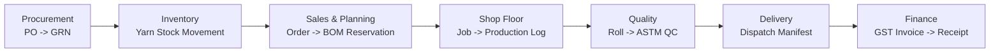

# End-to-End Textile Manufacturing Workflow Explanation

This guide outlines the end-to-end manufacturing and commercial process implemented across the 30 canonical tables.

## 1. Raw Material Procurement & Gate Inward
1. A Purchase Order (`purchase_order`) is issued to a spinning mill (`supplier`) for specified yarn SKUs (`yarn_item`).
2. Upon truck arrival at the mill gate, a Goods Receipt (`goods_receipt`) is registered.
3. Distinct yarn lots (`goods_receipt_item`) are recorded with unique lot codes and weights.
4. The system automatically creates positive `receipt` entries in the `yarn_stock_movement` ledger. Available stock is calculated dynamically from this ledger.

## 2. Customer Order & Material Planning (BOM)
1. A Buyer (`buyer`) places a Sales Order (`customer_order`) with specific fabric specifications and quantities (`order_item`).
2. A Bill of Materials explosion (`order_material_requirement`) specifies required raw yarn kg.
3. Material reservation verifies available stock in `yarn_stock_movement` and reserves stock safely.

## 3. Production Execution & Shop-Floor Logs
1. A Production Job ticket (`production_job`) is assigned to a physical machine (`machine`) at an active process stage (`process_stage`).
2. When the job starts, the machine status shifts to `running`.
3. Shift operators log touchscreen handover outputs (`output_qty`, `scrap_qty`, `power_kwh`) into `production_log`.
4. Idempotency tokens (`client_request_id`) prevent duplicate kiosk entries.

## 4. Doffing & ASTM 4-Point Quality Control
1. Finished rolls are doffed into `fabric_roll` with unique barcodes (`roll_code`) in `pending_qc` status.
2. A QA auditor inspects the roll under ASTM D5430 4-point grading (`qc_inspection`).
3. Individual defect positions and penalty points (1 to 4) are logged in `qc_defect`.
4. The system computes the normalized score per 100 sq yd and assigns a commercial grade (`A`, `B`, `C`, `Rejection`).
5. Passed rolls transition to `in_stock`.

## 5. Transport Dispatch & Double-Dispatch Collision Prevention
1. A dispatch manifest (`dispatch`) is prepared for a buyer's order with vehicle and driver details.
2. Storekeepers scan roll barcodes (`dispatch_item`).
3. Database constraint (`active_roll_id` virtual column with unique index) and service-layer serialization guarantee that no roll can ever be loaded on two active dispatches simultaneously.
4. Once gate outward is authorized, all loaded rolls transition to `dispatched`.

## 6. GST Tax Invoicing & Accounts Receivable
1. An official GST tax invoice (`invoice`) is generated from order items and dispatched meterage (`invoice_item`).
2. Line totals and 5% GST are calculated using exact decimal rounding.
3. Bank payments (`buyer_payment`) are recorded against invoices with idempotency guards and reversal capabilities.
4. Outstanding receivable balances are derived in real time.

## 7. Workforce Muster, Piece-Rate Wages & Direct Cost Absorption
1. Daily worker attendance is logged in `attendance_record`.
2. Monthly payroll calculations (`wage_record`) combine base salaries, attendance allowances, and loom piece-rate bonuses.
3. Direct material, labor, machine power, and overhead costs are absorbed into `cost_entry`.
