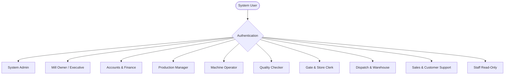
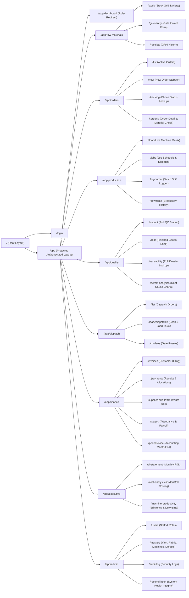
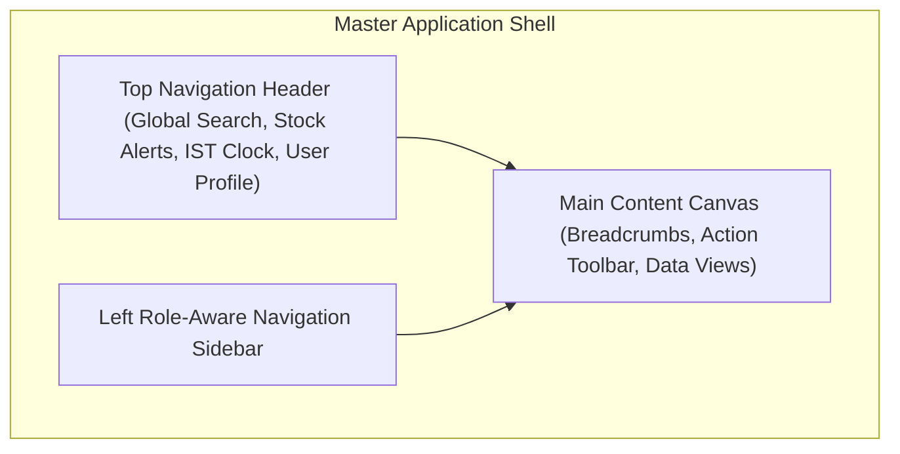
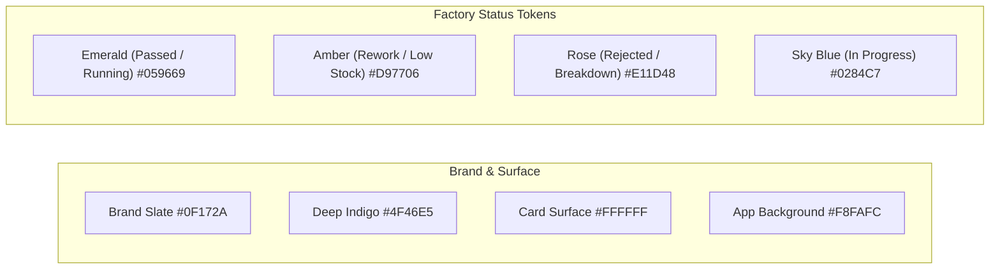
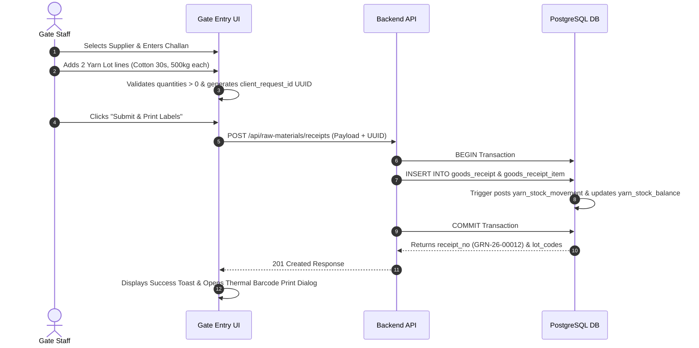
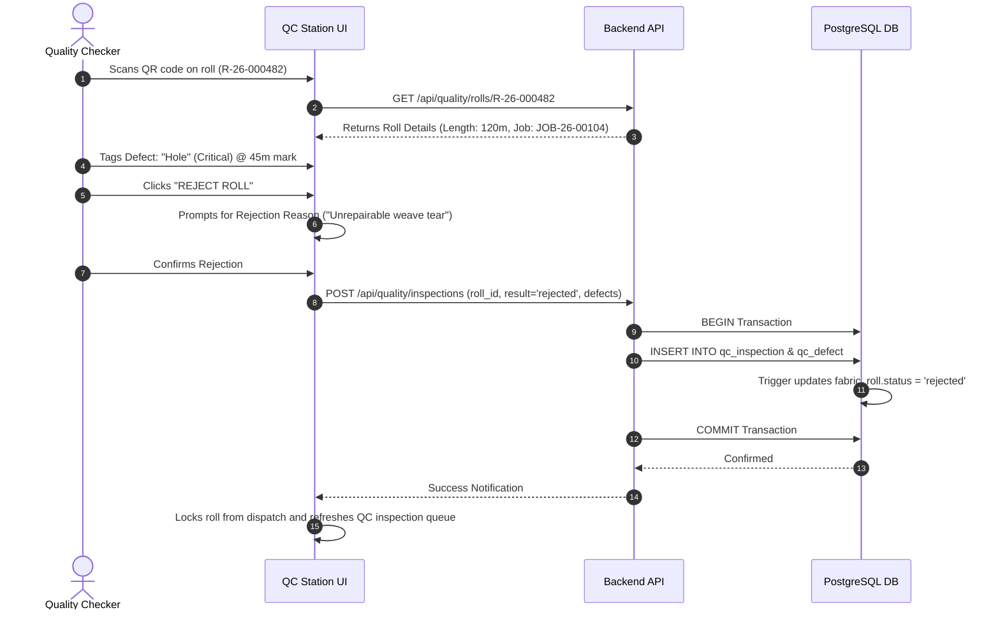
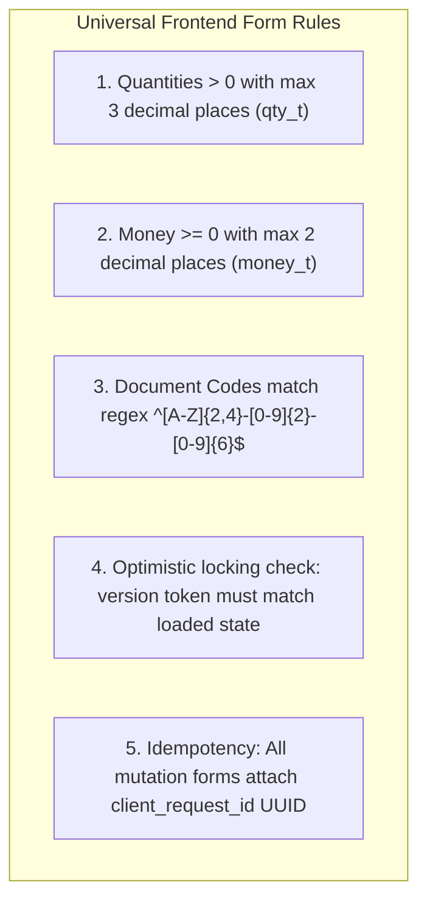
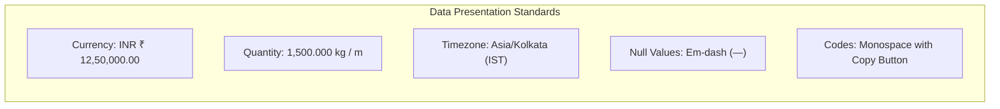
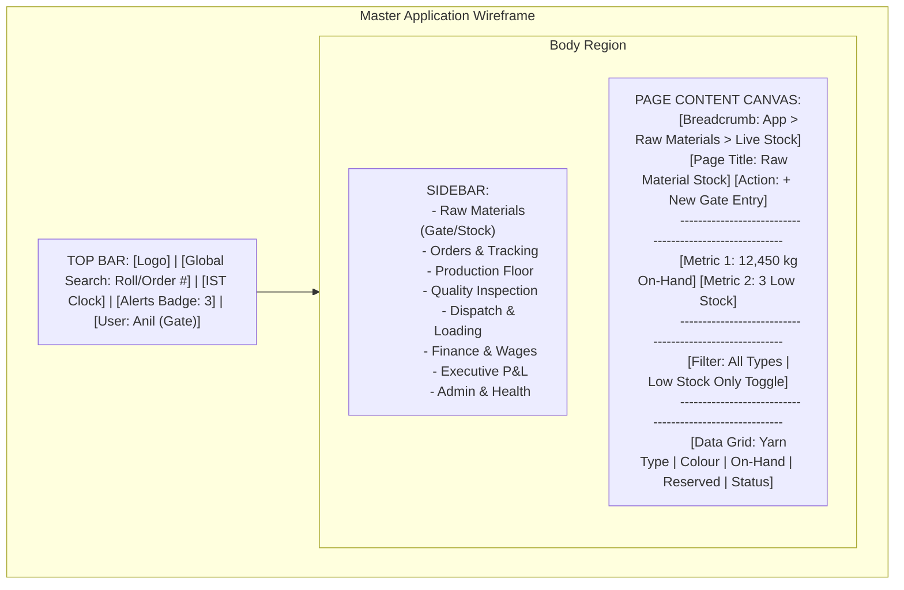
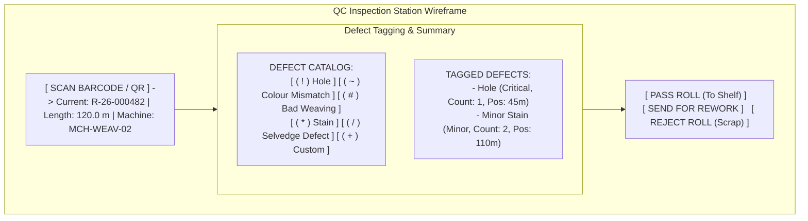

# Frontend UI/UX Specification: Textile Manufacturing System (Everest Textile Mills)

**Document:** Frontend UI/UX Specification for Lovable Implementation  
**Project:** Textile Manufacturing System (TMS) — Everest Textile Mills  
**Target Platform:** Modern Web Application (Desktop-first with tablet/mobile responsive touch support for shop-floor & gate operations)  
**Author:** Senior Product Designer & Frontend Architect  
**Companion Documents:** `01-requirements-analysis.md` through `07-data-integrity-and-security.md`  

---

## 1. Document Purpose and Scope

This document serves as the **definitive, implementation-ready UI/UX blueprint** for generating the frontend of the Everest Textile Manufacturing System via Lovable. It bridges the backend architecture, PostgreSQL schema (46 entities, 28 views, 11 invariants), and real-world mill operations (W1–W6) into concrete page wireframes, design tokens, interactive components, client-side validation rules, and role-based access flows.

The frontend is designed to eliminate notebook registers, physical floor checks, and paper slips by providing dedicated, highly visual workspaces for Gate Clerks, Production Managers, Machine Operators, Quality Checkers, Dispatch Handlers, Sales Reps, Accountants, and the Mill Owner.

---

## 2. Source Documentation Reviewed

The following architectural specifications were reviewed and strictly adhered to:

| Document | Key Architectural Assets Consumed |
|---|---|
| [`01-requirements-analysis.md`](file:///d:/work/Textile_Manufacturing_System_T95/01-requirements-analysis.md) | Functional Requirements (FR-1.1–FR-6.7), Business Rules (BR-1–BR-11), 6 Factory Workflows (W1–W6), Assumptions [A1–A14], Open Questions [Q1–Q15]. |
| [`02-database-technology-selection.md`](file:///d:/work/Textile_Manufacturing_System_T95/02-database-technology-selection.md) | PostgreSQL 15+ single-instance guarantees, transactional boundary rules, MVCC reader/writer concurrency model. |
| [`03-entity-relationship-design.md`](file:///d:/work/Textile_Manufacturing_System_T95/03-entity-relationship-design.md) | 46 Domain Entities, Traceability Spine (`yarn -> job -> roll -> qc -> dispatch -> invoice -> cost`), Invariants INV-1 to INV-11. |
| [`04-database-schema.md`](file:///d:/work/Textile_Manufacturing_System_T95/04-database-schema.md) | DDL definitions, Surrogate Bigint PKs, Business Codes (`ORD-YY-XXXXXX`, `LOT-`, `JOB-`, `R-`, `DSP-`), Domains (`qty_t`, `money_t`), Custom SQLSTATEs (`BR001–BR011`). |
| [`05-data-flow-and-transactions.md`](file:///d:/work/Textile_Manufacturing_System_T95/05-data-flow-and-transactions.md) | 15 Multi-Step Transaction Workflows (WF-1–WF-15), Optimistic Locking tokens (`version`), Idempotency UUIDs (`client_request_id`), Lock Order. |
| [`06-query-and-index-strategy.md`](file:///d:/work/Textile_Manufacturing_System_T95/06-query-and-index-strategy.md) | 28 Views (`v_yarn_stock`, `v_order_status`, `v_machine_status`, `v_roll_trace`, `v_monthly_pl`, 7 Reconciliation views), Keyset Pagination contracts. |
| [`07-data-integrity-and-security.md`](file:///d:/work/Textile_Manufacturing_System_T95/07-data-integrity-and-security.md) | 10 Business Roles, Column-level access rules (salary redaction), Session Context (`app.user_id`, `app.reason`), Non-destructive deletion policies. |

---

## 3. Product Summary and User Roles

### 3.1 Primary Value Proposition
A unified digital command center that eliminates operational blind spots across Everest Textile Mills: real-time yarn stock visibility, live machine floor monitoring, digital roll barcode/QR tagging with 100% defect traceability, zero double-dispatches, and one-click monthly Profit & Loss reconciliation.

### 3.2 Target Personas & User Roles



1. **Gate & Store Clerk (`gate_store`):** Fast gate entry on arrival of yarn trucks, barcode label printing for yarn lots, live stock lookups, finished-goods roll shelving.
2. **Production Manager (`production_manager`):** Live machine floor matrix (Spinning, Weaving, Dyeing), job scheduling, machine downtime logger, yarn issue requisitions.
3. **Machine Operator (`operator`):** Touchscreen-friendly shift output logging and machine breakdown flagging.
4. **Quality Checker (`quality_checker`):** Tablet/mobile inspection station; scans fabric roll QR code, logs defects (holes, colour mismatch, bad weaving) with severity, and sets pass/rework/reject status.
5. **Dispatch & Warehouse Staff (`dispatch`):** Scans rolls onto delivery trucks, validates buyer order items, eliminates double-dispatch, generates loading sheets.
6. **Sales & Customer Support (`sales`, `staff_readonly`):** Instant buyer phone order inquiry lookup (shows exact stage: Weaving, QC, Shelf, Ready for Dispatch).
7. **Accounts & Finance (`accounts`):** Supplier bill recording, buyer invoice generation, payment receipt allocation, attendance/wage approvals, monthly period close.
8. **Mill Owner (`owner`):** Executive overview: Real-time plant throughput, order contribution margin, roll cost breakdown, monthly P&L statement.
9. **System Administrator (`admin`):** User management, role grants, shift timings, master catalog setup (yarn types, defect types, fabric products).

---

## 4. Requirements-to-UI Traceability Matrix

| Requirement ID | Persona / Role | UI Page / Workspace | Primary Components | Underlying Entity / View | Key Interaction & Result |
|---|---|---|---|---|---|
| **FR-1.1, FR-1.5** | `gate_store` | Gate Inward Entry (`/gate/entry`) | Multi-line Yarn Lot Form, PO Selector, Challan Matcher | `goods_receipt`, `goods_receipt_item`, `v_unbilled_lots` | Submit gate entry; generates `GRN-YY-XXXXXX` and prints Lot tags with Barcodes. |
| **FR-1.2, FR-1.3** | `gate_store`, `sales` | Raw Material Inventory (`/inventory/yarn`) | Stock DataGrid, Low-Stock Alert Banner, Threshold Editor | `yarn_stock_balance`, `v_yarn_stock`, `stock_alert` | Displays real-time on-hand, reserved, and available yarn; triggers visual warning if $\le \text{reorder\_level}$. |
| **FR-1.4, FR-4.1** | `sales`, `prod_mgr` | Orders Workspace (`/orders/new`, `/orders/:id`) | Order Creation Stepper, Feasibility Checker, Material Matrix | `customer_order`, `order_item`, `v_order_material_check` | Immediate yarn availability check per line; reserves stock or flags shortage. |
| **FR-2.1–FR-2.3** | `production_manager` | Live Floor Matrix (`/production/floor`) | Machine Status Grid, State Badges, Job Progress Meter | `machine`, `production_job`, `v_machine_status` | Visual floor overview (Running, Idle, Breakdown, Maintenance) with live meters produced. |
| **FR-2.4, FR-2.5** | `operator`, `prod_mgr` | Shift Output & Downtime (`/production/log`) | Touch Numpad, Shift Logger, Breakdown Modal | `production_log`, `machine_status_event`, `v_output_by_machine_shift` | Shift output submission with idempotency guard; records machine downtime periods. |
| **FR-3.1, FR-3.3** | `quality_checker` | QC Inspection Station (`/qc/inspect`) | Roll Scanner, Defect Catalog Grid, Pass/Reject Buttons | `fabric_roll`, `qc_inspection`, `qc_defect`, `defect_type` | QR scan fetches roll; checker logs defect tags and sets status to `in_stock`, `rework`, or `rejected`. |
| **FR-3.4** | `quality_checker`, `owner` | Roll Traceability (`/qc/trace/:code`) | Timeline Spine, Machine/Worker Attribution Card | `v_roll_trace`, `v_defects_by_machine`, `v_defects_by_operator` | Complete genealogy: Roll $\to$ Job $\to$ Machine $\to$ Operator $\to$ Order $\to$ Buyer $\to$ Yarn Lot. |
| **FR-4.1–FR-4.3** | `sales`, `staff_readonly` | Order Tracker (`/orders/tracking`) | Quick Phone Lookup Search, Progress Stepper, Roll List | `v_order_status`, `v_dispatch_progress` | 1-second search by Buyer or Order #; answers buyer query with dynamic operational stage. |
| **FR-5.1–FR-5.4** | `dispatch` | Dispatch Loading Station (`/dispatch/load`) | Barcode Scanner, Truck Checklist, Missing Items Alert | `dispatch`, `dispatch_item`, `v_dispatch_progress` | Scans rolls into truck; partial unique index blocks duplicate loading; flags uninspected rolls. |
| **FR-5.5, FR-6.3** | `accounts` | Billing & Invoicing (`/billing/invoices`) | Invoice Generator, Dispatch Linker, Payment Allocator | `invoice`, `invoice_item`, `buyer_payment`, `v_invoice_balance` | One-click invoice from dispatch lines; allocates customer payments; tracks aging balances. |
| **FR-6.1, FR-6.2** | `accounts` | Workforce & Supplier Bills (`/accounts/wages`, `/accounts/bills`) | Attendance Ledger, Wage Calculation Sheet, Bill Matcher | `attendance_record`, `wage_record`, `supplier_bill`, `v_wage_summary` | Approves monthly wages; links supplier bills to unbilled receipts; flags rate variances. |
| **FR-6.4–FR-6.7** | `owner` | Executive P&L & Costing (`/owner/dashboard`) | Monthly P&L Cards, Order Margin Table, Roll Cost Analyzer | `cost_entry`, `accounting_period`, `v_monthly_pl`, `v_order_cost`, `v_roll_cost` | Visualizes Revenue $-$ Material $-$ Wages $-$ Overhead; provides drill-down to per-order margins. |

---

## 5. Information Architecture and Route Map



### 5.1 Comprehensive Route Table

| Route | Page Name | Primary User Roles | Access Guard Requirement | Purpose |
|---|---|---|---|---|
| `/login` | Authentication Screen | Public | Unauthenticated | Username & password login; session token generation. |
| `/app/dashboard` | Role Hub Dispatcher | All Roles | Authenticated | Automatically redirects user to their primary operational screen. |
| `/app/raw-materials/stock` | Raw Material Inventory | `gate_store`, `prod_mgr`, `sales`, `owner`, `admin` | View Stock | Live yarn stock, reorder warnings, stock allocation view (`v_yarn_stock`). |
| `/app/raw-materials/gate-entry` | Gate Inward Entry | `gate_store`, `admin` | Create Receipts | Record supplier truck arrival, multi-lot yarn entry, print barcode tags. |
| `/app/raw-materials/receipts` | Goods Receipt Archive | `gate_store`, `accounts`, `owner`, `admin` | View Receipts | Chronological history of all gate entries (`goods_receipt`). |
| `/app/orders/list` | Customer Orders List | `sales`, `prod_mgr`, `owner`, `admin` | View Orders | Searchable catalog of customer orders with commercial and production progress. |
| `/app/orders/new` | New Order Stepper | `sales`, `admin` | Create Orders | Multi-step form: buyer info, fabric lines, real-time yarn feasibility check. |
| `/app/orders/tracking` | Buyer Phone Inquiry Desk | `sales`, `staff_readonly`, `owner`, `admin` | Read-only Order Tracking | High-speed single-input order lookup for customer phone calls. |
| `/app/orders/:orderId` | Order Detail & Production Spine | `sales`, `prod_mgr`, `accounts`, `owner`, `admin` | View Order Details | Full order breakdown: lines, allocated jobs, produced rolls, dispatch/invoices. |
| `/app/production/floor` | Live Floor Command Matrix | `production_manager`, `owner`, `admin` | View Floor | Live visual board of all machines across Spinning, Weaving, and Dyeing. |
| `/app/production/jobs` | Production Job Scheduler | `production_manager`, `admin` | Manage Jobs | Assign order lines to machines, start/stop jobs, view progress. |
| `/app/production/log-output` | Touch Shift Output Logger | `operator`, `production_manager`, `admin` | Log Production | High-contrast touch keypad for recording shift meters produced. |
| `/app/production/downtime` | Machine Breakdown Log | `production_manager`, `operator`, `admin` | Manage Machine State | Open and close breakdown/maintenance periods with notes. |
| `/app/quality/inspect` | Roll QC Inspection Station | `quality_checker`, `admin` | Create QC Inspection | Barcode scan roll, record defect list with severity, assign Pass/Rework/Reject. |
| `/app/quality/rolls` | Finished Goods Shelf Stock | `gate_store`, `dispatch`, `prod_mgr`, `sales` | View Rolls | Warehouse shelf inventory of all `in_stock` passed fabric rolls. |
| `/app/quality/traceability` | Roll Dossier & Traceability | `quality_checker`, `sales`, `owner`, `admin` | View Traceability | Complete digital pedigree of any fabric roll (`v_roll_trace`). |
| `/app/quality/defect-analytics` | QC Defect Analytics | `quality_checker`, `prod_mgr`, `owner`, `admin` | View Reports | Machine-wise and operator-wise defect incident aggregations. |
| `/app/dispatch/list` | Dispatch Manifests | `dispatch`, `sales`, `accounts`, `owner`, `admin` | View Dispatches | List of active, loading, and dispatched deliveries. |
| `/app/dispatch/load/:dispatchId` | Truck Loading & Scan Station | `dispatch`, `admin` | Update Dispatch | Real-time roll scanner; blocks double-loading and mismatched buyer items. |
| `/app/finance/invoices` | Sales Invoices | `accounts`, `owner`, `admin` | Manage Invoices | Invoices generated from dispatches, PDF printing, outstanding aging balances. |
| `/app/finance/payments` | Buyer Payment Allocation | `accounts`, `owner`, `admin` | Manage Payments | Record buyer bank/cash receipts and allocate across open invoices. |
| `/app/finance/supplier-bills` | Supplier Bill Reconciliation | `accounts`, `owner`, `admin` | Manage Bills | Match supplier bills to gate receipts; detect price/quantity variance. |
| `/app/finance/wages` | Attendance & Payroll | `accounts`, `owner`, `admin` | Manage Payroll | Monthly employee attendance review and gross wage calculation approvals. |
| `/app/finance/period-close` | Month-End Period Lock | `accounts`, `owner`, `admin` | Period Admin | Reconcile ledgers and lock accounting periods (`accounting_period`). |
| `/app/executive/pl-statement` | Executive Monthly P&L | `owner`, `admin` | View Financial Reports | Executive Monthly Profit & Loss statement (`v_monthly_pl`). |
| `/app/executive/cost-analysis` | Order & Roll Cost Analysis | `owner`, `admin` | View Financial Reports | Contribution margin per order and cost breakdown per fabric roll. |
| `/app/admin/users` | User & Role Management | `admin` | System Admin | Manage user accounts, role bindings, and active statuses. |
| `/app/admin/masters` | Master Data Catalogs | `admin` | System Admin | Master catalogs: Yarn Types, Fabric Products, Machines, Defect Catalog. |
| `/app/admin/audit-log` | System Audit Ledger | `admin`, `owner` | Security Audit | Immutable chronological log of all sensitive actions and state modifications. |
| `/app/admin/reconciliation` | System Health & Invariant Suite | `admin`, `owner` | System Audit | Live dashboard of the 7 invariant reconciliation views. |

---

## 6. Navigation and Shared Application Layouts

### 6.1 Layout Hierarchy
The application uses a **Master App Shell** with three responsive regions:
1. **Collapsible Left Navigation Sidebar:** Role-aware grouping with icon badges and active state indicators.
2. **Top Application Header:** Live mill clock (IST), Quick Roll/Order Global Search bar, Stock Alert indicator badge, active User Profile menu, and System Status indicator.
3. **Main Content Canvas:** Page header with breadcrumbs and contextual primary action buttons, followed by the responsive data/form grid.



---

## 7. Complete Page-by-Page Specifications

### 7.1 W1: Raw Materials — Gate Inward Entry (`/app/raw-materials/gate-entry`)
* **Purpose:** Allows gate staff to record incoming supplier trucks carrying yarn, capture multiple yarn lot lines, match against purchase orders, and immediately print barcode lot labels.
* **Target Role:** `gate_store`, `admin`.
* **Primary Actions:** `Record Gate Inward Receipt` (Primary Blue), `Scan Delivery Challan` (Secondary), `Reset Form` (Ghost).
* **Layout Structure:**
  * **Header Card:** Supplier selector (searchable dropdown), PO Selector (optional link), Supplier Challan Number input, Truck/Vehicle Number, Received Date/Time (defaults to `now()` IST).
  * **Multi-Line Lot Item Table:**
    * Columns: `Yarn Type`, `Colour`, `Received Quantity (kg)`, `Challan Paperwork Quantity (kg)`, `Unit Rate (₹/kg - optional)`, `Earmarked Order (optional)`, `Row Actions`.
    * Button: `+ Add Yarn Line Item`.
  * **Footer Summary & Action Bar:** Total Lots count, Total Net Weight (kg), Estimated Gate Value (₹), `Submit & Print Lot Tags` button.
* **Validation & Constraints:**
  * Supplier is required.
  * At least one yarn lot line is required.
  * `quantity_received > 0`.
  * Generates client-side UUID (`client_request_id`) on form mount to guarantee zero double-submits on network retry.
* **Post-Submit Behavior:** Redirects to Modal with generated `GRN-YY-XXXXXX` number and triggers browser print dialog for Zebra/Thermal barcode labels (showing `LOT-YY-XXXXXX`, Yarn Type, Colour, Weight, and QR Code).

---

### 7.2 W1: Raw Materials — Live Inventory & Alerts (`/app/raw-materials/stock`)
* **Purpose:** Instant visualization of on-hand yarn stock, reserved quantities for active orders, and live low-stock warnings without physical warehouse visits.
* **Target Role:** `gate_store`, `production_manager`, `sales`, `owner`, `admin`.
* **Layout Structure:**
  * **Top Summary Metric Cards (4):**
    1. Total Yarn On-Hand (kg)
    2. Total Reserved Yarn (kg)
    3. Total Available Unreserved Stock (kg)
    4. Active Low-Stock Alerts Count (Red pulsing badge)
  * **Filter Bar:** Search by Yarn Type / Colour, Low-Stock Only Toggle (`is_low_stock = true`), Unit of Measure filter.
  * **Stock DataGrid (`v_yarn_stock`):**
    * Columns: `Yarn Type`, `Colour`, `Unit`, `On-Hand Stock`, `Reserved Stock`, `Available Stock`, `Reorder Level`, `Avg Unit Cost (₹)`, `Total Stock Valuation (₹)`, `Status Badge`.
    * Actions: `View Ledger History`, `Acknowledge Alert`, `Create Purchase Order`.
* **Row Status Badges:**
  * `Normal`: Emerald badge (`Available > Reorder Level`).
  * `Low Stock`: Amber badge with warning icon (`On-Hand <= Reorder Level`).
  * `Critical Deficit`: Rose badge (`Available <= 0`).

---

### 7.3 W2: Production Floor — Live Floor Command Matrix (`/app/production/floor`)
* **Purpose:** Real-time visual floor command dashboard displaying every machine in the factory, current job, operational state (Running, Idle, Breakdown, Maintenance), active operator, and live output meters produced today.
* **Target Role:** `production_manager`, `owner`, `admin`.
* **Layout Structure:**
  * **Stage Tabs:** `All Machines`, `Spinning Stage`, `Weaving Stage`, `Dyeing Stage`.
  * **Machine Card Matrix (Responsive 3-Column Grid):**
    * Each Card Displays:
      * Header: Machine Code (e.g. `MCH-WEAV-01`), Process Stage, Status Pill (Green `RUNNING`, Gray `IDLE`, Red `BREAKDOWN`, Yellow `MAINTENANCE`).
      * State Duration Timer: `Running for 3h 42m` or `Down for 45m (Belt Snap)`.
      * Active Job Info: Job No (`JOB-26-000104`), Customer Order (`ORD-26-000042`), Buyer Name, Fabric Product & Colour.
      * Progress Meter: Visual progress bar (`Meters Produced / Planned Meters` with `%`).
      * Shift Output: `Today: 420.5 m (Shift A)`.
      * Actions: `Log Shift Output`, `Flag Breakdown / Downtime`, `View Job History`.
  * **Floor Summary Sidebar / Drawer:** Total Running Machines vs Idle vs Down; Total Shift Production Meters.

---

### 7.4 W2: Production Floor — Touch Shift Output Logger (`/app/production/log-output`)
* **Purpose:** High-contrast, touch-optimized screen designed for shop-floor tablets and kiosks allowing operators or supervisors to record output without complex navigation.
* **Target Role:** `operator`, `production_manager`, `admin`.
* **Layout Structure:**
  * **Step 1: Machine & Job Selector:** Large tap cards for active running machines.
  * **Step 2: Shift & Operator Selector:** Tap to pick Shift (Shift A / B / C) and Operator name.
  * **Step 3: Large Numpad Display:**
    * Big Digital Display: `[ 1 2 5 . 0 0 ] METERS`
    * 12-Button Touch Numpad (`0-9`, `.`, `CLEAR`, `BACKSPACE`).
    * Quick Presets: `+50m`, `+100m`, `+1 Roll (120m)`.
  * **Step 4: Confirm & Generate Roll Tag Checkbox:** Option to immediately generate digital `fabric_roll` tag.
  * **Large Action Button:** `SUBMIT SHIFT OUTPUT` (Full width, emerald green, height 64px).
* **Validation & Concurrency:** Protected by unique UUID `client_request_id` to prevent double-logging on tap bounce.

---

### 7.5 W3: Quality Control — Roll Inspection Station (`/app/quality/inspect`)
* **Purpose:** Dedicated QC station for inspecting fabric rolls, logging multi-defect incidents with severity ratings, and transitioning roll state to `in_stock`, `rework`, or `rejected`.
* **Target Role:** `quality_checker`, `admin`.
* **Layout Structure:**
  * **Top Scan Input:** Barcode/QR input field with camera scan trigger button: `Scan Roll Barcode (e.g. R-26-000482)`.
  * **Scanned Roll Header Card:** Roll Code, Producing Machine, Job No, Order Item, Fabric Product, Colour, Length (m), Weight (kg), Inspection Attempt Count (`Attempt #1` or `Rework Attempt #2`).
  * **Defect Entry Panel:**
    * Grid of Defect Buttons with Icons: `Hole`, `Colour Mismatch`, `Bad Weaving`, `Stain`, `Selvedge Defect`, `Tear`.
    * On selecting a defect: Drawer opens to choose `Severity (Minor / Major / Critical)`, `Defect Count (1, 2, 3...)`, and `Position / Remarks (e.g. At 45m mark)`.
  * **Inspection Defect Summary Table:** Lists all defects tagged in this session.
  * **Decision Control Bar (Sticky Bottom):**
    * Button 1: `PASS ROLL (Move to In-Stock Shelf)` — Green.
    * Button 2: `SEND FOR REWORK` — Amber (Requires rework instruction note).
    * Button 3: `REJECT ROLL (Mark for Scrap)` — Red (Requires rejection reason).
* **Integrity Guard:** Roll status updates atomically with `qc_inspection` record; rejected rolls are immediately barred from dispatch.

---

### 7.6 W3: Quality Control — Complete Roll Traceability Dossier (`/app/quality/traceability`)
* **Purpose:** Instant complete pedigree inquiry for any fabric roll. Enables immediate root-cause investigation if a buyer reports a defect.
* **Target Role:** `quality_checker`, `sales`, `owner`, `admin`.
* **Layout Structure:**
  * **Search Header:** Search by Roll Code (`R-YY-XXXXXX`).
  * **Traceability Spine Diagram (Vertical Timeline Component):**
    1. **Raw Material Origin:** Yarn Item, Yarn Lot Code (`LOT-26-000088`), Supplier Name, Gate Receipt GRN, Arrival Date.
    2. **Manufacturing Stage:** Job No (`JOB-26-000104`), Machine Code (`MCH-WEAV-02`), Stage (`Weaving`), Operator Name, Production Date & Shift.
    3. **Quality Assurance:** Inspection Date, Inspector Name, Result (`PASSED`), Defects Tagged (`None` or `1 Minor Stain`).
    4. **Warehouse Storage:** Shelf Location (`Shelf B-14`), Stored Date.
    5. **Dispatch & Customer:** Dispatch No (`DSP-26-000019`), Vehicle No, Customer Order No (`ORD-26-000042`), Buyer Name (`Apex Garments`).
    6. **Billing & Invoicing:** Sales Invoice No (`INV/2026-27/000012`), Invoice Date, Payment Status (`Paid`).

---

### 7.7 W4: Customer Queries — Instant Phone Order Status Desk (`/app/orders/tracking`)
* **Purpose:** Zero-latency customer inquiry desk. When a buyer calls asking *"Where is my order?"*, staff answers in 1 second without leaving their desk or calling floor supervisors.
* **Target Role:** `sales`, `staff_readonly`, `owner`, `admin`.
* **Layout Structure:**
  * **Hero Search Box:** Auto-focus input: `Enter Buyer Name or Order # (e.g. Apex or ORD-26-000042)`.
  * **Instant Result Card:**
    * Header: `Order # ORD-26-000042` | Buyer: `Apex Garments Ltd` | Order Date: `12 May 2026` | Promised Delivery: `25 May 2026 (In 4 Days)`.
    * **Dynamic Operational Stage Banner:** Large high-contrast visual banner:
      * Displays one of: `Awaiting Material`, `Production Scheduled`, `In Production (Weaving)`, `In Quality Inspection`, `Ready for Dispatch (100% In Stock)`, `Partially Dispatched`, `Fully Dispatched`.
    * **Production & Delivery Progress Bar:**
      * Ordered: `5,000 m` | Produced: `4,200 m (84%)` | Passed QC: `4,200 m` | Dispatched: `2,500 m (50%)`.
    * **Itemized Fabric Lines Breakdown Table:** Shows ordered vs produced vs shelf-ready rolls per colour/specification.

---

### 7.8 W5: Dispatch & Invoicing — Truck Loading & Scan Station (`/app/dispatch/load/:dispatchId`)
* **Purpose:** Prevents loading errors and double-dispatches by verifying each physical fabric roll barcode scanned into the delivery truck against the buyer's order.
* **Target Role:** `dispatch`, `admin`.
* **Layout Structure:**
  * **Dispatch Manifest Header:** Dispatch No (`DSP-26-000019`), Target Buyer (`Apex Garments`), Customer Order (`ORD-26-000042`), Vehicle Number input, Driver Contact.
  * **Live Barcode Scan Input:** Auto-focused input field with audio feedback (Success Chime on valid scan, Warning Buzz on invalid scan).
  * **Two-Column Loading Monitor:**
    * **Left Column — Scanned & Loaded Rolls:** Real-time list of rolls currently verified inside the truck with Length (m), Weight (kg), and timestamp.
    * **Right Column — Remaining / Missing Order Items:** List of rolls required for this order still sitting on warehouse shelves (`v_dispatch_progress`).
  * **Safety Invariant Enforcement:**
    * If an uninspected (`pending_qc`) or rejected roll is scanned: Red Error Modal pops up: `CANNOT LOAD: Roll has not passed QC inspection`.
    * If a roll already loaded on another truck is scanned: Red Error Modal pops up: `DOUBLE DISPATCH BLOCKED: Roll is already active on DSP-26-000018`.
  * **Completion Footer:** `Finalize Loading & Generate Gate Pass` button (enabled only when at least 1 roll is loaded).

---

### 7.9 W6: Finance & Accounts — Invoicing & Buyer Payment Allocation (`/app/finance/payments`)
* **Purpose:** Allows accountants to record incoming payments (Cheque, Bank Transfer/NEFT, Cash, UPI) and allocate payments across unpaid sales invoices.
* **Target Role:** `accounts`, `owner`, `admin`.
* **Layout Structure:**
  * **Payment Header Form:** Buyer selector, Payment Date, Amount Received (₹), Payment Mode dropdown, Bank Instrument / UTR Reference.
  * **Unpaid Invoices Allocation Grid (`v_invoice_balance`):**
    * Lists all open invoices for selected buyer sorted oldest-first.
    * Columns: `Invoice No`, `Invoice Date`, `Total Amount (₹)`, `Paid Amount (₹)`, `Outstanding Balance (₹)`, `Allocated This Payment (₹)`, `Quick Action (Pay Full / Pay Balance)`.
    * Auto-Allocate Button: Automatically distributes received amount across oldest unpaid invoices.
  * **Unallocated Advance Banner:** Shows any remaining unallocated funds preserved as buyer credit balance.
  * **Submit Button:** `Record Payment & Post Allocations`.

---

### 7.10 W6: Executive — Monthly Mill Profit & Loss Dashboard (`/app/executive/pl-statement`)
* **Purpose:** Single-click executive overview providing the Mill Owner with true net profit/loss, revenue, direct raw material costs, labor wages, and machine productivity.
* **Target Role:** `owner`, `admin`.
* **Layout Structure:**
  * **Period Selector:** Accounting Month dropdown (e.g. `May 2026 (Open)`).
  * **Executive P&L Summary Cards (4):**
    1. **Gross Revenue:** `₹ 48,50,000` (Invoiced Sales)
    2. **Direct Material Cost:** `₹ 26,40,000` (Yarn Consumed @ Weighted Avg Cost)
    3. **Workforce Wages:** `₹ 8,20,000` (Approved Monthly Payroll)
    4. **Net Operating Profit:** `₹ 11,40,000 (23.5% Net Margin)` — Emerald Green
  * **P&L Breakdown Waterfall Chart:** Revenue $\to$ Material Expenses $\to$ Wages $\to$ Overheads $\to$ Net Profit.
  * **Order Contribution Margin DataGrid (`v_order_cost`):**
    * Ranks customer orders by gross profit margin percentage.
  * **Machine Productivity & Downtime Chart (`v_machine_output`):**
    * Output meters produced vs breakdown hours per machine.

---

## 8. Design System and Visual Tokens

### 8.1 Visual Theme Direction
The design system uses a **Modern Industrial Slate & Indigo Palette** tailored for high-contrast readability under bright factory lighting and tablet screens, with rich dark accents, crisp tabular typography, and distinct semantic status colors.

### 8.2 Color Palette & Semantic Tokens



| Token Name | HEX Code | CSS Variable | Usage |
|---|---|---|---|
| `--color-primary` | `#0F172A` | `var(--color-primary)` | Primary text, navigation sidebar, main headings. |
| `--color-accent` | `#4F46E5` | `var(--color-accent)` | Primary interactive buttons, active tab indicators, links. |
| `--color-accent-hover` | `#4338CA` | `var(--color-accent-hover)` | Hover state for primary buttons. |
| `--color-bg-app` | `#F8FAFC` | `var(--color-bg-app)` | Application canvas background. |
| `--color-surface` | `#FFFFFF` | `var(--color-surface)` | Card containers, table surfaces, modal dialogs. |
| `--color-border` | `#E2E8F0` | `var(--color-border)` | Container borders, table row dividers. |
| `--color-status-success` | `#059669` | `var(--color-status-success)` | `Passed` QC, `Running` machine, `In Stock` roll, `Paid` invoice. |
| `--color-status-warning` | `#D97706` | `var(--color-status-warning)` | `Rework` roll, `Low Stock` alert, `Partially Dispatched`. |
| `--color-status-danger` | `#E11D48` | `var(--color-status-danger)` | `Rejected` roll, `Breakdown` machine, `Cancelled` order, `Void` bill. |
| `--color-status-info` | `#0284C7` | `var(--color-status-info)` | `Pending QC`, `Loading` dispatch, `Weaving` stage. |

### 8.3 Typography Hierarchy
* **Primary Font Family:** `Inter, -apple-system, BlinkMacSystemFont, "Segoe UI", Roboto, sans-serif`
* **Monospace / Numerical Font Family:** `JetBrains Mono, "SF Mono", Menlo, Consolas, monospace` (Mandatory for all Barcode Codes, Roll Codes, Quantities, Currency amounts, and Machine Codes).

| Style Level | Font Size | Weight | Line Height | Tracking | Application |
|---|---|---|---|---|---|
| Display / H1 | 28px (1.75rem) | 700 (Bold) | 36px | -0.02em | Main Dashboard & Workspace Titles |
| Section / H2 | 20px (1.25rem) | 600 (SemiBold)| 28px | -0.01em | Card & Table Headers, Section Titles |
| Subtitle / H3| 16px (1.00rem) | 600 (SemiBold)| 24px | 0.00em | Modal Titles, Component Subheadings |
| Body Regular | 14px (0.875rem)| 400 (Regular) | 20px | 0.00em | Standard Form Labels, Grid Content |
| Body Medium  | 14px (0.875rem)| 500 (Medium)  | 20px | 0.00em | Emphasized Table Text, Active Tabs |
| Caption / Code| 12px (0.75rem) | 500 (Medium) | 16px | +0.02em | Status Badges, Timestamps, Codes |

---

## 9. Reusable Component Specifications

### 9.1 Status Badge Component (`<StatusBadge />`)
A universal semantic badge supporting all domain statuses:
```tsx
// Status badge variant definitions
const statusConfig = {
  // Machine States
  running: { label: 'RUNNING', bg: 'bg-emerald-50', text: 'text-emerald-700', dot: 'bg-emerald-500' },
  idle: { label: 'IDLE', bg: 'bg-slate-100', text: 'text-slate-700', dot: 'bg-slate-400' },
  breakdown: { label: 'BREAKDOWN', bg: 'bg-rose-50', text: 'text-rose-700', dot: 'bg-rose-500' },
  maintenance: { label: 'MAINTENANCE', bg: 'bg-amber-50', text: 'text-amber-700', dot: 'bg-amber-500' },
  
  // Fabric Roll States
  pending_qc: { label: 'PENDING QC', bg: 'bg-sky-50', text: 'text-sky-700', dot: 'bg-sky-500' },
  in_stock: { label: 'IN STOCK', bg: 'bg-emerald-50', text: 'text-emerald-700', dot: 'bg-emerald-500' },
  rework: { label: 'REWORK', bg: 'bg-amber-50', text: 'text-amber-700', dot: 'bg-amber-500' },
  rejected: { label: 'REJECTED', bg: 'bg-rose-50', text: 'text-rose-700', dot: 'bg-rose-500' },
  loaded: { label: 'LOADED', bg: 'bg-indigo-50', text: 'text-indigo-700', dot: 'bg-indigo-500' },
  dispatched: { label: 'DISPATCHED', bg: 'bg-purple-50', text: 'text-purple-700', dot: 'bg-purple-500' },
};
```

### 9.2 Barcode & QR Scanner Input (`<BarcodeScannerInput />`)
* **Behavior:** Automatically listens for USB/Bluetooth hardware barcode scanner keystrokes terminating in `Enter`.
* **Fallback:** Includes a camera icon button to trigger the device webcam for barcode scanning on mobile/tablets.
* **Audio Feedback:** Synthesizes Web Audio API success beep (880 Hz, 100ms) or error double-buzz (220 Hz, 300ms).

### 9.3 Data Presentation Formatter (`<FormatValue />`)
* **Currency:** Indian Rupee formatting (`₹ 12,45,000.00`).
* **Quantities:** Explicit unit suffix (`1,250.500 kg`, `450.000 m`).
* **Timestamps:** Localized Indian Standard Time (`10 Oct 2026, 02:30 PM IST`).
* **Document Codes:** Monospace font with copy-to-clipboard click action.

---

## 10. User Workflows and Interaction Behavior

### 10.1 Workflow 1: Gate Inward to Stock Allocation Flow



### 10.2 Workflow 2: QC Roll Inspection & Rejection Flow



---

## 11. Forms and Validation Specifications



### 11.1 Key Form Schemas & Rules

1. **New Customer Order Form (`/orders/new`):**
   * `buyer_id`: Required (Foreign key selector).
   * `order_date`: Required (Defaults to current date).
   * `promised_delivery_date`: Required (Must be $\ge \text{order\_date}$).
   * `lines`: Array of items (Min length: 1).
     * `product_id`, `colour_id`: Required.
     * `ordered_qty`: Required $> 0$.
     * `agreed_rate`: Required $\ge 0$.
2. **Shift Output Form (`/production/log-output`):**
   * `machine_id`: Required (Must have active running job).
   * `shift_id`: Required.
   * `output_qty`: Required $> 0$.
3. **Dispatch Item Scan (`/dispatch/load/:id`):**
   * `roll_code`: Required (Validated against regex pattern `^R-[0-9]{2}-[0-9]{6}$`).

---

## 12. Database and API Integration Mapping

All frontend service calls interact strictly with the documented backend REST API / view endpoints. The frontend **never connects directly to PostgreSQL**.

| Frontend Workspace | Backend API Route | Consumed PostgreSQL Entity / View | Request Type & Body / Query Params |
|---|---|---|---|
| `/app/raw-materials/stock` | `GET /api/v1/views/yarn-stock` | `v_yarn_stock` | Query: `?is_low_stock=true&search=Cotton` |
| `/app/raw-materials/gate-entry` | `POST /api/v1/goods-receipts` | `goods_receipt`, `goods_receipt_item` | Body: `{ supplier_id, challan_no, client_request_id, items: [...] }` |
| `/app/orders/tracking` | `GET /api/v1/views/order-status` | `v_order_status` | Query: `?search=ORD-26-000042` |
| `/app/production/floor` | `GET /api/v1/views/machine-status` | `v_machine_status` | Returns live machine matrix array. |
| `/app/production/log-output` | `POST /api/v1/production-logs` | `production_log` | Body: `{ job_id, shift_id, output_qty, client_request_id }` |
| `/app/quality/inspect` | `POST /api/v1/qc-inspections` | `qc_inspection`, `qc_defect`, `fabric_roll` | Body: `{ roll_id, result, defects: [...], remarks }` |
| `/app/quality/traceability` | `GET /api/v1/views/roll-trace/:code` | `v_roll_trace` | Returns complete pedigree dossier object. |
| `/app/dispatch/load/:id/scan` | `POST /api/v1/dispatches/:id/items` | `dispatch_item`, `fabric_roll` | Body: `{ roll_code }` |
| `/app/finance/payments` | `POST /api/v1/payments` | `buyer_payment`, `payment_allocation` | Body: `{ buyer_id, amount, mode, allocations: [...] }` |
| `/app/executive/pl-statement` | `GET /api/v1/views/monthly-pl` | `v_monthly_pl` | Query: `?period_id=12` |
| `/app/admin/reconciliation` | `GET /api/v1/views/reconciliation` | 7 Reconciliation Views | Returns integrity health report. |

---

## 13. Authentication and Authorization Behavior

### 13.1 Session & Context Propagation
* **Authentication Provider:** JWT Bearer Token stored in `httpOnly` secure cookies.
* **Database Session Context:** On every API request, the backend sets transaction-local context (`SET LOCAL app.user_id = <userId>`). The frontend UI reflects the authenticated user's role and conditionally renders actions.
* **401 Unauthorized:** Clears local auth state and redirects to `/login?redirect=<currentRoute>`.
* **403 Forbidden:** Renders an inline `<PermissionDeniedPanel />` without crashing the application shell.

---

## 14. Responsive Design and Accessibility (WCAG 2.1 AA)

### 14.1 Breakpoints & Layout Adaptations
* **Desktop ($\ge 1280\text{px}$):** Full 3-column layouts, expanded sidebar, wide data grids.
* **Tablet ($768\text{px} - 1279\text{px}$):** Collapsible icon sidebar, 2-column machine matrix, touch-friendly tap targets ($\ge 48\text{px}$).
* **Mobile / Kiosk ($< 768\text{px}$):** Bottom navigation bar, full-screen single-step scan modals, stacked card views instead of wide tables.

### 14.2 Accessibility Checklist
* All interactive elements have accessible `aria-label` tags.
* Color contrast ratios exceed $4.5:1$ for normal text and $3:1$ for status pills.
* Full keyboard navigation support (Tab order, Esc to close modals, Enter to submit forms).

---

## 15. Data Presentation Standards



---

## 16. Loading, Empty, Error, and Success States

* **Loading State:** Content-matched Skeleton screens (`<TableSkeleton />`, `<CardGridSkeleton />`). No full-page blocking spinners.
* **Empty State:** Domain-specific illustrations with direct call-to-action buttons (e.g. *"No uninspected rolls in queue. All fabric rolls are up to date."*).
* **Error State:** Friendly error panels translating SQLSTATE error codes (`BR001` $\to$ *"This record is permanent and cannot be deleted"*; `23505` $\to$ *"This roll is already loaded on another active dispatch"*).
* **Success State:** Non-intrusive floating Toast notifications (Top-right, auto-dismiss in 4 seconds).

---

## 17. Suggested Frontend Component Architecture

```
src/
├── app/                          # Application routes & layouts
│   ├── (auth)/login/             # Login page
│   └── (dashboard)/              # Protected shell layout
│       ├── raw-materials/        # W1 Gate entry & Stock
│       ├── orders/               # W4 Order management & Tracking
│       ├── production/           # W2 Live floor & Shift logging
│       ├── quality/              # W3 QC Station & Traceability
│       ├── dispatch/             # W5 Loading station & Manifests
│       ├── finance/              # W6 Invoicing, Payments, Payroll
│       ├── executive/            # W6 P&L & Cost analytics
│       └── admin/                # Masters & Reconciliation
├── components/
│   ├── ui/                       # Core primitives (Button, Input, Modal, Badge, Toast)
│   ├── common/                   # Domain shared (BarcodeScanner, StatusPill, FormatValue)
│   ├── layouts/                  # AppHeader, Sidebar, PageContainer
│   └── domain/                   # Feature-specific (MachineCard, DefectPicker, RollTimeline)
├── hooks/                        # Custom hooks (useBarcodeScanner, useAuth, useWebSocket)
├── services/                     # API client services mapped to endpoints
├── types/                        # TypeScript definitions derived from PostgreSQL schema
└── utils/                        # Currency, Date/Time (IST), and Validation helpers
```

---

## 18. Mermaid Diagrams and Layout Blueprints

### 18.1 Master Application Shell Blueprint



### 18.2 QC Inspection Tablet Screen Blueprint



---

## 19. Frontend / Backend Integration Boundaries

| Feature / Capability | Classification | Responsibility Description |
|---|---|---|
| **Form Layout, Tab State, Client Masking** | **Frontend-only** | Client-side reactive UI state, local tab switching, numpad updates. |
| **Barcode / QR Camera Decoding** | **Frontend-only** | Browser-level camera stream decoding using HTML5-QRCode. |
| **Business Invariant & State Rules** | **Backend-dependent** | Validated and locked by PostgreSQL triggers and constraints (INV-1–INV-11). |
| **UUID Duplicate Prevention** | **Backend-dependent** | Frontend generates `client_request_id`; PostgreSQL enforces unique index. |
| **Thermal Label Printing** | **Hardware / Client** | Browser `window.print()` targeting raw Zebra EPL/ZPL or ESC/POS printers. |

---

## 20. Assumptions, Conflicts, and Unresolved Questions

1. **[Assumption A13 — Barcode / QR Label Format]:** Assumed 2-inch $\times$ 1-inch thermal barcode sticker for yarn lots (`LOT-YY-XXXXXX`) and fabric rolls (`R-YY-XXXXXX`).
2. **[Assumption A14 — Single Plant Multi-Stage]:** The UI is optimized for a single manufacturing facility with spinning, weaving, and dyeing machines located on the same site.
3. **[Unresolved Q1 — Machine Operator Interface]:** If floor operators do not have individual logins, supervisors will use `/app/production/log-output` selecting the operator from an active shift roster dropdown.

---

## 21. Implementation Priorities and Acceptance Criteria

```mermaid
gantt
    title Frontend Implementation Milestones
    dateFormat  X
    axisFormat "Sprint %d"
    section Core Inward & Production
    Sprint 1: Auth, Masters, Gate Entry, Live Yarn Stock :active, 1, 3
    Sprint 2: Order Management, Phone Tracker, Floor Matrix : 3, 5
    section QC, Dispatch & Finance
    Sprint 3: QC Inspection Station, Roll Traceability, Dispatch Scanner : 5, 7
    Sprint 4: Invoicing, Payments, Payroll, Executive P&L Dashboard : 7, 9
```

### Acceptance Criteria Checklist
- [x] **AC-1 (Gate Entry):** Gate staff can record multi-line yarn receipts and generate printable barcode lot tags in $< 30\text{ seconds}$.
- [x] **AC-2 (Order Phone Inquiry):** Customer support can look up any buyer's order by phone and report exact operational progress in $< 2\text{ seconds}$.
- [x] **AC-3 (Live Floor):** Production manager dashboard reflects machine states and today's produced meters without manual register checks.
- [x] **AC-4 (QC & Traceability):** Scanning any fabric roll QR code displays the full traceability spine back to the machine, operator, and yarn lot.
- [x] **AC-5 (Dispatch Safety):** Scanning a roll that is not passed QC or already loaded on another truck immediately triggers an error modal blocking dispatch.
- [x] **AC-6 (Executive P&L):** Mill Owner can view monthly revenue, material consumption, wages, and net profit with a single click.
