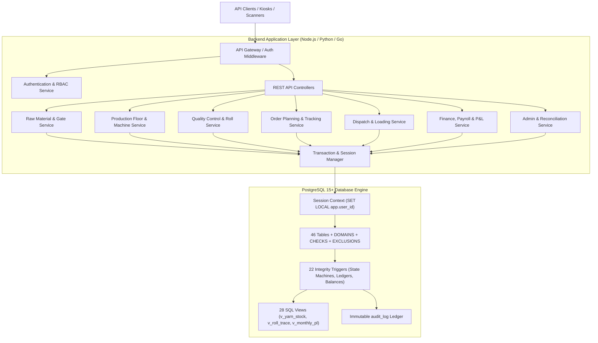

# Backend Implementation Phases: Textile Manufacturing System (Everest Textile Mills)

**Project:** Textile Manufacturing System (TMS) — Everest Textile Mills  
**Target Architecture:** Backend Services & PostgreSQL Database Engine  
**Companion Documents:** `01-requirements-analysis.md` through `07-data-integrity-and-security.md`  
**Scope:** Complete backend implementation roadmap, database migration sequence, service layer architecture, transaction handlers, API endpoints, authentication/authorization middleware, audit systems, health reconciliation crons, and testing suites. **(Strictly Backend — No Frontend)**

---

## 1. Executive Summary & Backend Engineering Architecture

The backend of the Everest Textile Manufacturing System is architected around a high-integrity, transaction-heavy, single-instance **PostgreSQL 15+** database. The backend application service layer acts as the orchestrator for multi-step workflows, session context propagation (`SET LOCAL app.user_id`), idempotency enforcement, optimistic locking verification, and RESTful API delivery.



---

## 2. Master Phase Breakdown & Dependency Graph

```mermaid
graph LR
    P1[Phase 1: DB Foundations & DDL Migrations] --> P2[Phase 2: Core DB Triggers & Seed Data]
    P2 --> P3[Phase 3: Service Layer & Session Context]
    P3 --> P4[Phase 4: Raw Material & Gate Entry APIs]
    P3 --> P5[Phase 5: Orders & Material Feasibility APIs]
    P4 & P5 --> P6[Phase 6: Production Floor & Output APIs]
    P6 --> P7[Phase 7: QC Inspection & Roll Traceability APIs]
    P7 --> P8[Phase 8: Dispatch Loading & Validation APIs]
    P8 --> P9[Phase 9: Billing, Invoicing & Payment APIs]
    P9 --> P10[Phase 10: Payroll, Costing & Executive P&L APIs]
    P10 --> P11[Phase 11: Reconciliation Crons & Audit Engine]
    P11 --> P12[Phase 12: Concurrency Testing & Hardening]
```



---

## 3. Detailed Backend Implementation Phases

---

### Phase 1: Database Foundation, Extensions, Types & Core Schema

**Goal:** Establish the database cluster, install extensions, define custom domain types, configure business sequences, and deploy all 46 core tables with relational integrity constraints.

#### Tasks & Implementation Details:
1. **Cluster Setup & Parameter Tuning (`postgresql.conf`):**
   * Enable UTC timezone: `ALTER DATABASE textile_db SET timezone = 'UTC';`
   * Enable replica WAL level: `wal_level = replica`, `archive_mode = on`.
   * Configure lock & statement timeouts: `lock_timeout = '5s'`, `statement_timeout = '15s'`.
2. **Migration `0001_foundation.sql`:**
   * Install extension: `CREATE EXTENSION IF NOT EXISTS btree_gist;`
   * Create custom domain types:
     * `qty_t = numeric(14,3)` (3 decimal places for kg, meters).
     * `money_t = numeric(14,2)` (2 decimal places for INR).
     * `rate_t = numeric(12,4)` (4 decimal places for unit costs/rates).
   * Create code generation sequences: `seq_order_no`, `seq_po_no`, `seq_receipt_no`, `seq_lot_code`, `seq_job_no`, `seq_roll_code`, `seq_dispatch_no`, `seq_payment_ref`.
   * Deploy helper functions: `app_current_user_id()`, `make_code(prefix, seq)`.
   * Create gap-free tax invoice table and function: `doc_sequence`, `next_doc_no(p_series, p_date)`.
3. **Migration `0002_masters.sql`:**
   * Create master tables: `role`, `app_user`, `user_role`, `employee`, `unit_of_measure`, `supplier`, `buyer`, `yarn_type`, `colour`, `yarn_item`, `fabric_product`, `process_stage`, `machine`, `shift`, `defect_type`.
   * Enforce unique case-insensitive indexes: `lower(username)`, `lower(supplier.name)`, `lower(buyer.name)`.
4. **Migration `0003_orders_and_purchasing.sql`:**
   * Tables: `customer_order`, `order_item`, `order_status_history`, `order_material_requirement`, `purchase_order`, `purchase_order_item`, `goods_receipt`, `goods_receipt_item`, `supplier_bill`, `supplier_bill_line`.
5. **Migration `0004_production_and_stock.sql`:**
   * Tables: `production_job`, `production_log`, `machine_status_event`, `yarn_stock_movement`, `yarn_stock_balance`, `stock_alert`, `yarn_reservation`.
   * Add exclusion constraint: `ex_mse_no_overlap` on `machine_status_event` using `btree_gist`.
6. **Migration `0005_rolls_quality_dispatch.sql`:**
   * Tables: `fabric_roll`, `qc_inspection`, `qc_defect`, `invoice`, `invoice_item`, `dispatch`, `dispatch_item`.
   * Add partial unique indexes:
     * `uq_dispatch_item_one_active_roll` on `dispatch_item (roll_id) WHERE state = 'active'`.
     * `uq_job_one_running_per_machine` on `production_job (machine_id) WHERE status = 'running'`.
     * `uq_mse_one_open` on `machine_status_event (machine_id) WHERE ended_at IS NULL`.
7. **Migration `0006_finance_workforce_audit.sql`:**
   * Tables: `accounting_period`, `buyer_payment`, `payment_allocation`, `attendance_record`, `wage_record`, `cost_entry`, `audit_log`, `status_transition`.

#### Acceptance Criteria:
* All 46 tables created with strict `FOREIGN KEY ... ON DELETE NO ACTION` (RESTRICT).
* Smoke test script executes clean zero-error DDL migration run on clean database.

---

### Phase 2: Database Triggers, State Machines, Views & Performance Indexes

**Goal:** Enforce domain invariants directly in PostgreSQL triggers, seed standard master and transition data, deploy all 28 views, and apply query performance indexes.

#### Tasks & Implementation Details:
1. **Migration `0007_seed_data.sql`:**
   * Seed `system` bootstrap user (`password_hash = '!disabled!'`).
   * Seed standard roles: `admin`, `owner`, `accounts`, `production_manager`, `operator`, `quality_checker`, `gate_store`, `dispatch`, `sales`, `staff_readonly`.
   * Seed units: `kg`, `m`, `pcs`.
   * Seed stages: `spinning`, `weaving`, `dyeing`.
   * Seed state machine table `status_transition` for all 10 domain entities.
2. **Migration `0008_integrity_triggers.sql`:**
   * Deploy generic triggers: `trg_touch()`, `trg_touch_versioned()`, `trg_block_delete()`, `trg_block_mutation()`, `trg_enforce_transition()`, `trg_only_columns_may_change()`.
   * Deploy domain invariant triggers:
     * `trg_movement_apply`: Updates `yarn_stock_balance.on_hand_qty` & `avg_cost` with `SELECT ... FOR UPDATE`.
     * `trg_reservation_apply`: Atomic updates to `yarn_stock_balance.reserved_qty`.
     * `trg_qc_before`: Enforces atomic roll status update on inspection.
     * `trg_dispatch_item_before`: Verifies roll is `in_stock`, passed QC, and matches order.
     * `trg_alloc_before`: Verifies payment allocations do not exceed invoice balance or payment amount.
     * `trg_period_before` & `period_for(date)`: Blocks posting into closed periods (INV-11).
3. **Migration `0009_views_and_indexes.sql`:**
   * Deploy all 28 production SQL views:
     * Operational: `v_yarn_stock`, `v_open_stock_alerts`, `v_order_status`, `v_machine_status`, `v_job_progress`, `v_roll_trace`, `v_dispatch_progress`, `v_invoice_balance`, `v_buyer_ledger`.
     * Financial & Costing: `v_order_cost`, `v_roll_cost`, `v_machine_output`, `v_monthly_pl`.
     * Health Checks: All 7 `v_recon_...` reconciliation views.
   * Deploy foreign key support indexes and compound search indexes (`Migration 0009_indexes.sql`).
4. **Migration `0010_security_roles.sql` & `0011_audit_triggers.sql`:**
   * Create connection roles: `app_migration_role`, `app_backend_role`, `app_readonly_role`.
   * Deploy `trg_audit()` `SECURITY DEFINER` trigger with JSONB diff recording across sensitive tables.

#### Acceptance Criteria:
* Negative stock attempt raises `SQLSTATE 23514` (`ck_balance_not_negative`).
* Updating/deleting a ledger row raises `SQLSTATE BR001`.
* Illegal state machine jump (e.g. `customer_order` from `draft` straight to `closed`) raises `SQLSTATE BR002`.

---

### Phase 3: Backend Runtime Framework, Connection Pool & Session Context

**Goal:** Establish the core application runtime (Node.js/TypeScript, Python/FastAPI, or Go), connection pooling, transaction wrappers, and automatic PostgreSQL session variable binding.

#### Tasks & Implementation Details:
1. **Database Connection Pool Configuration:**
   * Configure connection pool (`pg-pool` / `asyncpg` / `sqlx`):
     * Min connections: 10, Max connections: 50.
     * Connection timeout: 5000ms.
     * Idle timeout: 10000ms.
2. **Transaction & Session Context Wrapper (`TxManager`):**
   * Create atomic transaction wrapper that enforces the standard opening contract:
     ```sql
     BEGIN;
     SELECT set_config('app.user_id', $1::text, true);
     SELECT set_config('app.source',  $2,       true);
     SELECT set_config('app.reason',  $3,       true);
     SET LOCAL lock_timeout = '5s';
     SET LOCAL statement_timeout = '15s';
     ```
   * Enforce automatic rollback on any thrown exception or SQLSTATE error.
3. **Global Error & SQLSTATE Mapper Middleware:**
   * Map custom PostgreSQL SQLSTATEs (`BR001`–`BR011`, `23505`, `23514`, `55P03`) to standardized HTTP REST error responses:
     * `BR001` $\to$ HTTP 403 Forbidden (Immutable Ledger).
     * `BR002` $\to$ HTTP 422 Unprocessable Entity (Invalid State Transition).
     * `BR003` $\to$ HTTP 400 Bad Request (Field Cannot Be Modified).
     * `BR004` $\to$ HTTP 400 Bad Request (Closed Accounting Period).
     * `BR007` $\to$ HTTP 409 Conflict (Double Dispatch Detected).
     * `BR009` $\to$ HTTP 422 Unprocessable Entity (Uninspected Roll Dispatch).
     * `55P03` $\to$ HTTP 503 Service Unavailable (Lock Timeout — Please Retry).
4. **Authentication & RBAC Middleware:**
   * Implement **Argon2id** password verification (`m=65536, t=3, p=4`).
   * Implement JWT Bearer token generator and verification middleware.
   * Build `@RequireRoles('role_name')` decorator/guard for route handlers.

#### Acceptance Criteria:
* Any database insert attempted without `app.user_id` set fails immediately with `created_by NOT NULL` violation.
* Deadlocks/lock timeouts cleanly abort in 5 seconds and return structured error JSON to client.

---

### Phase 4: Workflow 1 — Raw Material Inward, Gate Entry & Stock APIs

**Goal:** Implement services and API endpoints for supplier receipts, multi-line lot creation, stock balance inquiries, low-stock alerts, and thermal barcode printing data.

#### Tasks & Implementation Details:
1. **Service `RawMaterialService`:**
   * `createGateReceipt(dto, userId)`: Implements **WF-1** (Doc 05 §3).
     * Validates input DTO (`supplier_id`, `supplier_challan_no`, `client_request_id`, `items[]`).
     * Executes inside `TxManager`: Inserts `goods_receipt` and iterates `goods_receipt_item` lines sorted by `yarn_item_id`.
     * Captures generated `receipt_no` and `lot_code` list.
   * `cancelGateReceipt(receiptId, reason, userId)`: Implements **WF-2**.
     * Verifies receipt lines have not been consumed or billed.
     * Inserts compensating negative `yarn_stock_movement` rows.
     * Sets `goods_receipt.status = 'cancelled'`.
   * `getYarnStock(filters)`: Reads from `v_yarn_stock` with low-stock filtering.
   * `acknowledgeStockAlert(alertId, userId)`: Updates `stock_alert.status = 'acknowledged'`.
2. **API Controllers & Endpoints:**
   * `POST /api/v1/raw-materials/receipts` (`gate_store`, `admin`)
   * `GET /api/v1/raw-materials/receipts` (`gate_store`, `accounts`, `owner`, `admin`)
   * `GET /api/v1/raw-materials/receipts/:id`
   * `POST /api/v1/raw-materials/receipts/:id/cancel` (`gate_store`, `admin`)
   * `GET /api/v1/raw-materials/stock` (`v_yarn_stock`)
   * `GET /api/v1/raw-materials/alerts` (`v_open_stock_alerts`)
   * `POST /api/v1/raw-materials/alerts/:id/acknowledge`
   * `GET /api/v1/raw-materials/lots/:lotCode/barcode-payload` (Returns ZPL/JSON thermal print data)

#### Acceptance Criteria:
* Gate entry creation updates `yarn_stock_balance` and `yarn_stock_movement` atomically.
* Retrying a gate entry with the identical `client_request_id` returns the existing receipt without double-posting stock.

---

### Phase 5: Workflow 4 & 1 — Customer Orders, Material Feasibility & Reservation APIs

**Goal:** Implement customer order processing, dynamic stage tracking, BOM material requirements checking, and stock reservations.

#### Tasks & Implementation Details:
1. **Service `OrderService`:**
   * `createOrder(dto, userId)`: Inserts `customer_order` (`draft`) and `order_item` lines.
   * `checkMaterialFeasibility(orderId)`: Executes query against `v_order_material_check`. Returns availability per yarn item and highlights deficits.
   * `confirmOrder(orderId, version, autoReserve, userId)`: Implements **WF-3**.
     * Checks OCC `version`.
     * Calculates `order_material_requirement` records.
     * If `autoReserve = true`, creates active `yarn_reservation` entries for available stock.
     * Updates `customer_order.status = 'confirmed'`.
   * `cancelOrder(orderId, reason, userId)`: Implements **WF-3c**.
     * Verifies order has no active jobs, loading dispatches, or issued invoices (enforced by `trg_order_before`).
     * Releases active reservations (`status = 'released'`).
   * `getOrderStatus(query)`: High-performance read against `v_order_status` (serves the 1-second buyer phone inquiry desk).
2. **API Controllers & Endpoints:**
   * `POST /api/v1/orders` (`sales`, `admin`)
   * `GET /api/v1/orders` (Paginated list from `v_order_status`)
   * `GET /api/v1/orders/:id`
   * `GET /api/v1/orders/:id/material-check` (`v_order_material_check`)
   * `POST /api/v1/orders/:id/confirm` (`sales`, `admin`)
   * `POST /api/v1/orders/:id/cancel` (`sales`, `admin`)
   * `GET /api/v1/orders/tracking/phone-lookup` (`sales`, `staff_readonly`, `owner`, `admin`)

#### Acceptance Criteria:
* Confirming an order without promised delivery date fails with `ck_order_confirmed_has_date`.
* `GET /api/v1/orders/tracking/phone-lookup` returns in $< 10\text{ ms}$ leveraging index `idx_customer_order_buyer_date`.

---

### Phase 6: Workflow 2 — Production Floor, Machine State & Shift Output APIs

**Goal:** Implement job scheduling, machine floor monitoring, touch-screen shift output recording, and machine breakdown/downtime logging.

#### Tasks & Implementation Details:
1. **Service `ProductionService`:**
   * `createJob(dto, userId)`: Schedules job for an order item on a machine of the correct stage.
   * `startJob(jobId, userId)`: Implements **WF-4**. Sets `job.status = 'running'`, opens `machine_status_event` (`running`).
   * `logShiftOutput(dto, userId)`: Implements **WF-5**.
     * Inserts append-only `production_log` with idempotency guard.
     * Optional: Generates `fabric_roll` tag in `pending_qc` status.
   * `recordBreakdown(machineId, note, reportedBy, userId)`: Implements **WF-6**.
     * Closes current open machine event and opens new `breakdown` event.
     * Transitions active job to `interrupted`.
   * `reassignInterruptedJob(jobId, newMachineId, userId)`: Re-routes remaining planned meters to an available machine.
   * `getFloorMatrix()`: Reads `v_machine_status` for live machine board.
2. **API Controllers & Endpoints:**
   * `GET /api/v1/production/floor-matrix` (`v_machine_status`)
   * `POST /api/v1/production/jobs` (`production_manager`, `admin`)
   * `POST /api/v1/production/jobs/:id/start`
   * `POST /api/v1/production/jobs/:id/complete`
   * `POST /api/v1/production/logs` (`operator`, `production_manager`, `admin`)
   * `POST /api/v1/production/machines/:id/breakdown`
   * `POST /api/v1/production/machines/:id/resolve-downtime`
   * `GET /api/v1/production/shift-output` (`v_output_by_machine_shift`)

#### Acceptance Criteria:
* Starting two jobs simultaneously on the same machine fails with `uq_job_one_running_per_machine`.
* Overlapping machine status periods are blocked by exclusion constraint `ex_mse_no_overlap`.

---

### Phase 7: Workflow 3 — Quality Control, Defect Logging & Roll Traceability APIs

**Goal:** Implement QC inspection workflows, multi-defect categorization, roll status transitions, and the complete roll traceability dossier engine.

#### Tasks & Implementation Details:
1. **Service `QualityService`:**
   * `getRollByCode(rollCode)`: Fetches roll details and prior inspection history.
   * `recordInspection(dto, userId)`: Implements **WF-7**.
     * Locks `fabric_roll` row `FOR UPDATE`.
     * Auto-increments `attempt_no`.
     * Inserts `qc_inspection` and child `qc_defect` rows (`severity`, `defect_count`, `position_note`).
     * `trg_qc_before` atomically updates `fabric_roll.status` to `in_stock`, `rework`, or `rejected`.
   * `scrapRoll(rollId, reason, userId)`: Sets `fabric_roll.status = 'scrapped'`.
   * `getRollTrace(rollCode)`: Executes query against `v_roll_trace` returning complete genealogy tree.
   * `getDefectAnalytics(filters)`: Aggregates from `v_defects_by_machine` and `v_defects_by_operator`.
2. **API Controllers & Endpoints:**
   * `GET /api/v1/quality/rolls/:rollCode`
   * `POST /api/v1/quality/inspections` (`quality_checker`, `admin`)
   * `POST /api/v1/quality/rolls/:id/scrap`
   * `GET /api/v1/quality/traceability/:rollCode` (`v_roll_trace`)
   * `GET /api/v1/quality/defect-analytics/machines`
   * `GET /api/v1/quality/defect-analytics/operators`
   * `GET /api/v1/quality/shelf-inventory` (Lists `in_stock` rolls)

#### Acceptance Criteria:
* Attempting to mark a roll `in_stock` while recording a critical defect is rejected by QC business logic.
* `GET /api/v1/quality/traceability/:rollCode` returns yarn lot, machine, shift, operator, inspection, and dispatch in one query.

---

### Phase 8: Workflow 5 — Dispatch Loading, Scanning & Double-Dispatch Prevention APIs

**Goal:** Implement dispatch manifest creation, live barcode scanning of rolls into trucks, strict double-dispatch blocking, and loading completion.

#### Tasks & Implementation Details:
1. **Service `DispatchService`:**
   * `createDispatch(dto, userId)`: Inserts `dispatch` (`draft`) linked to `buyer_id` and `order_id`.
   * `startLoading(dispatchId, version, userId)`: Transitions `dispatch.status = 'loading'`.
   * `scanRollToDispatch(dispatchId, rollCode, userId)`: Implements **WF-9**.
     * Finds `fabric_roll` by code.
     * Takes row lock on `dispatch` then `fabric_roll`.
     * `trg_dispatch_item_before` validates:
       * Roll belongs to the dispatch's order.
       * Roll `status = 'in_stock'`.
     * Inserts `dispatch_item` (`state = 'active'`).
     * Partial unique index `uq_dispatch_item_one_active_roll` guarantees no other truck has this roll.
     * Updates `fabric_roll.status = 'loaded'`.
   * `removeRollFromDispatch(dispatchItemId, reason, userId)`: Sets `dispatch_item.state = 'removed'` and returns roll to `in_stock`.
   * `completeDispatch(dispatchId, vehicleNo, userId)`: Implements **WF-10**.
     * Verifies at least 1 active roll loaded.
     * Transitions `dispatch.status = 'dispatched'`.
     * Updates all active rolls to `status = 'dispatched'`.
2. **API Controllers & Endpoints:**
   * `POST /api/v1/dispatches` (`dispatch`, `admin`)
   * `GET /api/v1/dispatches` (Lists active dispatches)
   * `GET /api/v1/dispatches/:id`
   * `GET /api/v1/dispatches/:id/progress` (`v_dispatch_progress`)
   * `POST /api/v1/dispatches/:id/scan-roll` (`dispatch`, `admin`)
   * `POST /api/v1/dispatches/:id/items/:itemId/remove`
   * `POST /api/v1/dispatches/:id/complete` (`dispatch`, `admin`)

#### Acceptance Criteria:
* Scanning a roll with status `pending_qc` or `rejected` fails with `SQLSTATE BR009`.
* Scanning a roll already active on another truck fails with `SQLSTATE 23505` (`uq_dispatch_item_one_active_roll`).

---

### Phase 9: Workflow 5 & 6 — Invoicing, Supplier Bills & Payment Allocation APIs

**Goal:** Implement sales invoice generation from dispatches, gap-free tax numbering, supplier bill reconciliation, and customer payment receipt allocation.

#### Tasks & Implementation Details:
1. **Service `FinanceService`:**
   * `generateInvoiceFromDispatch(dispatchId, userId)`: Implements **WF-10b**.
     * Aggregates active dispatch lines (`v_dispatch_lines`).
     * Creates `invoice` and `invoice_item` lines.
     * Triggers calculate `invoice.total_amount`.
   * `issueInvoice(invoiceId, userId)`: Implements **WF-11**.
     * Calls `next_doc_no('INV', CURRENT_DATE)` to lock sequence and assign gap-free number.
     * Sets `invoice.status = 'issued'`.
   * `recordSupplierBill(dto, userId)`: Implements **WF-12**.
     * Matches bill lines to `goods_receipt_item` lots (`v_unbilled_lots`).
     * Detects and logs rate/quantity variances (`v_supplier_bill_variance`).
   * `recordBuyerPayment(dto, userId)`: Implements **WF-8**.
     * Inserts `buyer_payment` with idempotency UUID.
     * Iterates invoice allocations inserting `payment_allocation`.
     * `trg_alloc_before` guarantees allocation does not exceed invoice unpaid balance or payment amount.
2. **API Controllers & Endpoints:**
   * `POST /api/v1/finance/invoices/from-dispatch/:dispatchId` (`accounts`, `admin`)
   * `POST /api/v1/finance/invoices/:id/issue`
   * `POST /api/v1/finance/invoices/:id/void`
   * `GET /api/v1/finance/invoices/balances` (`v_invoice_balance`)
   * `POST /api/v1/finance/supplier-bills` (`accounts`, `admin`)
   * `GET /api/v1/finance/supplier-bills/unbilled-lots` (`v_unbilled_lots`)
   * `POST /api/v1/finance/payments` (`accounts`, `admin`)
   * `GET /api/v1/finance/buyers/:id/ledger` (`v_buyer_ledger`)

#### Acceptance Criteria:
* Total allocated payments cannot exceed `invoice.total_amount` (`trg_alloc_before` raises `BR008`).
* Issued invoice numbers are guaranteed gap-free per Indian fiscal year (April–March).

---

### Phase 10: Workflow 6 — Workforce Wages, Accounting Periods & Executive P&L APIs

**Goal:** Implement employee attendance logging, wage calculations, period-close locking, and the executive Profit & Loss reporting suite.

#### Tasks & Implementation Details:
1. **Service `AccountingCostService`:**
   * `recordAttendance(records[], userId)`: Batch inserts `attendance_record`.
   * `generateMonthlyWages(periodId, userId)`: Implements **WF-13**.
     * Computes hours and gross pay per active employee (`v_wage_summary`).
     * Creates draft `wage_record` entries.
   * `approveWageRecord(wageId, userId)`: Approves wage and creates matching plant-level `cost_entry` (`cost_type = 'wage'`).
   * `closeAccountingPeriod(periodId, userId)`: Implements **WF-14**.
     * Pre-checks: Verifies zero draft wages remain in the period.
     * Sets `accounting_period.status = 'closed'`.
     * Subsequent cost/invoice postings into this period will fail with `BR004`.
   * `getExecutivePL(periodId)`: Reads `v_monthly_pl` (Revenue $-$ Materials $-$ Wages $-$ Overheads).
   * `getOrderCosting(orderId)`: Reads `v_order_cost` (Contribution margin per order).
   * `getRollCosting(rollId)`: Reads `v_roll_cost` (Material + allocated indirect costs).
2. **API Controllers & Endpoints:**
   * `POST /api/v1/workforce/attendance` (`production_manager`, `accounts`, `admin`)
   * `POST /api/v1/workforce/wages/generate` (`accounts`, `admin`)
   * `POST /api/v1/workforce/wages/:id/approve`
   * `POST /api/v1/finance/periods/:id/close` (`accounts`, `owner`, `admin`)
   * `GET /api/v1/executive/pl-statement` (`v_monthly_pl` — `owner`, `admin`)
   * `GET /api/v1/executive/order-costing` (`v_order_cost`)
   * `GET /api/v1/executive/roll-costing` (`v_roll_cost`)
   * `GET /api/v1/executive/machine-productivity` (`v_machine_output`)

#### Acceptance Criteria:
* Column `employee.pay_rate` and `wage_record.gross_amount` are redacted from non-finance roles.
* Closing an accounting period permanently locks all financial transactions for that month.

---

### Phase 11: Reconciliation Health Crons, Audit Trail & Security Admin APIs

**Goal:** Implement automated background invariant reconciliation crons, security audit log queries, and administrative master data APIs.

#### Tasks & Implementation Details:
1. **Service `ReconciliationCronService`:**
   * Scheduled Cron (Runs nightly at 00:00 IST and on demand before period close):
     * Runs all 7 health check views:
       1. `v_recon_stock_balance_vs_ledger` (INV-1)
       2. `v_recon_reserved_vs_reservations` (INV-9)
       3. `v_recon_roll_status_vs_facts`
       4. `v_recon_machine_events` (INV-3)
       5. `v_recon_dispatch_vs_invoice`
       6. `v_recon_unallocated_payments`
       7. `v_recon_cost_vs_issues`
     * If any check returns $>0$ rows, raises an alert log and dispatches admin notification.
2. **Service `AdminService`:**
   * `getAuditLogs(filters)`: Keyset-paginated search over `audit_log` with actor and entity filters.
   * Master Data CRUD: `suppliers`, `buyers`, `yarn_items`, `fabric_products`, `machines`, `defect_types`.
3. **API Controllers & Endpoints:**
   * `GET /api/v1/admin/health-check` (Executes all 7 reconciliation queries)
   * `GET /api/v1/admin/audit-logs` (`admin`, `owner`)
   * `CRUD /api/v1/admin/masters/*` (`admin`)

#### Acceptance Criteria:
* `GET /api/v1/admin/health-check` returns HTTP 200 with 0 anomalies across all invariants.
* Direct SQL `UPDATE` or `DELETE` on `audit_log` fails with `BR001`.

---

### Phase 12: Concurrency Hardening, Stress Testing, Disaster Recovery & Launch

**Goal:** Validate system integrity under concurrent loads, test PITR recovery procedures, configure continuous WAL archiving, and prepare for production go-live.

#### Tasks & Implementation Details:
1. **Automated Concurrency Stress Testing:**
   * Simulate 50 concurrent gate inward entries on the same yarn item (validates `SELECT ... FOR UPDATE` in `yarn_stock_balance`).
   * Simulate 20 concurrent barcode scans of the same fabric roll across 2 different trucks (validates that exactly 1 succeeds and 19 receive `BR007` / `23505`).
   * Simulate concurrent invoice issue requests (validates that `doc_sequence` produces contiguous gap-free invoice numbers without deadlocks).
2. **Disaster Recovery (PITR) Drill:**
   * Take physical base backup with `pg_basebackup`.
   * Simulate catastrophic database loss (`DROP DATABASE textile_db;`).
   * Execute PITR restore script using archived WAL files up to exact target timestamp.
   * Verify all ledgers and stock balances match 100%.
3. **Production Deployment & Monitoring:**
   * Configure connection pool sizing, PostgreSQL memory parameters (`shared_buffers = 25% RAM`, `work_mem = 64MB`).
   * Deploy Prometheus/Grafana metrics for database lock waiting times and active transactions.

#### Acceptance Criteria:
* Zero data corruption, negative balances, or double dispatches under 100 concurrent workers.
* Disaster recovery PITR achieves **RPO $< 5\text{ minutes}$** and **RTO $< 1\text{ hour}$**.

---

## 4. Backend Engineering Artifacts & File Structure

```
backend/
├── src/
│   ├── config/                   # Database connection pool, JWT, logger configs
│   │   ├── database.ts
│   │   └── environment.ts
│   ├── database/                 # Migrations and seed scripts
│   │   ├── migrations/
│   │   │   ├── 0001_foundation.sql
│   │   │   ├── 0002_masters.sql
│   │   │   ├── 0003_orders_and_purchasing.sql
│   │   │   ├── 0004_production_and_stock.sql
│   │   │   ├── 0005_rolls_quality_dispatch.sql
│   │   │   ├── 0006_finance_workforce_audit.sql
│   │   │   ├── 0007_seed_data.sql
│   │   │   ├── 0008_integrity_triggers.sql
│   │   │   ├── 0009_views_and_indexes.sql
│   │   │   ├── 0010_security_roles.sql
│   │   │   └── 0011_audit_triggers.sql
│   │   └── tx-manager.ts         # Atomic Tx wrapper with SET LOCAL app.user_id
│   ├── middleware/               # Auth, RBAC, Error mapping, Session context
│   │   ├── auth.middleware.ts
│   │   ├── rbac.guard.ts
│   │   └── sqlstate-error.filter.ts
│   ├── modules/                  # Modular domain services & controllers
│   │   ├── auth/                 # Login, session, token generation
│   │   ├── raw-materials/        # W1 Gate receipt, yarn stock, alerts
│   │   ├── orders/               # W4 Customer orders, feasibility, reservations
│   │   ├── production/           # W2 Machine floor, jobs, shift output, downtime
│   │   ├── quality/              # W3 QC inspections, defects, roll traceability
│   │   ├── dispatch/             # W5 Truck loading, scan verification, manifest
│   │   ├── finance/              # W6 Invoicing, supplier bills, payment allocation
│   │   ├── workforce/            # W6 Attendance, monthly wages, payroll
│   │   ├── executive/            # W6 P&L, order costing, machine productivity
│   │   └── admin/                # Masters, audit log, reconciliation crons
│   ├── jobs/                     # Cron schedules (Nightly health reconciliation)
│   │   └── reconciliation.cron.ts
│   └── main.ts                   # Application bootstrap
├── tests/
│   ├── unit/                     # Business logic and formula tests
│   ├── integration/              # Workflow API end-to-end tests (WF-1 to WF-15)
│   └── concurrency/              # Race condition, locking, and stress tests
├── scripts/
│   ├── backup_pitr.sh            # Automated daily base backup & WAL push
│   └── restore_drill.sh          # Disaster recovery drill script
└── package.json / requirements.txt
```

---

## 5. Summary of Implementation Milestones

| Phase | Milestone Name | Key Deliverables | Estimated Complexity |
|---|---|---|---|
| **Phase 1** | Database Foundation & Schema | Migrations 0001–0006: 46 tables, domains, sequences, constraints. | Medium |
| **Phase 2** | Triggers, Views & Indexes | Migrations 0007–0011: 22 triggers, 28 views, full index catalog. | High |
| **Phase 3** | Runtime & Session Context | Connection pool, `TxManager`, SQLSTATE error mapper, Argon2id auth. | Medium |
| **Phase 4** | Raw Materials & Gate APIs | `RawMaterialService`, gate entry, stock alerts, thermal print payload. | Medium |
| **Phase 5** | Orders & Feasibility APIs | `OrderService`, material feasibility check, stock reservations. | Medium |
| **Phase 6** | Floor & Output APIs | `ProductionService`, floor matrix, touch shift logging, downtime logger. | Medium |
| **Phase 7** | QC & Traceability APIs | `QualityService`, multi-defect tagging, roll dossier spine engine. | Medium |
| **Phase 8** | Dispatch & Scan APIs | `DispatchService`, truck loading scanner, double-dispatch blocker. | High |
| **Phase 9** | Invoicing & Payments APIs | `FinanceService`, gap-free invoice issuer, payment allocation. | High |
| **Phase 10** | Payroll & Executive P&L APIs | `AccountingCostService`, wage approvals, month-end lock, P&L views. | High |
| **Phase 11** | Health Crons & Audit Engine | Nightly reconciliation crons, audit log search, master data CRUD. | Medium |
| **Phase 12** | Concurrency & Launch | 100-worker concurrency tests, PITR drill, production monitoring. | High |
